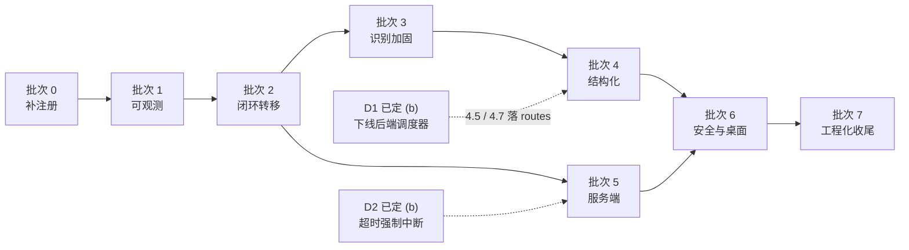

# AutoWSGR-GUI 问题汇总与修复排期

> **合并来源**（三份文档，2026-10-27 汇总）
>
> | 来源 | 篇幅 | 性质 | 在本文中的角色 |
> | --- | --- | --- | --- |
> | `AutoWSGR-GUI-架构与逻辑审查报告.md` | 46,029 字节 | 静态审查 + 架构结论 | 提供系统基线、契约规模、模块速查（§2、附录 D） |
> | `AutoWSGR-GUI-问题与风险清单.md` | 79,601 字节 | 49 条已定位问题 + 修复记录 | 提供问题主体、严重度、证据强度、状态（§4、§5） |
> | `AutoWSGR 状态机优化方案：把 UNKNOWN 变成一等状态.md` | 33,653 字节 | 分层改造方案 + 五批次排期 | 提供 L1–L5 设计、批次划分依据、真机验证（§6、§7） |
>
> **合并规则**：① 同一条问题只保留一个编号（沿用清单的 `R01–R49`，审查报告独有的两条吸收为 `R50/R51`，映射见 §3）；② 2026-10-25/26 之后的修复记录合并进「状态」与「遗留项」，不再按时间流水罗列；③ 两份文档曾给出两套互不兼容的批次（清单 §6 的四批 vs 状态机方案 §15 的五批），本文以 §15 为骨架重排为**统一批次 0–7**（§7）。
>
> **路径简写**：`py:` = `python/site-packages/autowsgr`；`asar:` = `resources/app.asar` 解包内容。
> **版本基线**：GUI `2.1.2-alpha.3` / 后端 `autowsgr 2.3.0` / Python `3.12.8`；后端来源 `ShiinaKuroko/AutoWSGR @ be09d354`（alpha），stable 基线 `OpenWSGR/AutoWSGR @ 49c28a28`。
> **截止时间**：本文状态截至 **2026-10-26 18:44**（最后一次前端改动实测）。

---

## 1. 一页纸结论

### 1.1 这是个什么系统

**Electron 壳 + 本地 FastAPI 后端 + 图像识别驱动手游**的三段式桌面自动化工具（战舰少女R）：

- **主进程**只做环境/进程/文件/窗口/更新的管家，不碰业务；
- **渲染层**是真正的**编排大脑**（任务队列、Cron、停止条件、日志统计），业务状态全在前端内存里；
- **Python 后端**是「一双眼睛 + 一只手」，只负责截图识别、决策、点击，外加一个**单槽任务执行器**；
- 三层用 **81 条 IPC**（配置/文件）+ **25 个 HTTP 路由 + 2 个 WebSocket**（运行时）连接，固定 `127.0.0.1:8438`。

架构评分 **B+**：分层干净、契约有意识（能力探针、路径沙箱、原子写、单一实例、双通道更新），关键路径（相对坐标、导航图、状态机、规则引擎）都是踩过坑之后的正确抽象。

### 1.2 问题总量与状态

**共 51 条**（清单 49 + 报告独有 2）：

| 级别 | 条数 | 已修复 | 已处置 | 部分缓解 | 不修 | 待修 |
| --- | --- | --- | --- | --- | --- | --- |
| **P0** | 6 | 4（R01/R02/R03/R46） | — | — | 2（R04/R05） | 0 |
| **P1** | 18 | 3（R19/R47/R48） | 1（R45） | — | — | 14 |
| **P2** | 23 | 2（R23/R26） | — | 2（R21/R22） | — | 19 |
| **P3** | 4 | 0 | — | 1（R41） | — | 3 |
| **合计** | **51** | **9** | **1** | **3** | **2** | **36** |

> R45 的处置方式是「按用户要求整功能移除」，不是常规修复，故单列「已处置」而不再计入「已修复」。

**P0 已清空**：R01（设备泄漏）、R02（停止不下沉）、R03（识别无兜底）、R46（准备页未注册）已修复并真机验证；R04（建造配方）、R05（决战分支）经评估**明确不修**。目前没有任何「功能不可用 / 资源泄漏 / 任务停不下来」级别的已知问题。

### 1.3 三句最该记住的话

1. **「卡住」不是识别算法不准，是状态空间缺了一个格。** 现实世界有 15 个页面 + 弹窗 + 加载态 + 人工操作后的任意界面，而模型里原先只有 13 个已注册页面（批次 0 后 14 个），差额落到 `None`、被当成异常抛掉。**UNKNOWN 必须成为一等状态**，有自己的转移（恢复链），而不是异常。
2. **决策层抽象得不错，但「页面操作的同步语义」还停在「点一下等一会儿」。** 全仓 **212 处 `time.sleep`**（批次 2 审计口径；分项统计 ui/ 170、ops/ 44、combat/ 14）、**114 处裸 `click()` 对 23 处闭环等待**、**80 个含点击但函数体内无任何验证的方法**——这才是稳定性天花板的真正来源。
3. **最初定级的五个 P0 里有四个是「逻辑写了一半」或「清理少了一步」。** 断开设备、停止下沉、识别兜底、配方与分支选择，都属于「补完最后一公里」：改动面小、收益直接。真正需要设计决策的只有两件：**停止语义**与**双执行栈**。

### 1.4 剩余工作里性价比最高的四件（合计约 2.25 天）

| 顺序 | 条目 | 一句话 | 工时 |
| --- | --- | --- | --- |
| 1 | **R07** | 健康检查改用真实探活，消灭「模拟器已关、界面还是绿的」 | 0.5d |
| 2 | **R06 + R49** | 租约维度并入状态查询，消灭「status=idle 却 409」 | 0.75d |
| 3 | **R08** | 掉落停止条件改走事件/API，不再依赖日志文本 | 0.5d |
| 4 | **R09** | 停止超时升级为强制中断，消灭「UI 报失败、实际还在点屏幕」 | 0.5d |

这四条都属于「**看起来成功其实没做**」这一最伤信任的类别——功能没坏，但用户看到的结论是错的。

### 1.5 批次总览（详见 §7）

| 批次 | 主题 | 条目 | 工时 | 建议周次 | 状态 |
| --- | --- | --- | --- | --- | --- |
| 0 | 补注册与可识别（L1/L2a/L2b/L3a） | R46 | 0.5d | — | ✅ 已完成 |
| 1 | 止血与可观测 | R47 | 2d | — | ✅ 已完成 |
| 2 | 闭环转移 | R48 | 5d | — | ✅ 已完成 |
| — | 专项（不属批次） | R01 / R02 / R03 / R19 / R45 | 3d | — | ✅ 已完成 |
| **3** | **识别加固** | R21/R23/R24/R26/R39 + R46 遗留 | **0d**（已交付 7.75d） | 第 1–2 周 | ✅ 3.1–3.9 全部完成（2026-10-27/28） |
| **4** | **状态模型结构化** | R49/R22 + L4/L5（D1 已定，4.1/4.5/4.7 按 (b) 落点） | **13d** | 第 3–5 周 | ✅ 4.0–4.7 全部完成（4.5 于 2026-10-30；4.1.1–4.1.4 于 2026-10-31 清盘，真机待验） |
| **5** | **服务端状态与并发** | R06/R07/R08/R09/R10/R13–R16/R30/R31 + R50(d) 轮次原语 | **6.5d** | 第 6 周 | ✅ 5.1–5.11 全部完成（5.11 于 2026-10-29 落地） |
| **6** | **安全与桌面体验** | R11/R12/R17/R18/R20/R27/R32–R34/R36–R38/R44 | **7.75d** | 第 7–8 周 | ✅ 6.1–6.13 全部完成（6b-3 于 2026-10-29 落地） |
| **7** | **工程化收尾** | R25/R28/R29/R35/R40–R43/R51 | **6.25d** | 第 9 周 | ✅ 7.1–7.9 全部完成（7a/7b/7c，2026-10-30） |

**批次 0–7 的代码条目已全部落地**（4.5 于 2026-10-30 完成；4.1.1–4.1.4 于 2026-10-31 完成）。排期表内**无「未实现」条目**；验证层面仍有若干「真机待验/未验」项，集中在 4.1（解体/强化/常规+活动/演习）、5.1/5.9/5.11、6.x 的真机场景与 7.x 的双分辨率/强化快照。7.x 工程化收尾于 2026-10-30 清盘。

---

## 2. 系统基线（速览）

### 2.1 代码规模

| 部分 | 文件数 | 行数 | 说明 |
| --- | --- | --- | --- |
| Electron 主进程（asar:dist/electron） | 69 | 14,126 | main / preload / 11 个 IPC 模块 / 30 个 service / 12 个 pythonEnv 模块 |
| 渲染层（asar:dist/renderer.bundle.js） | 1（153 模块） | 31,165 | esbuild 打包，未压缩；**外链 `renderer.bundle.js.map`（sourcesContent，153 源）随 asar 分发** |
| 页面与样式（asar:src/view） | 2 | 11,468 | index.html 2,456 + styles.css 9,012 |
| Python 后端（py:） | 186 | 43,460 | ui 74 / ops 22 / server 17 / vision 14 / combat 12 / emulator 10 |
| 随包资源（resources/resource） | 1,300+ | — | 模板块 101 张、地图 YAML 273 个、系统计划 40+ 份 |

### 2.2 全局架构

```
┌──────────────────────────────────────────────────────────────────────┐
│ 渲染进程 (Chromium)  index.html + renderer.bundle.js（原生 DOM，手写 MVC）│
│  ┌────────────┬─────────────┬──────────────┬────────────────────┐    │
│  │ View 层     │ Controller  │ Model 层      │ Adapter 层          │    │
│  │ 3 主页/12 弹层│ 20+ 控制器  │ Scheduler     │ IpcAdapter          │    │
│  │ 命令式渲染   │ 编排与校验   │ CronScheduler │ ApiClient(HTTP/WS)  │    │
│  │            │             │ TaskQueue     │ Storage/File/YAML   │    │
│  └────────────┴─────────────┴──────────────┴────────────────────┘    │
└───────────────┬──────────────────────────────────┬───────────────────┘
                │ window.electronBridge (81 通道)   │ HTTP :8438 / WS
┌───────────────▼──────────────────┐   ┌───────────▼───────────────────┐
│ 主进程 (Node)                     │   │ Python 后端 (uvicorn 单进程)   │
│  main.js 装配 + 生命周期           │   │  FastAPI + 单后台线程           │
│  ├ pythonEnv/  环境探测与安装      │   │  ├ /api/system  生命周期        │
│  ├ services/   30 个领域服务       │   │  ├ /api/task    任务单槽        │
│  ├ ipc/        11 组通道           │   │  ├ /api/game    只读状态        │
│  └ preload.js  API 白名单          │   │  ├ /api/ops     原子操作        │
└───────────────┬──────────────────┘   │  └ /ws/logs /ws/task           │
                │ spawn                └───────────┬───────────────────┘
      ┌─────────▼─────────┐            ┌───────────▼───────────────────┐
      │ python.exe 3.12.8 │            │ 自动化引擎                     │
      │ site-packages/    │            │  screenshot → recognize →      │
      │   autowsgr 2.3.0  │            │  decide → click → verify       │
      └───────────────────┘            └───────────┬───────────────────┘
                                         scrcpy H264 + 控制 socket
                                        ┌────────▼────────┐
                                        │ MuMu / 雷电 模拟器│
                                        └─────────────────┘
```

### 2.3 分层职责与越界点

| 层 | 位置 | 职责 | 现状 |
| --- | --- | --- | --- |
| 壳层 | asar:dist/electron | 窗口、单实例、环境安装、Python 进程、文件沙箱、更新 | ✅ 不碰游戏逻辑 |
| 编排层 | 渲染进程 | 任务队列、Cron 定时、停止条件、日志统计、UI 状态 | ⚠️ **承担了本该属于后端的调度职责**（见 R50） |
| 服务层 | py:server | HTTP 契约、设备租约、任务线程、状态上报 | ⚠️ 只做单槽，无队列；状态模型缺维度（R49） |
| 引擎层 | py:{scheduler,ops,combat} | 任务实现、战斗状态机、异常恢复 | ⚠️ `TaskScheduler` 完整实现但**未接线** |
| 感知层 | py:{ui,vision} | 页面识别、导航图、元素定位 | ⚠️ 13/15 页面注册（现 14），识别失败无降级 |
| 执行层 | py:emulator | scrcpy 视频流 + 触摸/按键注入 | ✅ 相对坐标、幂等回收（R01 后） |

### 2.4 进程与磁盘布局（要点）

| 进程 | 数量 | 生命周期 | 关键点 |
| --- | --- | --- | --- |
| AutoWSGR-GUI.exe | 1（单实例锁） | 用户启动 | 重复启动聚焦已有窗口 |
| 渲染进程 | 1 | 随窗口 | `contextIsolation=true`、`nodeIntegration=false`、CSP 注入 |
| python.exe | 1 | `startBackend()` 拉起 | `-X utf8 -c <bootstrap>`，uvicorn 绑 `127.0.0.1:8438` |
| adb.exe server | 0/1 | GUI 启停 | 退出时 `adb kill-server` |
| scrcpy-server（设备端） | 1 | 后端连接期间 | **R01 前退出不清理**，现已幂等回收 |

```
%APPDATA%/wsgrgui/            Electron userData（用户数据与安装目录彻底分离，升级不丢配置）
├─ gui_settings.json          GUI 自身设置（端口/Python/CUDA/自动化开关）
├─ usersettings.yaml          后端 UserConfig（模拟器/账号/OCR/日志/日常）
├─ task_groups.json            任务组定义 v4
├─ user_battle_plans/ · user_team_plans/ · ship-library/
└─ logs/                       GUI 侧 + 后端日志 + 失败截图
安装目录/logs/                 后端 loguru 日志 + logs/images/*.png
安装目录/.env_ready            环境就绪标记（版本 / commit / 绑定关系）
```

### 2.5 启动时序与三个陷阱

```
app.whenReady → 更新检查 → 迁移询问 → initPythonEnv → initBackend → 用户目录
→ 旧计划迁移 → 注册更新 IPC → 恢复热更新 → 创建窗口
渲染进程 init → getAppRoot/getPlansDir/getConfigDir(IPC) → Logger.init
→ 迁移冲突弹窗 → 读 usersettings.yaml → 探测模拟器 → [首次]SetupWizard
→ checkAndPrepareEnv → startBackend → 每秒 ping 最多 30 次
→ POST /api/system/start（超时 300s） → cronScheduler.start → 每 30s 心跳
```

| 陷阱 | 条目 | 后果 |
| --- | --- | --- |
| 启动链上 **8 条 `sendSync`** 同步 IPC 阻塞渲染主线程 | R36 | 冷启动白屏 200–800ms，用户重复双击 |
| `checkAndPrepareEnv` **无感知执行 `pip install`** | R20 | 离线/内网环境长时间卡在「正在检查环境」 |
| 启动即自动跑一次远征检查（占设备租约） | R49 | 「启动 → 立刻点开始」几乎必现 409，而 status 显示 idle |
| 登录/选区页与「启动画面」像素签名重合，启动链不校验 MAIN | 2026-10-29 真机回归 | GUI 在登录页上打印「启动完成」，所有任务 UNKNOWN → 恢复失败 → 强制重启循环 |

> **2026-10-29 真机修复（登录页/启动链）**：登录/选区页此前没有页面模型，且与「启动画面」共用底部 5 点像素签名（登录页上启动签名 **5/5、score=1.0**）。修复前 `wait_for_game_ui` 只检测启动画面（`startup.py:154`），`start_game` 点完「点击进入」后只再等一次启动签名就打印「游戏加载完成」，`ensure_game_ready` 冷启动分支不校验 MAIN（`startup.py:384-393`）→ 实际停在登录页。修复：新增 `PageName.LOGIN`（16 个 PageName / 15 个注册页）、`ui/login_page.py`、模板 `login/enter_game_720p.png`（152×52；10/10 实机登录帧 1.000，74 张 golden 最高 0.435）；`StartScreenPage.is_current_page` 命中像素签名后先用登录模板负向排除；`wait_for_game_ui`/`start_game` 改为 **start → login → main** 三态状态机，必须看到 MAIN 才算加载完成；`recover_to_main_or_restart` 识别到登录页先点「进入游戏」+ `ensure_page(MAIN)`；`ensure_game_ready` 结尾统一 `go_main_page`；`NAV_GRAPH` 增 `LOGIN → MAIN` 边。验证：`tests/test_login_startup.py` 11/11；golden 75/75（15/15 页）；manifest 103 项校验通过；`audit_click_sleep --check` PASS。**真机待验**：冷启动/战斗 SL 重启日志应出现 `检测到登录页面` → `登录页: 点击「进入游戏」` → `导航到主页面`/`游戏加载完成`，且不再在登录页上打印 `启动完成`。纯后端改动，未重打包 `app.asar`。

### 2.6 三套「调度」，只有两套在跑

| # | 调度 | 位置 | 在跑？ | 说明 |
| --- | --- | --- | --- | --- |
| 1 | 前端 `CronScheduler`（每分钟 tick） | renderer.bundle.js:9279-9566 | ✅ | 演习 / 战役 / 常规 / 决战 / 战利品；「定时方案」分支**无生产调用方**（R28） |
| 2 | 前端 `Scheduler` + `TaskQueue`（事件驱动） | renderer.bundle.js:8480-8770 | ✅ | 优先级队列、插队、拖拽；**队列只在内存**（R37） |
| 3 | 后端 `TaskScheduler` | py:scheduler/scheduler.py | ❌ **GUI 下未启动** | 有优先级队列、`DOCK_FULL` 重试、远征插入、跨日重置；GUI 只调 `scheduler.launch()`，从未调 `TaskScheduler.run()` |

**后果**（R50）：三份轮次语义并存（`routes/task.py` 四处循环、`ops/normal_fight.py:175` `run_for_times`、`scheduler/scheduler.py:225` `_run_task`），新增任务类型要改两层。`ctx.active_fight_tasks` 与优先级饥饿保护**不再构成理由**——前者在 R45 后已无消费者，后者只存在于 GUI 不走的 `run_daily()` 路径（复核见 §6 主线 D）。

### 2.7 引擎五层链路与关键参数

| 层 | 入口 | 实现要点 |
| --- | --- | --- |
| 截图层 | py:emulator/controller/scrcpy.py:601 | scrcpy H264 + PyAV 解码线程维护「最新帧」，截图是**最近一帧**语义而非即时抓屏 |
| 识别层 | py:ui/page.py:121 `get_current_page()` | 三套原语并列：像素签名、模板匹配（`TM_CCOEFF_NORMED`）、OCR（EasyOCR / MaaFramework FastOCR） |
| 导航层 | py:ops/navigate.py:167 `goto_page()` | 15 页注册 + 24 条边 + BFS 最短路径 + **逐步重规划**（每步重新识别再走下一步） |
| 决策层 | py:combat/handlers.py:103 | 16 态战斗状态机、12 个阶段处理器，决策后由 `resolve_successors()` 校验转移合法性 |
| 执行层 | py:emulator/controller/scrcpy.py:633 | 全部坐标**相对值 0–1**，内部按分辨率换算；触摸用 scrcpy 二进制协议 |

| 场景 | 超时/重试 |
| --- | --- |
| 导航单步 | 识别 5 次 × 1 s，最多 20 步 |
| 出征准备页识别 | 5 s，间隔 0.5 s |
| 战斗夜战提示 | 基础 **30 s** + 画面推进时延长至 90 s（3.6 收口，原 150 s） |
| 战斗结算 | 90 s |
| 启动就绪 | 120 s |
| 章节切换 | 20 次尝试，需连续两帧一致 |

### 2.8 契约规模

| 契约 | 规模 | 备注 |
| --- | --- | --- |
| IPC | **81 条**（11 组），全部在 preload 白名单内 | 含 **13 条 `sendSync`**（启动路径至少触发 8 条）；10 个方法从未被调用；10 个「领域网关」返回同一对象 |
| HTTP | **25 路由 + 2 WS** | 原报告声明的总数；§8.2 契约表可点名的分组为：`/api/system` 4 · `/api/task` 3 · `/api/game` 2 · `/api/expedition` 3 · `/api/build` 3 · `/api/repair` 2（已随 R45 移除） · 其它 ops 4 · `/api/health` 1 = 22，差额为 `/api/intensify` 等未逐条列出的端点 |
| 任务判别式 | 5 类 | `normal_fight` / `event_fight` / `campaign` / `exercise` / `decisive`，由 `type` 字段路由（py:server/schemas.py:388-477） |
| 契约缺口 | — | `/ws/logs` 已由 5.6 接上 loguru WS Sink（R31 已修复）；仍余全部端点**无鉴权** + `allow_origins=['*']` + 默认暴露 `/docs`（R17） |

---

## 3. 统一编号与来源映射

### 3.1 编号规则

- **R01–R49** 沿用《问题与风险清单》，是唯一权威编号；清单原有的分组（A–H + 附录 A–F）不再保留，改为按批次组织（§7）。
- **R50 / R51** 是审查报告独有的两条（报告编号 `R-17`、`R-24`），清单未收录，本文吸收。
- 审查报告的 `R-1`–`R-25` 是**另一套编号**，与清单编号**不对齐**（例如报告 `R-2` = 清单 `R04`）。本文一律使用清单编号，映射见 3.2。

### 3.2 审查报告 → 统一编号

| 报告 | 统一 | 说明 |
| --- | --- | --- |
| R-1 | **R01** | `system_stop` 不调 `ctrl.disconnect()` |
| R-2 | **R04** | 建造配方未实现 |
| R-3 | **R05** | `get_advance_choice()` 恒 `return 0` |
| R-4 | **R22** | 固定 sleep 主导同步（决战 32 处、全仓 212 处） |
| R-5 | **R03** | 识别全灭无兜底（清单 R03 有 5 次「无匹配」的日志实证） |
| R-6 | **R06** | 状态先置完成、租约后释放 |
| R-7 | **R02** | 停止只在战斗循环生效 |
| R-8 | **R12** | 设备不唯一时启动失败（报告原判「永久阻塞」，**已纠正**：实测不阻塞，直接抛错） |
| R-9 | **R13** | WS 广播持锁 `await send_text` |
| R-10 | **R14** | 两 WS 端点共用连接集合 |
| R-11 | **R18** | 4 处 `innerHTML` 拼接 |
| R-12 | **R19** | 退出不 `await` 异步落盘 |
| R-13 | **R33** | HTTP 超时 `setTimeout` 不清理 |
| R-14 | **R17** | CORS 全开 + 无鉴权 + 暴露 `/docs` |
| R-15 | **R11** | 配置路径不存在静默降级 |
| R-16 | **R10** | `lifecycle_lock` 覆盖启动/停止 |
| R-17 | **R50** | **双执行栈分叉**（清单未收录，本文新增） |
| R-18 | **R35** | 配置双真值源 |
| R-19 | **R41**（+R25、R28） | 死代码与桩（`IpcRegistrar.js` 空文件、`find_selected_chapter_y` 常量、`PAGE_SIGNATURE` 未用、`registerScheduledTask` 无调用方） |
| R-20 | **R39** | 模板/模型无版本与哈希清单 |
| R-21 | **R42** | 巨型单文件、无 sourcemap |
| R-22 | **R43** | 两套重复编队 UI |
| R-23 | **R34** | preload 只提供 `on*` 无退订 |
| R-24 | **R51** | **资源阈值缺失**（清单未收录，本文新增） |
| R-25 | **R40** | 硬编码绝对路径/像素坐标 |

### 3.3 严重度定义（沿用清单）

| 级别 | 判定标准 | 处理建议 |
| --- | --- | --- |
| **P0** | 功能实际不可用、数据/设备资源泄漏、任务无法停止、会导致「看起来成功其实没做」 | 下个版本必须修 |
| **P1** | 特定条件下稳定性崩坏、安全问题、可观测性缺失导致排障困难 | 优先排期 |
| **P2** | 一致性/可维护性缺陷、局部体验问题、潜在但有边界 | 随功能迭代修 |
| **P3** | 死代码、风格、优化项 | 有空再做 |

### 3.4 证据强度（保留，因为它是「能不能动手修」的判据）

| 标记 | 含义 | 用法 |
| --- | --- | --- |
| **[实证]** | 有运行日志/产物佐证，或本机复现路径明确 | 可直接开修，验收以复现路径为准 |
| **[直读]** | 逐行阅读源码确认，行号可复查 | 可直接开修，改前先确认行号未漂移 |
| **[推断]** | 由代码结构推导，未运行时验证 | **先写复现用例再修**，否则可能在修一个不存在的问题 |

---

## 4. 风险总览（51 条）

> 列说明：「批次」= §7 中的实施批次；`D1` = 架构决策项（§7.9）；`—` = 不进入实施队列。
> 状态标记：`已修复` / `已修复*`（有遗留）/ `已处置` / `部分缓解` / `不修` / `待修`。

| ID | 级别 | 标题 | 一句话后果 | 证据 | 状态 | 批次 |
| --- | --- | --- | --- | --- | --- | --- |
| R01 | P0 | 停止系统不断开设备 | scrcpy 连接与设备端进程永久泄漏 | 直读 | 已修复 | 专项 |
| R02 | P0 | 停止只对战斗循环生效 | 导航/准备阶段「停不下来」，最坏白开一场 | 直读 | 已修复* | 专项 |
| R03 | P0 | 页面识别失败无兜底 | 卡在未知页面直到手动干预 | 实证 | 已修复* | 专项 |
| R04 | P0 | 建造配方未实现 | 用户设的油弹钢铝被忽略 | 直读 | 不修 | — |
| R05 | P0 | 决战前进点恒选第一个 | 路线与配置不符，胜率下降 | 直读 | 不修 | — |
| R06 | P1 | 状态先完成、租约后释放 | 紧接新任务偶发 409「设备占用」 | 直读 | 待修 | 5 |
| R07 | P1 | 健康检查用 `_ctx is not None` | 模拟器掉线仍显示「已连接」 | 直读 | 待修 | 5 |
| R08 | P1 | 掉落停止条件依赖日志文本 | 改日志级别后停止条件静默失效 | 直读 | 待修 | 5 |
| R09 | P1 | 停止超时后上下文保留 | UI 报失败、实际仍在跑，状态撕裂 | 直读 | 待修 | 5 |
| R10 | P1 | `lifecycle_lock` 覆盖长任务 | 启动期间所有任务请求挂起 | 直读 | 待修 | 5 |
| R11 | P1 | 配置路径不存在静默降级 | 连错模拟器/错服而不报错 | 直读 | 待修 | 6 |
| R12 | P1 | 多设备时启动直接失败 | 多开用户首次配置必踩，且提示只进日志 | 直读 | 待修 | 6 |
| R13 | P1 | WS 广播持锁发送 | 一个死连接拖死所有推送 | 直读 | 已修复（5.5） | 5 |
| R14 | P1 | 两个 WS 端点共用连接池 | 频道不隔离 + 残留死连接 | 直读 | 已修复（5.6） | 5 |
| R15 | P1 | 跨线程状态无锁 | `result_summary` 偶发读到半截 | 推断 | 已修复（5.7） | 5 |
| R16 | P1 | `run_coroutine_threadsafe` 无保护 | 退出瞬间把成功任务判失败 | 推断 | 已修复（5.8） | 5 |
| R17 | P1 | 无鉴权 + CORS 全开 | 本机任意页面可驱动设备（解装/消耗资源） | 直读 | 待修 | 6 |
| R18 | P1 | 前端 4 处 innerHTML 拼接 | 恶意文件名可注入 DOM | 直读 | 待修 | 6 |
| R19 | P1 | 退出不等待异步落盘 | 最后一次任务组修改丢失 | 直读 | 已修复 | 专项 |
| R20 | P1 | 启动静默 pip install | 离线环境长时间卡住，无进度无取消 | 直读 | 待修 | 6 |
| R21 | P2 | 识别器异常被吞 | 某页识别器崩溃长期无人知 | 直读 | 已修复（3.7） | 3 |
| R22 | P2 | 固定 sleep 主导同步 | 设备卡顿即误判（4.1 前决战 32 处最集中） | 直读 | 部分缓解（4.1.1–4.1.4 已清高频路径；剩余 100 处为必要等待，真机待验） | 4 |
| R23 | P2 | 模板阈值双标准 | 同一次识别两套判定，0.84 不中 / 0.62 中 | 直读 | 已修复* | 3 |
| R24 | P2 | 分辨率获取失败回退 960×540 | 模板缩放基准错，整体低分不报错 | 直读 | 已修复（3.8） | 3 |
| R25 | P2 | `find_selected_chapter_y()` 返回常量 | 方法名承诺了不存在的扫描逻辑 | 直读 | 已修复*（7.3，改名 `DEFAULT_CHAPTER_Y`） | 7 |
| R26 | P2 | 夜战超时 150s 连累同批候选 | 异常时白等两分半 | 直读 | 已修复（3.6） | 3 |
| R27 | P2 | 截图开关未真正生效 | 关掉仍写盘 / 生成名为 None 的目录 | 实证 | 待修 | 6 |
| R28 | P2 | 定时任务注册无调用方 | 功能入口存在但永不触发 | 直读 | 待修 | 7 |
| R29 | P2 | 强化快照依赖未注入环境变量 | 该组 API 恒 503 | 直读 | 已修复*（7.5；`strengthen.json` 仍为外部数据） | 7 |
| R30 | P2 | HTTP 错误语义混用 | 所有失败都是 200，监控失效 | 直读 | 待修 | 5 |
| R31 | P2 | `/ws/logs` 无生产者 | 通道存在但永远收不到日志 | 直读 | 已修复（5.6，接 loguru WS Sink） | 5 |
| R32 | P2 | 日志定时器无 dispose、缓冲无上限 | 长时间运行内存缓慢增长 | 直读 | 待修 | 6 |
| R33 | P2 | HTTP 超时定时器不清理 | 请求越多残留越多 | 直读 | 待修 | 6 |
| R34 | P2 | preload 事件无退订、暴露面过大 | 二次绑定叠加；最小权限缺失 | 直读 | 待修 | 6 |
| R35 | P2 | 配置双真值源 | 改 YAML 主题不生效 | 直读 | 已修复（7.6，2026-10-30） | 7 |
| R36 | P2 | 13 条同步 IPC | 首屏卡顿 | 直读 | 待修 | 6 |
| R37 | P2 | 队列只在内存 | 刷新/崩溃即丢队列 | 直读 | 待修 | 6 |
| R38 | P2 | 包名子串匹配 | `com.a` 命中 `com.ab` | 直读 | 待修 | 6 |
| R39 | P2 | 资源无版本/哈希清单 | 换模板后静默低分 | 直读 | 已修（3.9，2026-10-28） | 3 |
| R40 | P2 | 硬编码绝对路径/像素坐标 | 换机器/换分辨率即失效 | 直读 | 已修复*（7.1，2026-10-30；真机双分辨率待验） | 7 |
| R41 | P3 | 死代码与空实现 | 误导维护者 | 直读 | 部分缓解（7.2 已删 IpcRegistrar/scheduler/PAGE_SIGNATURE；余 7.4） | 7 |
| R42 | P3 | 巨文件无 sourcemap | 线上报错无法定位 | 直读 | 已修复（7.7，2026-10-30） | 7 |
| R43 | P3 | 两套重复编队 UI | 改一处要改两处 | 直读 | 待修 | 7 |
| R44 | P3 | CSP 缺加固指令 | 攻击面略大 | 直读 | 待修 | 6 |
| R45 | P1 | 维修方式=手动仍自动浴室修理 | 已按用户要求整功能移除 | 实证 | 已处置 | — |
| R46 | P0 | 准备页未注册，被误判为活动页并死循环 | 任务空转十几分钟，界面看是卡死 | 实证 | 已修复 | 0；3.1/3.2 补遗留①；3.3/3.4 补遗留②③ |
| R47 | P1 | 状态机缺进度不变式，漂移无人消费 | 20 步预算被无效点击吃光 | 直读 | 已修复 | 1 |
| R48 | P1 | 闭环原语名不副实 | 关键选择点无验证 | 直读 | 已修复 | 2 |
| R49 | P2 | 状态查询缺租约维度 | 报空闲但设备被占（**必现**） | 实证 | 待修 | 4 |
| R50 | P2 | 双执行栈分叉（报告独有） | 三份轮次语义并存：新增任务类型改两层、船坞满轮计法不一（**D1 已定 (b)：7.2 下线 + 5.11 收敛**） | 直读 | 部分修复（5.11 已收敛 GUI 轮次原语；7.2 待下线 scheduler） | 7.2 / 5.11 |
| R51 | P2 | 资源阈值缺失（报告独有） | 资源耗尽只能靠游戏内弹窗被动发现 | 直读 | 已修复*（7.9；资源值仍依赖上游填充） | 7 |

---

## 5. 已修复与已处置项的验收证据

> 这一节回答「凭什么说修好了」。没有真机证据的条目一律标 `已修复*`，不用 `已修复`。

### 5.1 已修复（9 条）

| ID | 修复时间 | 改动落点 | 验证证据 |
| --- | --- | --- | --- |
| **R01** | 2026-10-23 | `server/routes/system.py`、`server/main.py`、`emulator/controller/scrcpy.py`、`scheduler/launcher.py` | MuMu 实机连续 10 次 `/start` + `/stop`：连接期设备端稳定 3 个 scrcpy 进程、停止后 **0 个**；`adb forward --list` 全程无增长；人为造的 `tcp:27999` 规则自动移除 |
| **R02** | 2026-10-26 | `infra/exceptions.py`（`TaskStopRequested`）、`ops/navigate.py`、`ops/normal_fight.py`、`server/routes/task.py`、`ops/startup.py` | 离线 5 用例全过；真机两次——夜战等待中停止 0.7s 退出，**出征准备阶段停止**时日志里**没有再出现「开始出征」**，`details` 为空且不计失败 |
| **R03** | 2026-10-26 | `ops/navigate.py`（`_try_press_back` / `_try_dismiss_network_error`）、`ui/utils/navigation.py`（`PageNotRecognizedError`）、`server/routes/task.py`、`renderer.bundle.js`（`handleTaskFinished`） | 离线 7 用例全过；真机地图页→主页面退页成功；合成网络弹窗命中 0.999；`app.asar` 重打包后实测日志：`[Scheduler] 任务「自动演习」因页面无法识别而中止…现场截图：…png` |
| **R19** | 2026-10-23 | `asar:dist/electron/main.js`、`preload.js`、`renderer.bundle.js` | Windows 实机：关窗到 `task_groups.json` mtime 更新约 **380ms**，主进程输出「Renderer 已落盘，关闭窗口」；重复点关闭不重复触发 |
| **R46** | 2026-10-25（主修）；2026-10-27（补遗留①③，见 §7.4） | `ui/__init__.py`、`ui/page.py`、`ui/stack.py`、`ui/navigation.py`、`ops/navigate.py`；`ui/event/event_page.py`（3.1/3.2/3.3）；`vision/thresholds.py`（3.4） | 三张历史 NavError 截图：全量与候选集识别均返回「出征准备」（0.932 > 0.868）；`find_path(准备页, 主页面)` = [准备页 → 地图, 地图 → 主页面]；其余 9 张截图结果不变。3.1+3.2 后：4 张准备页的活动页分数 0.870 → 不命中（0.0），按钮锚点在 ROI 内 0.870 → 0.445，24 张截图全表最大值 0.501。3.3+3.4 后（54 张截图）：`get_current_page` 与各页 `matched` 逐张不变、命中分不变；准备页上的活动页 0.660 < 0.80（不再靠出击按钮给页面身份），浮层判据仍用按钮 ROI |
| **R47** | 2026-10-25 | `ops/navigate.py`、`ui/stack.py`、`ui/utils/navigation.py`、`combat/engine.py`、`combat/recognizer.py` | 进度不变式 5 用例全过（原地踏步/振荡/正常推进/两次重复/A→A→B→B）；五种模式 `end_phase` 均可达，注入不可达值被拦截；真实截图 13 个阶段取证数值（`MAP_PAGE=0.728` 低于 0.80，正是「差一口气」样本） |
| **R48** | 2026-10-26 | `ui/utils/navigation.py`（`act_and_wait`）、`ui/battle/base.py`、`ops/campaign.py`、`ops/navigate.py` | 新增 14 用例全过；批次 1 的 15 用例无回归；**真机触发**：`已是目标舰队, 跳过点击` 出现 3 次（每轮一次），证明闭环验证在 GUI 通道同样生效 |
| **R23** | 2026-10-27（3.4，见 §7.4） | `vision/thresholds.py`（新增）、`vision/page_match.py`、`ui/page.py`、14 个页面识别器 | 阈值来源收敛为单一模块（数值逐项与改前相等）；`PageMatch.threshold` 全覆盖 14 页；54 张截图识别零变化；合成 10 用例（0.90/0.88 拦、0.90/0.85 放、0.932/0.868 放、0.84 对 0.62 拦）。**未验**：真机活动页（无素材） |
| **R21** | 2026-10-28（3.7，见 §7.4） | `ui/page.py`、`server/routes/system.py`、`renderer.bundle.js` | 人为损坏 `sidebar_540p.png`：连续 5 次后日志升级为 ERROR、`/api/system/status` 的 `recognizer_errors` = `{"侧边栏": 5}`、日志面板红色条目 + `×5` 角标；恢复模板后计数归 0（`{"侧边栏": 0}`）、出现恢复 info 日志、角标消失；60 张截图识别 0 变化 |

### 5.2 已处置（1 条）

| ID | 处置方式 | 影响 |
| --- | --- | --- |
| **R45** | 按用户要求**整功能移除**浴室修理（后端删除 `expedition_auto_check` 浴室阶段、`/api/repair/*`、`ops/repair.py`、`context/bathroom.py`、3 个配置字段；前端移除按钮/统计/设置项/`repair_method` 死字段） | 保留 `ui/bath_page/`、`PageName.BATH` 与识别模板仅供页面识别兜底；`repair_manually` 现在只控制战斗前快速修理 |

### 5.3 部分缓解（2 条）——说清边界，别当成已修

| ID | 已做 | 仍未做 |
| --- | --- | --- |
| **R22** | 4.1.1–4.1.4 已把高频 UI/ops 路径改为闭环：4.1.1 清 5 个 UI 文件（38 clicks/36 sleeps→1/0）；4.1.2 `ops/intensify.py` 16 sleeps→0；4.1.3 `ops/normal_fight.py` 8 sleeps→0；4.1.4 `ops/exercise.py` 4 sleeps→0。全仓 click **117→56**、sleep **244→100**；golden 75/75、24 个 `tests/test_*.py` 全过、audit PASS | 剩余 100 处 sleep 主要是设备 IO（21）、战斗节奏（14）、启动链（7）、OCR/分页/编队定位（5+5+4）等必要等待；4.1 已收尾，不再继续切。**真机待验**：解体（含四星）、强化、常规战+活动战、演习 |
| **R41** | `handle_overlays` 空参数与 `NavConfig` 字段已删（6 处引用）；7.2 删除 `IpcRegistrar.js`、4 个 scheduler 触发器模块与未用 `PAGE_SIGNATURE` | `registerScheduledTask`（7.4）未动；R41 因此仍记「部分缓解」 |

### 5.4 明确不修（2 条）与复启条件

| ID | 决定 | 理由 | **复启条件** |
| --- | --- | --- | --- |
| **R04** | 不修，接受现状 | 「功能未实现」而非「实现有缺陷」；补全配方滑块需重新标定三类控件坐标与拖拽行为，收益与成本不成比例 | 一旦启用建造任务队列 → **立即升为 P0**，配方滑块是第一个要补的 |
| **R05** | 不修，接受现状 | 用户当前不跑决战；分支决策需要额外地图拓扑数据支撑，不在现阶段范围 | 一旦启用决战跑图 → 升为 P1，至少把 `return 0` 改成「按 options 与配置优先列表匹配」 |

> 不修 ≠ 忘记。这两条已写进 §4 表格并标注 `不修`，不再出现在任何批次里；复启时从 §4 直接拉回。

### 5.5 累积的遗留项（本次合并新暴露）

原三份文档把遗留散落在各条修复记录末尾，容易漏。集中列出：

| 来源 | 遗留 | 归属批次 |
| --- | --- | --- |
| R02 | ~~残余延迟 ~3.5s：`change_fleet`、`_handle_spot_enemy` 等动作内部不查 stop~~ **已闭环（4.7，2026-10-28）**：stop 下沉 `wait_for_page` / `wait_leave_page` / `act_and_wait`，37 处调用点接 `ctx.stop_event`，实测 0.500s 中断 | 已闭环 |
| R02 | 服务器层「停止不计失败」只覆盖三个 executor，其他 ops 路由未统一 | 5.10 顺带 |
| R03 | 「重启游戏」兜底**刻意不在导航层做**，由 `startup._recover_to_main` 承担——批次 1 真机已验证：14 页全灭 → 恢复阶梯走到③仍失败 → Startup 强制重启 → 正常进主页面 | 已闭环，无需再做 |
| R46 | ① `fight_button_20260730` 文字条模板脆弱 → **已闭环（3.1 + 3.2，2026-10-27）** ② 页面识别与浮层判定复用同一判据 → **已闭环（3.3，2026-10-27）** ③ 缺分数 margin（0.932 vs 0.868 仅差 0.064）→ **margin 0.05 已落地，但该样例差 0.064 不在拦截范围；近失否决另行覆盖 R23 的 0.84/0.62（3.4，2026-10-27）** | 已闭环 |
| R48 | 80 个未验证方法只改了 3 个（出征准备入口）；`start_battle` 刻意保留裸点击（点完可能弹「船坞已满」，重试会误触） | **4.1** |
| R48 | 恢复阶梯未含「逃生返回键」（已在 R03 专项补）与「重启游戏」（任务层职责） | 已闭环 |
| 批次 2 | 本批两项保障（重试、双重确认）在真机回归中**一次都没被用到**——它们是异常路径的保险，有效性目前只由 14 个用例覆盖 | 4.4 golden set 补 |
| 等级停止条件（新功能） | **5.11 已迁移到后端（2026-10-29）**：`run_rounds()` 按 `convert_combat_result` 的 `fleet_levels` 求值，命中后返回 `stop_reason=stop_condition`；前端 `StopConditionChecker` 已移除等级求值，只读后端 `stop_reason`。槽位精度仍依赖“编队无中间空槽”假设，真机未验 | 5.11 已完成 / 真机验证 |
| R39 | ~~`manifest.json` 被仓库 `.gitignore` 的 `*.json` 规则忽略~~ **已加白名单**（`!python/site-packages/autowsgr/image_resources/manifest.json`）；5 张 `ui/*.png` 为 `tabbed_page` 归一化模板，记 `normalized`；其余无后缀模板生成时报错（exit 2），不静默回落 | 已处理（2026-10-28） |
| R36 | 6.11 的 **`<150ms` 冷启动目标未达成**（改后 FCP 559–611ms）。已排除同步 IPC：13 个 getter 只占 4.1–4.8ms，改后并行 invoke 2.9–4.1ms，两版都无 >50ms 长任务。实测缺口 = 进程启动→导航开始 ~470ms（主进程服务初始化后才建窗）+ 文档加载→FCP 559–611ms。**6.11b 已完成（2026-10-29）**：两段式 `boot.html` shell + 同窗口暖导航，主文档 FCP 中位 **90.4ms**、首个内容中位 **689ms**；单文档冷首帧硬下限 ~550–600ms，数据就绪比 6.11 基线晚 ~80–150ms | 6.11b 已完成 / 低配机未验 |
| R36 | 6.11b 的 **主文档 `<150ms` 只在热渲染进程成立**：首个内容（shell `ready-to-show`）仍约 689ms，受冷渲染进程首帧硬下限约束；本机只在开发机取样，未做低配机/真冷缓存对比 | 真机/低配验证 |
| R12 | 6.6 的 **双开 MuMu 真机未验**：本机只有 1 台在线设备；设置页设备列表、启动失败原文透传、非法 serial → 设备选择 → 回写/重连已实测；双设备渲染由 `test_batch6b_3.py` 的 `setAdbDevices` harness 覆盖 | 双开真机验证 |
| R20 | 6.7 的 **真实离线 wheel 目录导入与真实网络 pip 安装未跑**：确认/取消、fake pip 进度/取消、3000 字符完整日志已由真实 GUI + harness 验证；不修改真实 Python 环境 | 离线包真机验证 |
| R37 | 6.12 的 **真实挂机任务未跑**：用真实 `queue_state.json` + 强杀 renderer 验证“重开队列还在、运行中标中断不自动重跑”；真实运行中任务与 8 小时挂机仍未验 | 真机长跑验证 |
| R32/R33 | 6.9/6.10 的 **真机 8 小时挂机未跑**：现以 Node 假定时器 + 磁盘满故障注入（10 万条写失败、500 次混合请求）给离线证据，缓冲区/退避/定时器行为已断言到具体数值；真机长跑仍需一轮 8 小时停机验收 | 6b 真机窗口 |
| R36 | 6.11 的运行时配置缓存只在 `saveConfig()` 与首启向导写 Python 路径两处回写；若后续新增直接改 `gui_settings` 的入口（例如设备列表一键选择落盘），必须同步 `patchRuntimeSettings`，否则设置页会回显旧值 | 6.6 落地时注意 |

---

## 6. 六条主线：为什么这些问题会长成这样

> 这一节是三份文档「分析部分」的合并摘要。修的时候按批次走，但理解问题必须按主线看——同一个批次的十条修复，往往服务于同一条主线。

### 主线 A · 停止语义：从「一个检查点」到「可中断等待」

`ctx.stop_event` 全仓只有一个消费者（`combat/recognizer.py:323`）。所以停止只在「等战斗阶段出现」时生效——导航、换船、补给、点开始出征全都不响应。

最坏后果不是延迟，而是**点完停止之后又开了一场新仗**，然后在战斗第一帧放弃，白耗一次出征。

R02 已把检查点扩到：识别重试循环、导航每步、恢复每级、出征准备四节点、`run_for_times` 每轮、服务器层异常语义。**粒度问题已由 4.7 关闭**：stop 下沉到 `wait_for_page`/`wait_leave_page`/`act_and_wait`，导航等待中 0.5s 置位实测 0.500s 中断；剩下的只是页面自写的 OCR/滑动重试循环（不在 4.7 范围）。

配套的两个坑：R09（超时后保留半死上下文，UI 说失败、设备还在动）、R10（`lifecycle_lock` 把启动的几分钟和任务请求串在一起，且没有「启动中」状态）。

### 主线 B · 页面识别：把 UNKNOWN 变成一等状态

**已确认的事实链**（不是推测）：
- `PageName` 定义 15 个值；批次 0 前注册 13 个，现 14 个。`BATTLE_PREP` 已于批次 0 接线为 `always=True`；现在唯一有意不注册的是 `CHOOSE_REPAIR`（被 `BathPage` 当页内浮层吸收）。
- 当时不注册 BATTLE_PREP 的理由是「准备页有 5 个入口，图上建入边无法泛化」——**这是导航问题，被错误地当成了识别问题**。「无法确定怎么走到它」≠「无法知道自己在它上面」。
- 未注册的代价有三重：不在注册表（认不出）→ 不在候选集（当时 `candidates()` 只含 当前+邻居+父+目标+目标邻居；现在 `BATTLE_PREP` 以 `always` 固定入候选）→ 不在导航图（认出来也无路可走）。**三者缺一不可**，这是 R46 修复时最关键的发现。
- 误判放大效应：候选集不只是「缩小范围」，也会**放大误差**——候选内的高分误命中会抢先返回。实机案例：活动页「出击按钮」模板（173×31 **纯文字条**「出击准备」）在准备页标题栏命中 0.868，被判为活动页；而同一个 `_fight_button_detail()` 又充当「浮层是否打开」判据 → 恒为真 → 每 0.8 秒点一次红色 X → 无法自愈。**2026-10-27 已闭环**：3.2 把按钮匹配限定到右下角 `_FIGHT_BUTTON_ROI`（同一张截图 0.868 → 0.445），3.1 把标题提到锚点表首位，3.3 把页面身份与浮层判据拆开（新增 `_has_node_overlay`，页面识别不再引用出击按钮），3.4 让未命中页保留原始分并加 margin/近失校验。

**目标模型**（状态机方案的 L1–L5，除 L4 看门狗外均已落地）：

| 层 | 内容 | 状态 |
| --- | --- | --- |
| L1 | 补注册 `BATTLE_PREP` | ✅ 批次 0 |
| L2 | 页面元数据 `overlay` / `always` / `escape`，候选集并入 always | ✅ 批次 0（escape 用图上出边替代） |
| L3 | 分级降级：候选 → 全量 → 清弹窗 → 逃生 → 退避 → 重启 | 🟡 候选/全量/清弹窗/逃生/退避已有（批次 2.4 + R03 + 4.2），重启由 startup 承担 |
| L4 | 看门狗（同页同动作 3 次 / 12 步 1 页 / 连续失败 5 次） | ✅ 批次 4.6 |
| L5 | `goto_page` → `ensure_page`，UNKNOWN 成一等状态 | ✅ 批次 4.2 |

**一条重要的经验**：L4 看门狗不能只靠超时。本例里每一轮都有明确超时（5s/1s），单轮不卡，卡的是「轮与轮之间」——看门狗看的是**跨轮次的模式**，不是单次时长。

### 主线 C · 开环点击：114 : 23 的真相

| 指标 | 数值 | 含义 |
| --- | --- | --- |
| 裸 `click(` | **114 处** | 点完就走，不验证 |
| `click_and_wait_for_page(` | **23 处** | 有闭环等待 |
| `time.sleep()` | **212 处**（ui/ 170、ops/ 44、combat/ 14；决战 32） | 用固定睡眠充当同步 |
| 含点击但函数体内**无任何验证**的方法 | **80 个** | 静态扫描结果 |

结论：**约八成状态转移是开环的**。批次 2 已建好原语（`act_and_wait` + `stable_frames` + 重试前复查），但只迁移了 3 个入口。剩下的要靠批次 4.1 按页面重要性推进。

**两个刻意不做的选择**（避免过度工程）：
- **不在导航里重启游戏**——几十秒的重手段，塞进导航会导致「卡一次就重启」的风暴；由任务层按轮次决定。
- **不做无限重试**——最多 4 遍 `_goto_page`，之后照常抛错。失败要快，别把一次导航拖成几分钟。

### 主线 D · 双执行栈：前端编排 vs 后端调度器（R50）

**先给结论**：GUI 里**只有一个在跑的编排者（渲染层）**，后端只有**一个单槽执行器**，`TaskScheduler` 从来不在 GUI 的调用链上。R50 真正记录的不是「后端调度器没启用」，而是**三份轮次逻辑、三种船坞语义、一个没人消费的派生量**——每一条都能落到行号。

**事实链（2026-10-27 对照 `py:` 逐项复核）**

| # | 结论 | 证据 |
| --- | --- | --- |
| 1 | `TaskScheduler` 是完整实现，不是桩 | `py:scheduler/scheduler.py:127` 类定义；`:175` 顺序 `run()`；`:338` 触发器 `run_daily()`；`:405`/`:420` 优先级入队/出队；`:426` 跨日 reset；`:497` 轮间远征插队；`:282-320` 船坞满轮不计数 |
| 2 | 全仓**没有生产调用者** | 只出现在 `scheduler/__init__.py` 的用法示例、`daily_plan.py` 的文档串、`plan_runner.py:92`（CLI 辅助）；`server/` 下 **0 处**构造 |
| 3 | GUI 在跑的是**单槽执行器** | `py:server/task_manager.py:149-201`：一任务一线程；`:176` 取设备租约、`:235` 释放；无队列、无优先级 |
| 4 | 轮次循环在路由里**各写一遍** | `py:server/routes/task.py`：常规 `:127`、活动 `:184`、战役 `:231`、决战 `:313`，四处 `for i in range(times)`，各自做 stop 检查 + `update_progress` + 结果转换 |
| 5 | **渲染层才是编排者** | `renderer.bundle.js:8782` `consumeNext` 消费循环；`:8869` `scheduleRetry`（`maxRetries` + 5s）；`:8804` 停止条件预检；`:8892` `handleTaskFinished`（manual / unknown_page / terminal 三个出口）；`:8771-8780` 队列增删与拖拽 |

> 行号取自 2026-10-23 审查快照（本机 `python/site-packages/autowsgr` 当前不可读，故以同版本源码副本核对）。`routes/task.py` 与 `ops/normal_fight.py` 在 R02/R03 后有改动，**引用前按 §8.4 复核一次漂移**；`scheduler/scheduler.py` 未被已修复项触碰，行号可直接用。

**三条「可观察后果」重新打分**（原判断 → 复核）

| 原判断 | 复核结果 | 结论 |
| --- | --- | --- |
| `ctx.active_fight_tasks` 恒为 0 → 洗澡修理安全判断失效 | 该字段全仓只在 `scheduler.py:235`/`:322` 自增自减；R45 移除浴室修理后**没有任何消费者** | **已消解**，不再构成理由 |
| `build_daily_plan` 的优先级饥饿保护不生效 | 该保护（`daily_plan.py:193-199`）只存在于 `run_daily()` 路径，GUI 从不走；GUI 的等价语义是前端队列排序/拖拽，本来就没有自动优先级 | **不适用**，只能算「能力缺席」 |
| 新增任务类型要改两处 | 成立，但准确说法是**改两层**：后端 `routes/task.py` 新增一个 executor 循环 + 前端新增 task type 与 UI；新循环会照抄而不是继承 `:127-147` 的语义 | **成立**，是 R50 的残余价值 |

**真正的代价：三处语义只在「不跑的那份」里写对了**

| 语义 | `TaskScheduler`（不跑） | `routes/task.py`（在跑） | 可观察差异 |
| --- | --- | --- | --- |
| 船坞满轮是否计入次数 | 解装成功（`dock_full_destroyed`）的轮**不占次数**、立即重试（`:282-287`） | 每轮无条件 `current_round = i+1` 并计入结果，**不区分**解装轮 | 同一份「打 10 次」计划，船坞满时 GUI 实际少打 |
| 船坞满且解装失败 | 停止本任务并告警（`:312-320`） | 不 break，把剩余轮次继续跑完 | 反复撞同一堵墙，白耗租约与时间 |
| 轮与轮之间的远征/日常插队 | `_maybe_collect_expedition()`（`:497`） | 无；远征是前端另起的独立任务 | 长任务期间远征只能等任务结束 |

> `py:ops/normal_fight.py:175` 的 `run_for_times()` 还有**第三份**轮次循环（遇 `DOCK_FULL` 直接 `break`，`:203-205`），语义又与上面两份不同。三份循环、三种船坞处理，是 R50 最容易踩的坑——比「调度器没启用」严重得多。

**为什么会分叉成这样**（不是谁写错了）

- 后端是 **CLI 优先**的库：`launch()` → `build_daily_plan()` → `run_daily()` 面向「一条命令挂一天」，天然带触发器、优先级、跨日。
- GUI 要的是**可干预**：插队、拖拽、单条重试、按掉落停止、停止后继续队列。这些能力先在渲染层长出来（`Scheduler` + `TaskQueue`），后端只保留「给我一个任务，我跑完报结果」的单槽契约。
- 于是 `TaskScheduler` 成了**第三份**实现：GUI 不走，CLI 走的是同类的 `run_daily()` 路径——它服务的是「库用户 / 脚本」，不是这个 GUI。

**D1 要回答的三个问题**（不是「启用还是删除」）

1. **队列归谁**：现在在前端（含重试、停止条件、逻辑任务），要不要搬到后端？
2. **轮次语义归谁**：三份循环要不要收敛成一份共用原语（船坞满轮、stop 检查、进度上报）？
3. **长驻调度要不要在 GUI 里存在**：跨日 reset、轮间远征插队、优先级饥饿保护——GUI 现在是「没有」，不是「坏了」。

> 三个问题**不必同一个答案**：问题 2 可以先做（与 D1 无关，见 §7.9 选项 (d)），问题 1 留到出现「无头运行 / 跨日无人值守」硬需求时再定。

### 主线 E · 设备生命周期：四个状态源互不可见

| 状态源 | 位置 | 谁在维护 |
| --- | --- | --- |
| `_ctx`（上下文是否建立） | `server/main.py` | 启动/停止路由 |
| 设备租约（谁在用设备） | `server/task_manager.py` | 任务、ops 路由 |
| 任务状态（`idle` / `running`） | `task_manager` | worker |
| 真实设备连通性 | 设备控制器 | **没人主动探活** |

四个源互不可见，于是产生了 R01（断开不回收）、R06（顺序竞态）、R07（`_ctx` 冒充连通性）、R49（status 报 idle 但租约被占）。**这四个应该一起修**，修单个只是把矛盾换个地方出现。

R49 的实证（2026-10-26 17:16）最刺眼：两个请求间隔不到 1 秒，返回互相矛盾——

```
POST /api/task/start   → 409  device in use by api:expedition-check
GET  /api/system/status → idle, emulator_connected=true, current_task=null
```

因为 GUI 每次启动都会自动跑一次远征检查，所以「启动 → 立刻点开始」这条路径**几乎必现**。

### 主线 F · 服务端契约与安全：三条「说了不算」

| 契约 | 承诺 | 实际 |
| --- | --- | --- |
| 健康检查 | 「设备已连接」 | 只看 `_ctx is not None`，模拟器关掉仍报绿（R07） |
| HTTP 状态码 | 失败应 4xx/5xx | `except Exception: return ApiResponse(success=False)`，**全是 200**（R30） |
| `/ws/logs` | 「日志流」 | 已由 5.6 接上 loguru WS Sink，INFO 日志经队列广播（R31 已修复） |
| 鉴权 | 无 | CORS `*` + 无 token + `/docs` 暴露 → 本机任意页面可 `POST /api/destroy` 解装（R17） |

这四条的共同点：**调用方无法通过返回值判断真实情况**。它们不制造崩溃，但让所有上层自动化（golden set、前端自省、调度器）建在不可信的基础上——这也是为什么 R49 虽定 P2 却建议提前做。

---

## 7. 修复排期批次

### 7.1 排期五原则

1. **先可观测，再修。** 批次 1 不新增任何能力，但后面每一批的修复都要靠它验证「是否真的修好」。没有取证能力，修完只能靠「感觉好了」。
2. **先闭环，再加固识别。** 开环转移会让「识别对了」也变成「没用」，所以批次 2（闭环）必须排在批次 3（识别加固）之前——这条已经在历史排期中被遵守。
3. **止损优先于优雅。** 同一批次内，「看起来成功其实没做」类问题（R07/R06/R49/R08/R09）排在最前，哪怕它们级别只是 P1/P2。
4. **依赖优先于级别。** D2 与 D1 均已定（2026-10-27，§7.9）：D2 取 (b)，5.3 按「协作式 + 超时强制中断」实现；D1 取 (b)，4.5/4.7 的落点固定在 `routes/task.py`，4.1 不受约束。
5. **每批必可独立回滚。** 改动前留快照到 `.workbuddy/backup/<日期>_<条目>/`，改动后跑固定回归基线（§8），不通过不入下一批。

### 7.2 依赖关系



**说明**：批次 5 与批次 3/4 无代码依赖，只有人员排期冲突——后端与桌面可拆两条线并行；批次 6 同时依赖 4.0（状态可信）与 5（服务端契约），但只有 6.9/6.11 这类小项可以提前。D1 **已定 (b)**：不阻塞 4.1（4.1 改的是 `ui/` 内部的识别—动作—验证，不碰轮次循环），4.5（进度上报）与 4.7（停止落点）随之固定在 `routes/task.py`；D2 **已定 (b)**：5.3 按强制中断实现。

### 7.3 已完成批次（0–2 + 专项 + 3.1–3.9）

| 批次 | 主题 | 条目 | 交付 |
| --- | --- | --- | --- |
| **0**（2026-10-25） | 补注册与可识别 | R46 | ① `register_page(BATTLE_PREP, ..., always=True)`；② `UIStack.candidates()` 并入 always 页；③ 补出边「出征准备 → 地图」；④ `dump_page_scores()` Top6 取证 |
| **1**（2026-10-25） | 止血与可观测 | R47 | ① `_reconcile_drift` 消费漂移信号；② `_detect_stall` 进度不变式（原地打转 / A↔B 振荡）；③ `_probe_phase_score` 超时取证；④ 删 `handle_overlays` 空参数；⑤ `_validate_plan` 校验 `end_phase` 可达 |
| **2**（2026-10-26） | 闭环转移 | R48 | ① `act_and_wait` 原语；② 重试前复查（超时后不重复点）；③ `stable_frames=2` 双重确认；④ `select_fleet`/`select_panel`/`ensure_battle_support` 闭环；⑤ `goto_page` 三级恢复阶梯 |
| **专项**（10-23/10-26） | 不属任何批次 | R01 / R02 / R03 / R19 / R45 | 见 §5.1 / §5.2 |
| **3.1–3.9**（2026-10-27 / 10-28） | 批次 3 全部交付项（识别加固 + 模板清单 + 分辨率回退提示 + 异常高亮） | R46 遗留①②③ + R23 + R26 + R24 + R21 + R39 | 见 §7.4 的完成记录：3.1/3.2 锚点排序与 ROI、3.3/3.4 判据拆分与阈值收敛、3.5 锚点清单文档、3.6 分阶段等待预算、3.7 识别器异常计数/高亮、3.8 回退标志与状态栏黄条、3.9 manifest 与启动校验 |

> 批次 0–2 的共同价值：把「卡死 + 日志刷屏」变成「一条明确错误 + 现场截图」。批次 1 真机已被真实触发一次——会话一启动时游戏停在标题页，14 个识别器全灭，取证与恢复阶梯按设计走到第三级，最后交给 Startup 层强制重启，重启后正常开打。

### 7.4 批次 3 · 识别加固（7.75 天，第 1–2 周；3.1–3.9 全部已完成）

**目标**：让「看错了」不再发生。批次 2 解决「点了没用」，这一批解决误判——2026-10-24 的活动页误判是典型样本：活动页本有 3 个锚点，但按「哪个方便」排序而非「哪个特异」，最弱的文字条模板（0.868）排了第一。

| # | 条目 | 动作 | 落点 | 工时 | 验收标准 |
| --- | --- | --- | --- | --- | --- |
| 3.1 ✅ | R46 遗留① | 锚点从「单模板」改为「多锚点 + 特异性排序」：`event_title` → `difficulty_icon` → `fight_button`，首个命中即判定依据；**分数取锚点自身置信度**（删掉难度图标的常量 0.9 与标题的 ×0.95） | `ui/event/event_page.py` | 1d（已交付） | 4 张准备页：活动页 0.870 → 0（< 准备页 0.9495，与 3.2 联合达成）；合成件标题独占命中 0.9971；浮层态仅按钮时仍命中 0.995（**该条 3.3 后作废**：页面识别不再用出击按钮） |
| 3.2 ✅ | R46 遗留① | ~~替换 `fight_button_20260730_540p.png`~~ → 改为**搜索区域限定** `_FIGHT_BUTTON_ROI = ROI(0.70, 0.74, 0.96, 0.95)`。原方案两条都不成立：换完整按钮图缺素材（无 20260730 真活动页截图，现有 24 张截图无一是活动页）；加颜色 mask 引擎不支持（灰度 `TM_CCOEFF_NORMED`，只有 `unmask_factor` 亮度还原） | `ui/event/event_page.py`（原定 `data/images/event/`） | 0.5d（实际 0.25d） | 准备页标题栏不再命中（0.870 → 0.445；24 张全表最大 0.501 < 0.80）；活动页真按钮仍命中（合成件 0.995，center 0.8277/0.8424 ≈ `CLICK_FIGHT_BUTTON`） |
| 3.3 ✅ | R46 遗留② | 拆分判据：页面识别锚点改为「答题浮层 → 活动标题 → 难度图标」（**不再含出击按钮**）；新增 `_has_node_overlay` 作为唯一浮层判据，`_fight_button_detail` 只保留「浮层判据 + 点击目标」两个角色 | `ui/event/event_page.py` | 1d | 页面识别不引用出击按钮（准备页活动页分 0.660 < 0.80 不命中）；`go_back` 只按 `_has_node_overlay` 决定是否点红 X（不依赖页面身份）；浮层判定在真浮层上仍生效（待真机） |
| 3.4 ✅ | **R23** + R46 遗留③ | ① 阈值来源统一到 `vision/thresholds.py`（TEMPLATE_PAGE/STRICT/LOOSE/OVERLAY、TAB_COVERAGE、PIXEL_ALL，**数值与改前逐项相等**）；② `PageMatch.threshold` + 识别器返回**原始分数**（未达阈值也保留）；③ margin<0.05 判 UNKNOWN，另加**近失否决**（未达阈值但差 ≤0.02 且高于胜者 → UNKNOWN） | `ui/page.py`、`vision/thresholds.py`（新增）、14 个页面识别器 | 1.5d（S2 实际约 2d） | 合成用例：0.90/0.88 被拦、0.90/0.85 放行、0.84 对 0.62 被近失拦下；**0.932/0.868（差 0.064）按 0.05 不拦**——该验收样例已改写为 margin<0.05 的双命中件；54 张截图识别零变化；日志每条 PageMatch / 取证行带 `/thr=` |
| 3.5 ✅ | 文档 | 每页「锚点清单」：哪些锚点必须存在、各自阈值、特异性排序、是否 always | `.workbuddy/docs/page_anchors.md` + 评审 | 1.5d（已交付） | 15 页逐页过审；标注 `CHOOSE_REPAIR` 这类「有意不注册」的页面及理由 |
| 3.6 ✅ | **R26** | `wait_for_phase` 总超时改「首个候选命中即返回 + 分阶段预算」，不再取 `max(sig.default_timeout)` | `combat/recognizer.py` | 0.5d（已交付） | 夜战场景**异常（画面静止）≤30s** 判失败（原 150s）；画面仍在推进时延长至候选窗口上限（该边 90s），正常夜战/慢局不受影响 |
| 3.7 ✅ | **R21** | 识别器异常计数；连续 N 次升级为 error 并在前端日志面板高亮；`dump_page_scores` 区分「坏了」（−1.0）与「分低」 | `ui/page.py`、`server/routes/system.py` + 前端 | 0.5d（已交付） | 人为损坏一个模板 → 面板红色条目 + 计数递增 |
| 3.8 ✅ | **R24** | 分辨率回退 `(960,540)` 时打 WARNING + 状态栏提示「分辨率未识别，使用默认 960×540」 | `emulator/controller/scrcpy.py`、`server/routes/system.py` + 前端 | 0.25d（已交付） | 强制 `wm size` 返回空 → UI 明示 |
| 3.9 ✅ | **R39** | `image_resources/manifest.json`（路径 + 尺寸 + sha256 + 基准分辨率 + 适用游戏版本），启动校验并上报 | `py:image_resources/` | 1d | 删一张/换一张模板 → 启动报清单不一致并指出文件 |

**已完成（2026-10-27）：3.1 + 3.2**——单文件 `ui/event/event_page.py`，+89/−33 行，备份 `.workbuddy/backup/20261027_batch3_1_2/`。

1. `is_current_page` 改有序锚点表（`_title_detail` / `_difficulty_icon_detail` / `_fight_button_detail`），首个命中即返回；`_difficulty_icon_state` 改为 `_difficulty_icon_detail` 的薄封装，24 张截图上与旧两段式实现**逐张等价**。
2. `_fight_button_detail` 加 `roi=_FIGHT_BUTTON_ROI`；当时其余 4 处浮层判据调用点（`_enter_node` / `start_fight` / `ensure_no_overlay`×2 / `go_back`）**一行未改**——判据复用留给 3.3（**已由 3.3 同日完成**：新增 `_has_node_overlay`，页面识别不再引用按钮）。
3. 新增日志 `[UI] 活动地图: 锚点 <name> 命中 (score=…, center=…)`（3.3 后改打 `score=…, thr=…`，去掉无用的 center），批次出口标准里「误判能读出是哪个锚点」有了字段。
4. 验证：45 条断言全过；24 张截图（19 历史 NavError + 5 实时）全量识别**仅**少了 4 张准备页的活动页误命中，`get_current_page` 逐张不变；540p/720p/1080p 三档下 ROI 均不裁按钮（两模板 × 三分辨率 6 组合全部 ≥0.995）。
5. **未验**：真实活动页截图（无素材）与真机跑测——标题锚点在真图上的分数、以及它与 `DECISIVE_BATTLE` 的 margin 都还没实测，需一张真活动页截图。3.2 因此由「换图」降级为「ROI 限定」；拿到活动页截图后可再补完整按钮图（届时 ROI 可留作第二道保险）。3.4 的 margin 已落地，但该结论仍需真机活动页；**3.3 之后按钮不再给页面身份，「浮层态仅按钮时仍命中」这条验收随之作废**。

**已完成（2026-10-27）：3.3 + 3.4**——备份 `.workbuddy/backup/20261027_batch3_3_4/`。

1. **3.3 判据拆分**（`ui/event/event_page.py`）：`is_current_page` 只保留 quiz → title → difficulty 三个页面级锚点；新增 `_has_node_overlay()` 作为唯一浮层谓词（内部仍用 ROI 内的出击按钮，阈值 0.80）；`_enter_node` / `ensure_no_overlay`×2 / `go_back` 四处改调该谓词，`start_fight` 仍用 `_fight_button_detail` 取点击中心。**行为不变的只有浮层判定；页面身份不再能被出击按钮兜住。**
2. **3.4 ① 阈值来源**：新增 `vision/thresholds.py`（`TEMPLATE_PAGE 0.85` / `TEMPLATE_STRICT 0.95` / `TEMPLATE_LOOSE 0.80` / `TEMPLATE_OVERLAY 0.85` / `TAB_COVERAGE 0.60` / `PIXEL_ALL 1.0` / `PAGE_SCORE_MARGIN 0.05` / `NEAR_MISS_EPSILON 0.02`），14 个页面识别器与 `ImageRule` 默认值全部引用它；**没有改任何一个既有数值**（侧边栏 0.80、主页面基础 0.95 等原样保留，只收敛来源）。`MainPage.is_base_page` 由 0.85 对齐到 `TEMPLATE_STRICT`（此前与 `is_current_page` 对同一模板两套判定；该函数当前无调用方）。
3. **3.4 ② 记录与取证**：`PageMatch.threshold` 全覆盖 14 页；识别器改为返回**原始分数**（模板 `find_best(confidence=0)`、标签页返回本页 coverage、像素 ratio），`matched = score >= threshold`；`dump_page_scores` 行扩为 `(name, score, matched, threshold)`，新增 `format_page_scores()`，导航失败取证从「全 0.000」变成 `出征准备=0.949/thr=0.85*` 这种可读行。
4. **3.4 ③ 两次"不猜"**：`get_current_page` 在同一 z-order 池内比较最高/次高分，`margin < 0.05` → UNKNOWN；再对非覆盖页做近失否决（`score ∈ [thr-0.02, thr)` 且 `score > 胜者`）→ UNKNOWN。UNKNOWN 复用既有 `PageNotRecognizedError → goto_page 三级恢复` 链，**没有新增恢复逻辑**；`_reconcile_drift` 顺带区分了「全量亦 UNKNOWN」与「与全量一致」（原代码会把前者也打成"已确认"）。
5. **验证**：54 张截图（19 张历史 NavError + 35 张会话截图）改前/改后逐张比对 —— `get_current_page` 0 变化、各页 `matched` 0 变化、命中分 0 变化；443 个原先 `0.000` 的未命中项首次暴露原始分。合成 10 用例全过（含 0.932/0.868 → 放行、0.84/0.62 → 拦下）。
6. **未验**：真机活动页（无素材）。「浮层态由标题识别」的依据是 `CombatPhase.EVENT_MAP_PAGE` 生产路径本来只用标题模板判战斗结束回活动地图。

**已完成（2026-10-27）：3.5**——新增 `.workbuddy/docs/page_anchors.md`，覆盖 15 个 `PageName`（14 个注册 + `CHOOSE_REPAIR` 有意不注册）；14 个注册页逐页代码级过审，真机缺口（活动页 20260730、决战入口、选船页独立 golden）已列入 4.4。同步修正 `statemachine.md` 的 13→14、22→23 与 `BATTLE_PREP` 说明。**未改任何代码/阈值/模板，不涉及 `app.asar` 重打包。**

> **2026-10-29 补注（登录页注册）**：新增 `PageName.LOGIN` 并注册后，锚点文档同步为 **16 个 `PageName` / 15 个注册页**，新增 §4.16 登录页面与总表第 16 行（锚点 `login/enter_game_720p.png`，阈值 0.85，出边 `LOGIN → MAIN`，并记录「启动画面签名在登录页上也是 1.0」的负向排除约束）。真机证据：两个会话 10 张登录帧模板 10/10 命中 1.000；golden 新增 `real/login` 正样本。

**已完成（2026-10-27）：3.6**——单文件 `combat/recognizer.py`（+126/−23 行），备份 `.workbuddy/backup/20261027_batch3_6/`。

1. **口径先被实测推翻一半**：从 74 份运行日志量 `FIGHT_PERIOD → {NIGHT_PROMPT, RESULT}` 这条边（n=735 次真实等待）：p50 **21.0s**、p90 26.3s、p95 35.7s、p99 **47.9s**、max **53.4s**，**超 30s 的占 7.1%**。所以「30s 硬截断」会误伤 7% 正常局，而超时的下游是 `_try_recovery` → SL → `restart_game()`（force-stop + 冷启动），代价比白等更大。据此把「异常」定义为**画面静止**，而不是「超过 30s」。
2. **分阶段预算**（`_BASE_STAGE_BUDGET=30.0` / `_MOTION_WINDOW=5.0`）：基础阶段 30s 内任一候选命中即返回；基础阶段用尽时，最近 5s 画面**有变化**（动画没播完）才延长到候选窗口上限（该边 90s），画面静止（卡死/弹窗/黑屏）直接判失败并保留 `_log_phase_probe` 取证。候选窗口上限仍取自 `max(sig.default_timeout)`，但只作**上界**，不再等于总超时。
3. **数值语义修正**：`NIGHT_PROMPT.default_timeout` 150 → **30**。150s 本是「昼战动画尾巴」的预算，与「夜战提示出现」不是一件事；该动画预算由同一等待里的 `RESULT(90s)` 承担，故正常夜战动画（`NIGHT_PROMPT → RESULT`，90s）不受影响。
4. **只动了 3 条边**：全量枚举 5 种模式 × `collect_result_info` 的转移，当前 `max()` 预算 > 30s 的只有 `FIGHT_PERIOD→{NIGHT_PROMPT,RESULT}(150)`、`MISSILE_ANIMATION→{FIGHT_PERIOD,RESULT}(90)`、`NIGHT_PROMPT→{RESULT}(90)`；其余 12 组候选集 ≤30s，`基础 == 上限`，行为逐项不变。首命中即返回、`after_match_delay`、`stop_event` 每轮检查均原样保留。
5. **验证**：7 条离线用例全过——静止 30.2s 失败、动画中第 40s 命中（覆盖 p95 慢局）、动画但永不命中 90.2s 上限、短预算 7.8s 逐项不变、首轮命中 0.2s 返回（1 次截图）、等待中停止 0.6s 退出、空候选仍 0.0s 报错。**54 张会话截图**用改前/改后两个模块逐张跑 `identify_current`：**0 张不一致**（RESULT 12、FIGHT_PERIOD 4、MAP_PAGE 3、PROCEED 2、EXP_SETTLEMENT 1、GET_SHIP 1、未命中 31）。`py_compile` + `import autowsgr.server` 通过。
6. **未验**：真机跑测（本次无设备）。真机验收看两条新日志——`基础阶段用尽, 画面仍在推进 → 延长至 90.0s`（正常局允许，每场约 1 条）与 `状态识别超时 (基础阶段 30.0s 画面静止 …)`（应为 0）；另 `匹配到状态: X (等待 21.3s)` 已带耗时，可直接复核分布。误判时的旋钮：先放宽 `_MOTION_WINDOW`（5→10s），再把 `_BASE_STAGE_BUDGET` 提到 35s（需同步改本表验收口径）。

**已完成（2026-10-28）：3.9**——新增 `py:image_resources/manifest.json`（101 项）与 `generate_manifest.py`，`image_resources/__init__.py` 导入时自动校验，`server/routes/system.py` 上报校验结果；备份 `.workbuddy/backup/20261028_batch3_9/`，纯 Python，**不涉及 `app.asar` 重打包**。

1. **清单**：扫描 `py:data/images/` 全部 101 张 PNG，记录 `path` / `width` / `height` / `sha256` / `base_resolution`；`game_version` 从 `resources/backend-distribution.json` 的可选字段读取（当前无该字段，留空字符串），`generated_at` 为 ISO 时间。`base_resolution` 取文件名 `_540p` / `_720p` 后缀（模板是裁剪件，尺寸无法反推基准）；5 张 600x40 的 `ui/*.png` 是 `tabbed_page.py` 的归一化二值模板，记 `normalized`，其余无后缀模板在生成时直接报错，不再静默回落 540p。
2. **启动校验**（`image_resources/__init__.py` L104-198）：模块导入时执行 `validate_manifest()`，只读比对存在性、PNG 尺寸与 SHA-256，并检查目录中清单未收录的 PNG；不一致逐条 `loguru.error`，全部通过时输出一行 `模板清单校验通过（101 项）`。校验失败不阻断导入，结果缓存在模块级供状态接口复用。
3. **上报**（`server/routes/system.py` L98、L110-111）：`/api/system/status` 增 `manifest_ok: bool` 与 `manifest_errors: list[str]`，位置在既有 `emulator_connected` / `game_running` 序列化之后。
4. **验证**：删 `page/sidebar_540p.png` → 日志 `清单缺失：page/sidebar_540p.png`、`manifest_ok=false`；给 `combat/formation_540p.png` 追加 1 字节 → `哈希不一致：combat/formation_540p.png（期望 34432c…，实际 0fd168…）`；正常启动通过 101 项；60 张截图（19 张历史 NavError + 41 张会话）改前/改后 `get_current_page` 与 `CombatRecognizer.identify_current` **0 张变化**；`py_compile` + `import autowsgr.server` 通过。
5. **边界**：`manifest.json` 被仓库 `.gitignore` 的 `*.json` 规则忽略，走 git 分发时需 `git add -f` 或加白名单；未上真机。

**已完成（2026-10-28）：3.8**——`scrcpy.py` 的既有回退分支置位 `resolution_fallback`，`/api/system/status` 上报，渲染层状态栏加黄色提示条；备份 `.workbuddy/backup/20261028_batch3_8/`，涉及 `app.asar` 重打包。

1. **回退分支可达性**：adbutils 2.12 的 `window_size()` 对空 `wm size`/无法解析输出是抛 `AdbError`，不是返回 `None`；因此 L169-179 把 `window_size()` 包进 try/except 并统一落到既有 `else` 回退分支。`_resolution_fallback` L122 初始化，connect L143 清零，回退时 L178 置位，`_release` L432 清零，L439-442 暴露属性；L179 原 warning 未改。
2. **上报**：`server/routes/system.py` L99-101 从 `_main._ctx.ctrl` 读取（无 ctx/无属性时 False），L111 序列化 `resolution_fallback`，位置在 `emulator_connected` / `game_running` 之后、`manifest_ok` 之前。
3. **前端**：`renderer.bundle.js` StatusBar L524-552 / L597-630 创建 `#resolution-fallback-notice`（`role=status`，`#fbbf24` 黄底、深色字，位于 `.nav-bar` 之后，`margin-top: var(--nav-height)`），仅 `resolution_fallback=true` 时 display；Scheduler L8718 / L8795 / L8804-8848 在启动完成、心跳 ping、启动超时恢复时同步，L29564 进 VO；停止时 L8912 清零。**无弹窗、无 toast。**
4. **验证**：真机 MuMu（127.0.0.1:16416，1280×720）两次启动——正常分辨率 `resolution_fallback=false`，提示条 `display:none`，状态栏元素位置不变；源码级注入 `RuntimeError` 模拟 `wm size` 空输出后启动，`resolution_fallback=true`，提示条显示于导航栏下方（高 29.5px，页面内容整体下移，不遮挡），实测黄底 `rgb(251,191,36)`，文案「分辨率未识别，使用默认 960×540」。离线用例覆盖 `window_size()` 返回 None / 抛异常 / 正常 1280×720 / 无 ctx 四种。`py_compile` + `import autowsgr.server` 通过。
5. **打包与回归**：`repack_asar.py` 重打包后 `app.asar` 4,779,452 B（较改前 +2,998 B，~4.78 MB），`dist/renderer.bundle.js` 1,265,382 B，29,839 行全部 CRLF，integrity 校验通过；60 张截图（19 NavError + 41 会话，当前 `logs/` 全量）与 3.9 基线逐张比对 **0 差异**。
6. **边界**：`adb shell` 走 adb server 的 TCP 协议、不经过 `adb.exe`，无法用二进制包装器拦截 `wm size`；验收采用源码级注入模拟同一分支。仓库当前只有 60 张截图（任务书写 12+54），以 3.9 基线 60 张为准。

**已完成（2026-10-28）：3.7**——识别器异常计数、连续 5 次升级 ERROR、`/api/system/status.recognizer_errors` 上报、日志面板红色条目 + 计数角标；备份 `.workbuddy/backup/20261028_batch3_7/`，涉及 `app.asar` 重打包。

1. **计数**（`ui/page.py` L44-52 / L191-216 / L312-314）：模块常量 `_RECOGNIZER_ERROR_ESCALATE_THRESHOLD=5`，`_recognizer_error_counts` 按注册名计数；异常递增，<5 打 warning，≥5 打 error（均带连续次数）；同一 key 恢复成功即置 0 并打一条 info 恢复日志；`get_recognizer_errors()` 返回快照。`dump_page_scores` 的 −1.0 取证保持原样未动。
2. **上报**（`server/routes/system.py` L96/L112）：`/api/system/status` 增 `recognizer_errors: {name: count}`，延迟导入 `get_recognizer_errors()`；首次启动为空 dict，某识别器恢复后保留 key 且计数为 0。
3. **前端**（`renderer.bundle.js`）：LogView L59/L123-237 解析 `[UI] 页面 'X' 识别器异常（连续 N 次）`，在 `log-meta` 挂 `×N` 角标（error 红 / warning 黄），仅保留最新一条；解析恢复行移除角标；`setRecognizerErrors()` 用 status 计数向上校正/空映射清理。Logger L7358-7472 将级别收敛为 `debug/info/warning/error/critical`（`warn` 归一为 `warning`，修复此前 warning 条目被 `level-warn` 隐藏）；bindBackendLog L29822-29867 改为结构化 `| LEVEL |` 解析（覆盖 loguru/GUI/uvicorn 三种行），不再用 `text.includes('ERROR')`；Scheduler L8800-8864 与 L28041 同步 status。
4. **验证**：真机 MuMu（127.0.0.1:16416）人为损坏 `sidebar_540p.png` 后启动——前 4 次 warning、第 5 次起 error，status `recognizer_errors={"侧边栏": 5}`，日志面板红色 `×5` 角标；恢复模板并触发识别后 count=0（status 保留 `{"侧边栏": 0}`）、出现 info 恢复日志、角标消失；`verify_batch3_7.py` 另覆盖临时 checker 的 5 次升级/恢复；`verify_real_template.py` 覆盖真实模板损坏/恢复且 finally 还原 SHA-256。`py_compile` + `import autowsgr.server` 通过；3.8 回退验收复跑通过。
5. **打包与回归**：`repack_asar.py` 重打包后 `app.asar` 4,786,645 B（较 3.8 后 +7,193 B，~4.79 MB），`dist/renderer.bundle.js` 1,272,575 B，29,987 行全部 CRLF，integrity 校验通过；60 张截图（19 NavError + 41 会话）与 3.9 基线逐张比对 **0 差异**。
6. **边界**：warning/error 判定按 loguru 的 `| LEVEL |` 字段；没有等级字段的 `[GUI]` 行仍按 info 处理。角标只挂在最新一条同识别器异常条目上，历史条目保留原文计数；恢复后所有该识别器角标移除。

**批次出口标准**：连续挂机 8 小时无「无匹配（评估 14 个候选）」型卡死；任何一次误判都能从日志里直接读出「是哪个锚点、差多少分」。

### 7.5 批次 4 · 状态模型结构化（13 天，第 3–5 周，分 4a/4b）

**目标**：让 UNKNOWN 成为一等状态，让状态可信，让改动可回归。这是收益最大、风险也最大的一批。

> **D1 已定 (b)（2026-10-27，§7.9）**：后端只做单槽执行器 → 4.5 的进度源留在 `routes/task.py:update_progress`，4.7 的每轮 stop 检查留原处，4.1 的范围与 4d 工时不变。

**4a（第 3–4 周，7.5 天）：先把地基铺平**

| # | 条目 | 动作 | 落点 | 工时 | 验收标准 |
| --- | --- | --- | --- | --- | --- |
| 4.0 ✅ | **R49** | `/api/system/status` 增 `device_lease{holder, since}`；前端状态栏显示「设备忙：<holder>」而非空闲；可选 `retry_after` | `server/routes/system.py`、`task_manager.py`、前端 | 0.5d（已交付） | 启动 GUI 后 1 秒内点开始 → UI 显示租约持有者，不再显示空闲 |
| 4.1 ✅ | **R22** + R48 遗留 | 子状态纳入：状态改 `(page, substate)`，或至少让 `ensure_panel`/`switch_tab`/`apply_supply`/`change_fleet` 走统一「识别 → 动作 → 验证」；顺带清理决战 10 处高频 sleep。**D1 已定 (b)：范围只到 `ui/`，进度与轮次不在本条** | `ui/page.py`、`ui/map/*`、`ui/build_page.py`、`ui/battle/*` | 4d | 30 个高频子状态入口有 checker；决战高频 sleep 改轮询；`start_battle` 保持裸点击（有意的）；**不触碰轮次计数与进度上报**（留给 (d)/4.5） |
| 4.2 ✅ | L5 | `goto_page` 升级为 `ensure_page`：UNKNOWN 成一等状态；图上不可达时先 `escape` 再重规划 | `ops/navigate.py` | 2d | 构造「孤岛页面」→ 自动出逃而非直接抛错；恢复预算有上界 |
| 4.3 ✅ | 错误分级 | `PageDriftError`（可恢复）/ `UIVersionError`（需人工）/ `DeviceError` 三类 | `infra/exceptions.py` | 1d | 三类错误在前端的提示文案与重试策略不同 |

> **4.1 第一/2a/2b 已落（2026-10-28）**：第一阶段建立 `UIState(page, substate)` 并闭环 4 个入口；2a 新增 `ui/substate.py` 的 `SubstateSpec`（`click/apply/wait`，探针不可用降级为点一次 + warning）并接入 A 组 7 入口；2b 完成 B1 强化、B2 浴室、B3 活动、B4 任务与 C 决战 legacy 的 checker/稳定帧闭环。全仓 AST：裸 ctrl click **117→91**、sleep **244→161**（其中 2b 为 103/213→91/161）；`map_controller` sleep 12→5、`battle_page` 9→1、`legacy_fleet_change` 4→0、`fleet_ocr` 1→0。新增 `tests/test_phase2b_entries.py`（6 个 fake-ctrl 用例），`audit_click_sleep.py` 增加 `must_not_increase` 严格列表并刷新基线。`start_battle` 保持裸点击；`routes/task.py` 未改。按 4.1 验收可标完成；残余 `build_page` 收取/解体、`main_page/overlays`、`battle/base`、`canteen`、`exercise` 等非 2b 清单项建议另立 4.1.1（已于 2026-10-31 由 4.1.1–4.1.4 清盘，见下）。

> **4.1.1 已落（2026-10-31）**：清掉 4.1 残余的 5 个 UI 文件开环点击/固定 sleep。`build_page` 16 clicks/18 sleeps→0/0（collect_all 用「结果标记出现或完成标记消失」门禁，destroy_ships 改为逐步画面变化探针 + 最终「回到解体列表」硬门禁）；`main_page/overlays` 6/5→0/0（四个 dismiss 均改为「点击→浮层消失」）；`battle/base` 7/4→1/0（仅 `start_battle` 保留裸点击；`select_fleet`/`select_panel` 走 `SubstateSpec`，`click_ship_slot` 验证选船页，`toggle_auto_supply` 验证状态翻转）；`canteen_page` 6/4→0/0（菜谱选择验证做菜按钮，做菜/强制/取消/弹窗/跳过动画闭环）；`map/panels/exercise` 3/5→0/0（滑动改箭头探针轮询，选对手验证离开列表，刷新验证画面变化）。新增 `py:ui/_checkers.py`（`screen_changed`/`confirm_dialog_visible`）与 `tests/test_batch4_1_1_entries.py`（16 用例，其中 14 个 fake-ctrl）。全仓 AST：裸 ctrl click **93→56**、sleep **164→128**；5 个目标文件加入 `must_not_increase`；golden **75/75 PASS**。**未改** `server/routes/task.py`、`ops/`、`start_battle` 裸点击与前端/asar。

> **4.1.2–4.1.4 已落（2026-10-31）**：4.1.2 清 `ops/intensify.py` 16 处 sleep（`navigator.open_*_selector` 自带状态验证；列表滑动/素材选中改稳定帧；目标选择/素材确认/强化动画改 `click_and_wait_for_page` / `click_and_wait_leave_page`，目标选择超时降级为「目标不可选」）。4.1.3 清 `ops/normal_fight.py` 8 处 sleep（出征面板/活动地图/出征准备/选舰队/换船/补给/开始出征统一 `_wait_stable`；`start_battle` 保持裸点击）。4.1.4 清 `ops/exercise.py` 4 处 sleep（演习面板/出征准备/选舰队/开始出征统一 `_wait_stable`）。新增 `tests/test_batch4_1_2_intensify.py` 13 例、`test_batch4_1_3_normal_fight.py` 9 例、`test_batch4_1_4_exercise.py` 6 例。全仓 AST：裸 ctrl click **117→56**、sleep **244→100**（4.1.1 前实测 93/164）；golden **75/75 PASS**、24 个 `tests/test_*.py` 全过、`audit_click_sleep --check` PASS。**4.1 系列收尾**：剩余 100 处 sleep 为设备 IO（21）、战斗节奏（14）、启动链（7）、OCR/分页/编队定位等必要等待；**真机待验**：解体（含四星）、强化、常规战+活动战、演习。

> **2026-10-29 真机回归修复（远征「收完不动」，关联 4.1/4.2/4.6）**：4.1 把远征结果页验证从「点完 sleep 1s + 轮询 5s，超时也继续」改成 `SubstateSpec` 硬门禁，但 checker 复用了战斗结算的 `Templates.Symbol.CLICK_TO_CONTINUE`（实机在远征结果页最高 **0.563 < 0.85**；历史成功日志每次点击槽位→点击跳过都固定 **6.28–6.40s**，证明该 checker 从未命中，旧代码只是吞掉超时）→ 点击槽位后必然抛 `PageDriftError`，游戏卡在「远征完成/点击继续。」结果页。4.2 的出逃三级（返回箭头 → 清确认/网络弹窗 → 退避）没有「点击继续」这一档，三次出逃全失败；随后每 15 分钟 `recover_to_main_or_restart` 强制重启（SL），新远征不会派出。修复：新增实机模板 `common/expedition_continue_720p.png`（170×54；6 张实机帧 1.000）并注册 `Templates.Symbol.EXPEDITION_CONTINUE`；`ui/map/panels/expedition.py` 改用该 checker（8s）并在任一步异常时 `_dismiss_expedition_overlay()` 兜底；**4.2 的 `escape` 第②级新增 `_try_dismiss_result_overlay()`**（登录/结果页等整屏 overlay 可被点掉，避免一错就滑到强制重启）。4.6 看门狗本身无问题，缺的是出逃阶梯这一档。验证：`tests/test_expedition_collect.py` 5/5；golden 新增 `real/expedition` 帧（期望 UNKNOWN）；`audit_click_sleep --check` PASS；manifest 102→103。**真机待验**：日志应出现 `远征/结果N 已到达`（≤1s）+ `确认操作` + `远征收取: N 支`，且不再出现 `[Startup] 页面恢复超时，执行强制重启游戏`。

**4.1 的依赖边界（与 D1 的关系）**

原排期把 4.1 写成「D1 不定就不能开工」，复核后要改成分层判断——4.1 的主体（子状态建模 + 入口闭环）与 D1 无关，只有两个接入点相关：

| 4.1 的组成 | 依赖 D1？ | 说明 |
| --- | --- | --- |
| 子状态建模 `(page, substate)`；`ensure_panel`/`switch_tab`/`apply_supply`/`change_fleet` 走「识别 → 动作 → 验证」 | **否** | 全在 `ui/` 层（`py:ui/map/base.py:210`、`py:ui/build_page.py:197`、`py:ui/battle/supply.py:77`、`py:ui/battle/fleet_change/_change.py:312`），由 ops 调用，与轮次循环在哪无关；`switch_tab` 已经在用 `click_and_wait_for_page`，证明原语可复用 |
| 30 个高频入口清单与 checker 模板 | **否** | 纯 `ui/` 清点与迁移，产出是可复用的 checker |
| 决战 10 处高频 sleep 改轮询 | **否** | `py:ui/decisive/*` 内部 |
| 进度上报带 substate（4.5） | **是** | 「一轮」由谁定义决定 `substate` 由谁产出：维持现状改 `routes/task.py` 的 `update_progress`；选 (a) 则落在 `_run_task`。**D1 已定 (b) → 改 routes** |
| 停止检查点位置（4.7） | **弱** | stop 下沉到 `wait_for_page` 与循环无关；但「每轮一次 stop 检查」这份代码在 (a) 下要从 routes 搬到 scheduler（删一处、不改逻辑）。**D1 已定 (b) → 留 routes** |
| 船坞满轮的计数语义 | **是** | 见 §6 主线 D 的语义表；走 (d) 抽共用原语即与 D1 解耦 |

结论：**4.1 可以在 D1 之前开工**，前提是把边界限制在 `ui/` 层——不顺手改轮次计数与进度上报。这样即使最终选 (a)，4.1 的 checker 与子状态模型原样复用，返工面只有「进度/停止」两个接入点（≤1 天）。反过来，若先定 D1 再开 4.1，等于让 4 天的重构等一个 1 小时的会议决定。

> **2026-10-27 决策已落（D1 取 (b)）**：上表里两个「是」随之定死——**4.5 改 `routes/task.py:update_progress`**、**4.7 的每轮 stop 检查留原处**；「船坞满轮」由 5.11 的共用原语一并解决，不再依赖调度器归属。4.1 的范围与 4d 工时不变。

**4b（第 5 周，5.5 天）：让问题可见、可回归**

| # | 条目 | 动作 | 落点 | 工时 | 验收标准 |
| --- | --- | --- | --- | --- | --- |
| 4.4 ✅ | golden set | `tests/golden/`：每页标准截图 + 期望识别结果，改模板后一键跑 | 新增 `tests/golden/` | 2d（已交付） | 一次跑完 15 页 + 62 张历史截图；任何模板改动前必跑，杜绝「改了 A 坏了 B」 |
| 4.5 ✅ | 前端自省 | WS 推送 `(current_page, ui_stack.pages(), combat_phase)`。**D1 已定 (b)：进度源留在 `routes/task.py` 的 `update_progress`，不迁后端调度器** | `context/game_context.py`、`server/ws_manager.py`、`server/task_manager.py`、`server/main.py`、`server/routes/task.py`、`ui/page.py`、`ui/stack.py`、`ops/navigate.py`、`combat/engine.py`、`asar:dist/renderer.bundle.js` | 1.5d（已交付） | 界面实时可看当前页面与战斗阶段；卡住肉眼可见 |
| 4.6 | L4 | 看门狗与 4.2 合并实现（避免两套恢复逻辑打架）：同页同动作 3 次 / 12 步 1 页 / 连续失败 5 次 → `StuckError` | `ops/navigate.py` | 1.5d | 构造空转 → 30 秒内报 `StuckError` 并带页面轨迹 |
| 4.7 | **R02 残留** | stop 下沉到 `wait_for_page`：给它传 ctx，轮询内查 stop。**D1 已定 (b)：每轮 stop 检查留在 `routes/task.py` 循环内，不搬 scheduler** | `ui/utils/navigation.py` | 0.5d | 导航中点停止 ≤1s 中断（原 3.5s） |

**已完成（2026-10-28）：4.0**——`/api/system/status` 暴露 `device_lease{holder,since}`，前端状态栏显示「设备忙：<holder>」；备份 `.workbuddy/backup/20261028_batch4_0/`，涉及 `app.asar` 重打包。

1. **租约快照（后端）**：`py:server/device_lease.py` 的 `DeviceOperationToken` 增 `since`（获取时生成 ISO UTC），新增 `DeviceOperationLease.snapshot()` 在同一把锁内返回 `{holder, since}`；`py:server/task_manager.py` 新增 `TaskManager.get_device_lease()`，只读该加锁快照，不裸读任务字段。`py:server/routes/system.py` 的 `system_status` 在 `current_task` 后返回 `device_lease`（无租约 `null`）；`py:server/schemas.py` 的 `SystemStatusResponse` 同步加 `device_lease` 模型。
2. **前端状态栏**：`asar:dist/renderer.bundle.js` 的 Scheduler 维护 `deviceLease`（`setDeviceLease` 归一化 holder/since，变化时重渲染）；`ping`/`isSystemReady`/`refreshSystemStatus` 从 status 同步；`checkExpedition()` 在请求发出前置一个 `api:expedition-check` 的临时租约、请求结束后清除并回读后端，使启动自动远征检查的 1 秒窗口内就显示「设备忙：api:expedition-check」；`buildMainViewObject` 仅在 `status === idle` 且有 holder 时把状态改为 `busy`/覆盖文案，运行中仍显示「运行中」；StatusBar 用黄色圆点（`#f59e0b` + pulse）、黄色文字和 `since` tooltip。任务结束回到 idle 时乐观清除 `task:*` 租约并延迟 100ms 回读，避免 5.2 的「先写状态、后放租约」竞态把「设备忙」多挂 30 秒。
3. **409 retry_after（可选增强，已做）**：`exclusive_device_operation` 装饰器、`task_start`、`system_stop` 的 409 都带 `Retry-After: 1` 响应头；前端暂未消费该头（`fetch` 封装只返回 JSON），需要时再扩展。
4. **验证**：`verify_batch4_0.py` 覆盖租约空态/占用态/释放态、`TaskManager` 注入实例安全读取、4 写 + 4 读线程 8000 次快照压力、409 头、`system_status` 字段，并直接走 ASGI 请求 `GET /api/system/status` 复核 JSON 序列化（无租约 null / 占用时 holder+since / 释放后 null）；`verify_batch4_0_renderer.js` 从真实 bundle 抽取 `buildMainViewObject`、`StatusBar.render`、`formatValidationDetail`、`Scheduler.checkExpedition`、`Scheduler.setStatus` 执行 11 条断言（idle+租约 → 「设备忙：api:expedition-check」、无租约 → 「空闲」、队列暂停、running/not_connected 不误报、黄色圆点/文字/since、409 detail 字符串透传、请求期间临时租约与结束后清除、running→idle 清理 task 租约）；`py_compile` + `import autowsgr.server` 通过。
5. **打包与边界**：`repack_asar.py` 重打包后 `app.asar` 4,789,719 B（较改前 +3,074 B），`dist/renderer.bundle.js` 1,275,649 B / 30,046 行全部 CRLF，429 个文件 integrity 逐项通过；**未上真机**（本次无模拟器）。真机验收：启动后 1 秒内点开始应看到「设备忙：api:expedition-check」，远征结束后恢复「空闲」且任务能正常启动；若状态栏未变，先查 `/api/system/status` 是否带 `device_lease`。前端「设备忙」只在 `idle` 时覆盖，`not_connected` 与 `running` 保持原文案；409 的 `detail` 文案会直接进入任务失败/重试日志。

**已完成（2026-10-28）：4.2**——`goto_page` 升级为 `ensure_page`，UNKNOWN/孤岛页先出逃再重规划；备份 `.workbuddy/backup/20261028_batch4_2/`，纯后端改动，未重打包 `app.asar`。

1. **状态模型与恢复预算**：`py:ops/navigate.py` 新增 `MAX_ESCAPE_ATTEMPTS=3` / `ESCAPE_BACKOFF=2.0`（L42-50）；`_goto_page` 在 `find_path` 返回 `None` 时改抛私有 `_UnreachablePageError`（L144），区分「页面认得出但无出边」与「目标无入边」，与 `PageNotRecognizedError` 一起交给恢复层，不再直接中止任务。
2. **escape 三级阶梯**：新增公共 `escape(ctx, target=None, *, reason='')`（L455）：①点游戏内「◁」返回箭头（沿用模板命中的真实坐标）→ ②清确认/网络重连弹窗 → ③退避 2s；每级后重新识别，只有识别到**能 BFS 到 target** 的页面才算成功，成功后 `ui_stack.reset(page)`，避免拿孤岛页当恢复成功空耗预算。
3. **ensure_page 重规划**：`ensure_page`（L547）取代 `goto_page` 成为主入口：失败 → `escape` → 重新识别 → 重新 BFS；最多 3 次出逃（初始 1 次 + 3 次重试 = 4 次 `_goto_page`），超限按最后错误类型抛 `PageNotRecognizedError`/`NavigationError`，消息带「导航恢复预算耗尽」。`goto_page`（L666）保留为兼容别名；业务层 27 处调用点切到 `ensure_page`（`ops/normal_fight.py`、`ops/campaign.py`、`ops/exercise.py`、`ops/expedition.py`、`ops/reward.py`、`ops/destroy.py`、`ops/intensify.py`、`ops/startup.py`、`ops/build.py`、`ops/cook.py`、`ops/decisive/chapter.py`、`context/game_context.py`、`server/routes/game.py`、`ui/material_first_intensify.py`）。
4. **验证**：`verify_batch4_2.py` 覆盖 9 个场景——孤岛页→返回箭头→MAIN→重新 BFS→抵达 MAP；UNKNOWN→清弹窗恢复；孤岛完全无法出逃→3 次预算耗尽且总规划 4 次后抛错；完全 UNKNOWN 预算耗尽→`PageNotRecognizedError`；目标无入边同样先出逃而非直接抛错；设备已断导致取证截图失败时仍抛明确的「预算耗尽」错误；已知页面打转时不点返回箭头（只走清弹窗/退避，沿用 R03 的失败性质判定）；真实返回箭头模板点击（0.972 @ (0.022, 0.058)）；`_goto_page` 私有异常与 `goto_page` 兼容别名。`py_compile` + `import autowsgr.server` 通过。
5. **回归与边界**：60 张截图（当前 `logs/` 全量，均为 NavError 帧）识别快照与 3.9 基线逐张比对 **0 差异**；未上真机（本次无模拟器）。真机验收看日志是否依次出现「检测到未知/孤岛页面，尝试出逃」→「出逃①/②/③成功」→「重新执行 BFS 路径规划」；完全出不去时应在 3 次出逃后报「导航恢复预算耗尽」，不再无限重试。

**已完成（2026-10-28）：4.6**——L4 看门狗升级为 `StuckError`，与 4.2 的 escape 合并为单一恢复链；备份 `.workbuddy/backup/20261028_batch4_6/`，纯后端改动，未重打包 `app.asar`。

1. **异常单一来源**：`py:infra/exceptions.py` 新增 `StuckError(NavigationError)`（L139），携带 `page_trail` / `action_trail` / `target` / `reason`，错误信息直接拼出最近页面与动作轨迹（最多 15 步）；`NavigationError`（L102）与 `PageNotRecognizedError`（L126）迁到 infra 作为唯一基类，`py:ui/utils/navigation.py` L18 改为 import 复用，消除两份同名异常导致 `except NavigationError` 漏接 `StuckError` 的隐患。
2. **轨迹记录**：`py:ops/navigate.py` 的 `_NavWatchdog`（L164）在每次 `edge.action` 后 `record(时间, 出发页, 动作名)`（L214），超过 15 步裁掉最旧一条（L59/L217），轨迹不随导航时长增长。
3. **四类判定合并**：`check`（L222）按「连续 5 次动作未改变页面 → 同页 12 步 → 同页同动作 3 次 → A↔B（及更长偶数周期）振荡 → 12 步未达目标」顺序判定；旧 `_detect_stall`（同页 4 次 / 振荡窗口 4）删除，振荡改为 `_oscillation`（L267），看门狗成为唯一数据源。「12 步未达目标」是兜底总预算（导航图最长最短路仅 4 步），保证振荡/A↔B 在 12 步内一定中止。
4. **与 4.2 合并**：`_goto_page`（L338）新增可复用的 `watchdog` 参数；`ensure_page`（L711）只创建一次看门狗并跨出逃重试复用，`except StuckError`（L782）直接上抛，不再被 escape 吞成通用 `NavigationError`。escape 内部的返回箭头/清弹窗动作不记步（出逃重试不直接算失败），但出逃后重新规划的点击会继续累计；UNKNOWN/孤岛页的 4.2 三级阶梯与预算行为保持不变。
5. **验证**：`verify_batch4_6.py` 覆盖 11 个场景——同页同动作 3 次（轨迹 `出征准备 → 出征准备 → 出征准备`）、A↔B 振荡第 4 步命中、5 连败、12 步无进度、正常 4 步路径不误杀、12 步同页兜底分支、`ensure_page` 直接上抛 `StuckError`、轨迹 15 步上限、`StuckError` 是 `NavigationError` 子类、孤岛页→返回箭头→重新规划仍可达、已知页失败仍不点返回箭头；适配后的 4.2 全量回归 9 例仍通过。`py_compile` + `import autowsgr.server` 通过；60 张截图识别快照与 4.2 基线逐张比对 **0 差异**；未上真机（本次无模拟器）。真机验收看卡住时日志是否出现「看门狗判定导航卡死」及「最近页面轨迹」，异常类型是否为 `StuckError`。

**已完成（2026-10-28）：4.7**——stop 下沉到导航等待原语，导航中点停止 **0.500s** 中断（原 3.5s）；备份 `.workbuddy/backup/20261028_batch4_7/`，纯后端改动，未重打包 `app.asar`。

1. **等待原语可中断**：`py:ui/utils/navigation.py` 新增 `_raise_if_stop_requested`（L94）与 `_sleep_or_stop`（L106）；`wait_for_page`（L128）增 keyword-only `stop_event`（L140），每轮截图前（L186）与超时判定前（L223）都检查，轮询间隔与 `stable_frames` 二次确认改用 `Event.wait`（L194/L207/L233）——停止置位后只差一次线程调度，不必等满 `interval`（实测 3.5s 间隔仍在 0.500s 醒来）。`wait_leave_page`（L236/L247）同样处理，`probe=True` 时停止优先于「预期超时」，不会被吞成 `None`。
2. **传参链路**：`act_and_wait`（L330）、`click_and_wait_for_page`（L414）、`click_and_wait_leave_page`（L530）全部增 `stop_event` 并透传，重试前的 `retry_delay` 也可被中断；37 处调用点接 `ctx.stop_event`（地图/侧边栏/建造/浴室/演习/决战/活动/任务/选船/战斗准备，`ops/campaign.py` 的 probe、`ops/destroy.py` 弹窗直达、`combat/handlers.py` 的迂回等待）。页面控制器都持有 `self._ctx`（地图面板 Mixin 继承 `BaseMapPage`、战斗 Mixin 宿主 `CombatEngine` 持有 `_ctx`），因此没有留下 `None` 兜底调用点。`TaskStopRequested` 不是 `NavigationError`，不会被 `act_and_wait` 的重试或 `ensure_page` 的恢复链吞掉。
3. **异常语义**：抛出阶段名带「等待页面: A -> B」「等待离开: A -> B」「导航动作: A -> B」，`routes/task.py` 既有的 `except TaskStopRequested` 静默收口路径不变——用户停止仍不计失败、不落 NavError 截图。
4. **验证**：`verify_batch4_7.py` 20 项断言全过——无 `stop_event` 的基线在 3.5s 等待间隔下仍按超时抛 `NavigationError`（3.515s）；同一 `interval=3.5s` 下 0.5s 置位 → `TaskStopRequested` **0.500s**（<1s）；已置位进入等待 0 截图；`stable_frames` 二次确认 0.297s 中断；`wait_leave_page(probe=True)` 0.500s 中断；`act_and_wait`/`click_and_wait_for_page` 只动作一次、不进入重试；`MapPage.go_back` 传入同一 `Event` 对象；全仓 40 处导航调用点漏传 0；`TaskStopRequested` 非 `NavigationError`；`stop_event=None` 的超时/到达行为与旧版一致。4.6 与 4.2 的既有验收脚本复跑仍全过。
5. **回归与边界**：`py_compile`（`ui/`+`ops/`+`combat/` 107 文件）与 `import autowsgr.server` 通过；60 张截图识别快照（页面 + 战斗阶段）与 4.6 基线逐张比对 **0 差异**；未上真机（本次无模拟器）。真机验收：导航等待中（点出征/切页/换船）点停止，1 秒内任务结束且日志出现「收到停止请求, 中断等待」，不产生 NavError 截图。**边界**：4.7 只覆盖导航等待原语，页面自写的 OCR/滑动重试循环仍按原节奏，真机若仍见 >1s 延迟，按同一模式接线。

**已完成（2026-10-28）：4.3**——错误分级落地为「可自动恢复 / 需人工 / 设备故障」三类；备份 `.workbuddy/backup/20261028_batch4_3/`，纯后端改动，未重打包 `app.asar`。

1. **异常定义**：`py:infra/exceptions.py` 新增 `PageDriftError(NavigationError)`（L186，`error_code=page_drift`，携带 `page_trail` / `action_trail` / `target` / `reason`；`StuckError` 保留为兼容别名，`type(error).__name__` 已是 `PageDriftError`）、`UIVersionError`（L242，`error_code=ui_version`，携带 `max_score` / `threshold` / `evaluated` / `top_matches`）、`DeviceError(EmulatorConnectionError)`（L82，`error_code=device`，携带 `operation`，兼容既有 `except EmulatorConnectionError`）；`get_graded_error_info`（L370）统一返回 `{error_code,error_type,error_hint}`。
2. **抛出点**：`ops/navigate.py` 的 `_raise_stuck`（L301）改抛 `PageDriftError`，`ensure_page`（L809）直接上抛、不再进出逃；`ui/page.py` 新增 `UI_VERSION_MAX_SCORE=0.4`（L74）与 `get_current_page(..., raise_on_total_failure=...)`（L161），全量识别最高分低于 0.4 时在 L303 抛 `UIVersionError`；`identify_current_page` 在 5 次重试/候选全量兜底耗尽后触发，出逃探测的 2 次短预算只把 `UIVersionError` 降级为 `None`，避免加载黑屏中断恢复。`emulator/controller/scrcpy.py` 的连接、首帧、控制通道、截图超时全部改抛 `DeviceError`，截图新增「连续全黑超过 `screenshot_timeout`」判定（L766-819，黑屏分支 L792）；3.8 的分辨率回退仍保持 warning + 状态栏提示，不升级为设备故障。
3. **异常收口**：`server/routes/task.py` 的五处执行循环统一捕获三类错误，`_graded_error_result`（L54）写入 `error_code` / `error_type` / `error_hint`，`error` 字段以 `[UIVersionError] 游戏可能更新，请更新模板: ...` 形式落日志；`task_manager.py` 的 `TaskInfo` 增 `error_code` / `error_type`（L94），异常路径与执行器结果回填（L233/L249）都会写进 `result_summary` 和 `/api/task/status`；`server/schemas.py` L598/L612/L624 暴露对应字段。前端未改，但日志面板会直接显示带类型名的文案，后续可按 `error_code` 上色/弹窗。
4. **验证**：`verify_batch4_3.py` 43/43 通过——层级与错误码、看门狗→`PageDriftError`（带轨迹、`ensure_page` 不逃）、全灭→`UIVersionError`（默认仍返回 None、导航入口抛、出逃探测不打断）、断开/超时/黑屏→`DeviceError`、task.py 与 TaskManager 的 `result_summary` 字段；`py_compile` + `import autowsgr.server` 通过；4.2/4.6/4.7 既有回归全部复跑通过。
5. **回归与边界**：60 张截图（19 NavError + 41 会话）识别快照与 4.7 基线逐张比对 **0 差异**；未上真机（本次无模拟器）。真机验收：破坏多个核心模板 → 日志出现 `[UIVersionError] 游戏可能更新，请更新模板`；触发看门狗 → `PageDriftError` 且带页面轨迹；断开模拟器 → `DeviceError`（`operation=stream/screenshot`）。边界：瞬时加载低分由重试预算消化，单帧不直接判 UI 版本；全黑判定给满 `screenshot_timeout`（默认 10s）窗口；`UIVersionError` 不是 `NavigationError`，不会被 `ensure_page` 吞成出逃。

**已完成（2026-10-28）：4.4**——`tests/golden/` 落地为 73 项页面+战斗阶段回归，14/14 注册页全覆盖；备份 `.workbuddy/backup/20261028_batch4_4/`，纯 Python/测试数据，未重打包 `app.asar`。

1. **目录与数据**：新增 `tests/golden/`，`images/real/nav_error/` 放 19 张历史 NavError 帧，`images/real/session/<会话>/` 放 41 张会话帧，`images/pages/` 放 13 张页面夹具；`expectations.json` 逐图记录 `expected_page / expected_score / expected_threshold / combat_phase / source / origin` 与 `top_page/top_score`。真实截图按原路径可追溯，来源哈希清单在备份目录 `source_images_manifest.json`。
2. **14 页覆盖**：60 张真实截图的正样本只覆盖 `出征准备`（4 张，0.9495 左右）与 `选择舰船页面`（1 张，1.0），其余 55 张为 UNKNOWN/战斗帧。为满足 14 页覆盖，新增 `page_fixtures.py`：用当前锚点模板合成 12 个缺失页面的 960×540 最小夹具（5 个标签页用二值标签栏 + 探针，选船页用 5 点像素签名），另加 1 张选船夹具作像素签名冗余。夹具明确标 `source=synthetic`，只证明「页面仍认得自己的锚点」，**不冒充真机截图**；真机图补入后应替换夹具并重生成基线。
3. **一键运行**：根目录 `run_golden.bat`、`tests\run_golden.bat`，或 `python\python.exe tests\run_golden.py`。GUI 自带 Python 是 embedded 发行版（`python312._pth`，`isolated=1`），不把 cwd 放入 `sys.path`，所以推荐 `tests\run_golden.py` 入口；它会自行定位仓库根目录，并在系统 Python 缺少 `cv2` 时自动 re-exec `python\python.exe`。`python -m tests.golden.test_recognition` 仅在普通 Python 下可用。
4. **判定与报错**：页面名、战斗阶段必须完全一致；得分默认绝对容差 `0.002`（`--tolerance` 可覆盖）；阈值必须完全一致。失败时打印图片路径、期望/实际页面、期望/实际得分、得分差、期望/实际阈值、战斗阶段、Top 候选，并返回退出码 1；终端支持 ANSI 时 `[FAIL]` 为红色。
5. **验证**：`run_golden.bat --quiet` → **73/73 PASS（真实截图 60/60、页面夹具 13/13、页面覆盖 14/14）**，约 92–98s；`build_page_fixtures.py --check` 13 文件一致；5 个测试脚本 `py_compile` 通过。**破坏性验收**：临时把 `page/sidebar_540p.png` 覆盖为随机噪声后重跑，出现红色 `[FAIL] pages/SIDEBAR.png`，期望页面 `侧边栏`、实际 `UNKNOWN`、期望得分 `1.000000`、实际得分 `0.569838`、期望页原始分 `0.008157`；从备份恢复后模板 sha256 回到 `4fbf0b7e…`，重跑 73/73 PASS。**边界**：13 张夹具是合成件，活动页 20260730、决战入口、选船独立真机图仍缺；模板/阈值有意变更时必须同步重生成 fixtures + expectations，不能直接把 FAIL 改成 PASS。

> **2026-10-29 补录（golden 扩到 75 项 / 15 页）**：新增两帧真机正/负样本——`real/expedition/NavError_104026_562.png`（远征结果页，期望 UNKNOWN）与 `real/login/NavError_182947_187.png`（登录页，期望 `登录页面`）；实时基线为 **62 真实 + 13 夹具 = 75 项，页面覆盖 15/15**。`expectations.json` 原 73 条逐字段 **0 变化**（加登录页模板后复扫，登录页最高分 1.0、其余页面最高 0.435，无跨页误伤）；`run_golden.py --quiet` **75/75 PASS**。同步更新 `tests/golden/README.md` 计数与 `generate_expectations.py` 的 `real/login` / `real/expedition` 来源映射。

**已完成（2026-10-30）：4.5**——WS 实时推送页面/导航栈/战斗阶段，前端顶栏「状态」chip 上线；备份 `.workbuddy/backup/20261030_batch4_5/`，前端改动已重打包 `app.asar`（并顺带修复 7b 的 AppPaths 打包遗漏）。

1. **状态源与推送格式**：`py:context/game_context.py` 新增 `ui_state_sink` / `ui_current_page` / `ui_substate` / `combat_phase` 与 `publish_ui_state()`：按 `(page, stack, phase, substate)` 四元组去重，路径直接读 `ui_stack.pages()`；`observe_page(None)` 不覆盖最后确认页（避免转场帧把状态栏切成「未知」），`reset_ui_state()` 在任务启动时强推空基线。`server/ws_manager.py:send_ui_state_update()` 固定 `{type:"ui_state_update", page, stack, phase, substate}`；`task_manager.publish_ui_state()` 复用 5.8 的 `_submit_to_loop()` 跨线程投递；`main.bind_context_observers()` 同时注入掉落/UI 两个 sink 并注册 `ui/page.py` 的页面观察者，`release_context` / `force_release_context` 负责摘除。
2. **触发点（只在变化时推）**：`get_current_page` 的 4 个返回点（含 UNKNOWN / 全灭）、`ops/navigate.py:_sync_ctx_page`（导航对账之后，栈不会比页面慢一步）、`ui/stack.py:record_page_substate`（导航栈没跟上也推「已闭环验证」的页面 —— 如 `ensure_page(MAP)` 后直接点进出征准备）、`combat/engine.py:_reset` / `_update_state` / `_try_recovery` 与 `run_combat` 收尾（`None` 清阶段）。`routes/task.py:update_progress` 一行未动，D1(b) 的进度源仍留在 routes。
3. **前端指示器**：`ApiClient` 分发 `ui_state_update` → `Scheduler.applyUiState`（保存 page/stack/phase/substate，重置 30s 定时器）→ `SchedulerBinder.onUiStateChange` 重绘 → `buildMainViewObject` 输出 `uiState / uiStateActive / uiStateStale / uiStateStaleAfterSeconds` → `StatusBar` 在顶栏右侧动态插入 `#nav-ui-state` chip：运行中青色显示「页面 · 子状态 · 战斗阶段」，`CombatPhase` 映射为「出征 / 索敌 / 阵型选择 / 战斗中 / 夜战选择 / 战果结算 / …」；30 秒没有新状态转黄 + `pulse`，tooltip 带导航栈、阶段与「可能卡住」。任务启动/系统停止清空，空闲显示「空闲」。
4. **离线验证**：新增 `tests/test_batch4_5.py` **19/19**——WS 负载字段；四元组去重（页面/栈/阶段/子状态分别触发）；UNKNOWN 不覆盖；`record_page_substate` 栈未匹配时仍推；任务启动强制基线；线程桥（运行中 loop / 已关闭 loop）；`bind/unbind` 观察者；`CombatEngine` 对 `START_FIGHT→NIGHT_PROMPT` 的每次迁移都推送；Node harness 直接执行 bundle 内的 Scheduler / StatusBar / VO（30s 定时器、stale 文案、pulse、恢复后清除）；打包后 asar 内 bundle / map / AppPaths 与工作副本一致。`python tests\run_golden.py --quiet` **75/75 PASS（15/15 页）**；`audit_click_sleep.py --check` PASS；19 个既有 `tests/test_*.py` 全过；`py_compile`（9 文件）+ `import autowsgr.server` 通过。
5. **真机与打包**：MuMu `127.0.0.1:16416`、打包版 GUI（真实 userData；冒烟前备份、结束后恢复 `queue_state.json`）。10-1（1 轮）实测 **72.4s**：页面 `识别中… → 主页面 → 地图页面 → 出征准备 → 空闲`，阶段 `出征 → 索敌 → 阵型选择 → 战斗中 → 战果结算 → 掉落`，chip 与后端日志逐条一致、`errors=[]`（`.workbuddy/evidence/4_5_live_ui.json`）。卡住验收用「冻结后端 python 进程 29.5s」模拟真实停更：chip 在 30s 阈值处变为 `出征准备 · 综合战力 · 战斗中 · 30s 无变化`，`data-state=stale`、动画 `pulse`、颜色 `rgb(251,191,36)`（黄）；恢复后下一帧「战果结算」把 stale 清回 active，任务随后收尾（冻结触发的 30s 识别超时走既有恢复链，`.workbuddy/evidence/4_5_stale_ui.json`）。**边界**：两局 10-1 均在昼战击沉敌舰/单点结束，游戏未弹夜战提示，故 `NIGHT_PROMPT` 未在真机出现（由 `CombatPhasePushTest` 的引擎迁移用例覆盖；识别模板未改）。**7b 回归修复**：首次真机启动即报 `appPaths.resourceDataRoot is not a function` —— 7b 已实现该方法，但 `repack_asar.py` 的 `CHANGED` 未包含 `dist/electron/services/AppPaths.js`，asar 内仍是旧版，导致打包版后端每次启动失败（7b 的「真机取证」只验了渲染层，未覆盖后端启动）。本次把 `AppPaths.js` 纳入重打包并加回归断言；`app.asar` **6,198,662 B / 430 文件 integrity 全过**，`renderer.bundle.js` 1,337,863 B / 31,319 行全 CRLF，`renderer.bundle.js.map` 1,318,221 B / **155 源**。

**批次出口标准**：golden set 成为发布前置；卡住事件在 UI 上可见；UNKNOWN 有明确出口且预算可控；状态查询与设备租约一致。

**风险**：4.1 是全项目最大的一次重构（触及 `ui/map/*` 与 `ui/battle/*`）。若排期紧张，**先做 4.0 + 4.2 + 4.4**——这三项投入 4.5 天、风险低、收益高，4.1 可以推到批次 5 之后单独做；推到那时反而更省事：4.3 的错误分级与 4.5 的进度上报已经定了接口，4.1 的 checker 直接按接口实现。

### 7.6 批次 5 · 服务端状态与并发（6.5 天，第 6 周）

**目标**：让状态不再撒谎。这一批全是「后端说了不算」的问题，单条都不大，但合起来决定上层能不能自动化。

> **D2 已定 (b)（2026-10-27，§7.9）**：5.3 按「协作式 + 超时强制中断」实现。**D1 已定 (b)**：单槽契约不变，5.11 的 `run_rounds()` 是轮次语义的唯一收敛点，也是将来 (a) 立项的迁移基座。

| # | 条目 | 动作 | 工时 | 验收标准 |
| --- | --- | --- | --- | --- |
| 5.1 | **R07** | 健康检查改真实探活：`ctrl.is_alive()` / 最近一帧时间戳 < 3s；`emulator_connected` 与 `_ctx` 解耦 | 0.5d | 手动关模拟器 → 30 秒内心跳显示「未连接」并停止派任务 |
| 5.2 | **R06** | `finally` 里先释放租约、再写状态（或状态写入进同一把锁） | 0.25d | 战役→演习连发 100 次无 409 |
| 5.3 | **R09** | 停止超时后升级为「强制中断」（断开设备 + 标记 ctx 失效），不再保留半死上下文（**D2 已定 (b)：协作式为主 + 超时强制中断**） | 0.5d | 停止卡死场景：30s 后设备真的断开，退出耗时 < 35s |
| 5.4 | **R10** | 引入显式状态机 `starting / ready / stopping`；`task_start` 在非 ready 时立即回 409/503 + 明确文案 | 1d | 启动中点击任务 → 立刻得到「系统正在启动，请稍候」，不再挂 300s |
| 5.5 | **R13** | 锁内只做快照，锁外 `asyncio.gather(..., return_exceptions=True)`，每个 send 加 `wait_for(1s)` | 0.5d | 人为制造半死连接 → 其他广播不阻塞；新连接可正常建立 |
| 5.6 | **R14 + R31** | 按 path 分两个 manager；所有路径加 `finally: await disconnect()`；`/ws/logs` 二选一（删掉通道，或给 loguru 加 WS sink） | 0.5d | 刷新界面 10 次后连接集合为空；`/ws/logs` 不再是无生产者的死码 |
| 5.7 | **R15** | `TaskInfo` 加锁，或改为不可变快照（每次更新生成新对象） | 0.5d | 1 秒级轮询 10 分钟，`current_round` 与 `success_runs` 始终自洽 |
| 5.8 | **R16** | `try/except RuntimeError` + `future.add_done_callback` 吞异常；`update_progress` 同理 | 0.25d | 任务结束瞬间关窗 20 次，不会再出现「上次任务失败」 |
| 5.9 | **R08** | 掉落停止条件改结构化：后端每次掉落经 WS 发 `loot_update`，前端只在无事件时回退到日志解析 | 0.5d | 日志等级设为 WARNING 时「刷胖次 50 个停」仍生效 |
| 5.10 | **R30** | 业务失败统一 4xx/5xx + 结构化 `error_code`；前端强制走统一封装 | 1d | 远征/建造/强化/解装失败时前端自动识别为失败，不依赖逐端点判 `success` |
| 5.11 | **R50(d)** | 抽出 `run_rounds()`：四处路由循环收敛为一处（stop 检查 / `update_progress` / 船坞满轮 / 结果转换），补「解装轮不计数」「解装失败即停」；`ops/normal_fight.py:175` 的第三份循环改为复用同一原语。**D1 已定 (b)：单槽契约不变，本条是轮次语义的唯一收敛点，也是将来 (a) 立项的迁移基座**；迁移“等级停止条件”（当前在前端 `StopConditionChecker` 求值，B 路线，见 §5.5 遗留项） | 1d | 「打 10 次」遇船坞满时实际开打 10 场；四处路由的轮次行为逐项一致 |

**已完成（2026-10-29）：5.7 + 5.8**——`TaskInfo` 改为不可变快照，事件循环关闭不再把成功任务误判为失败；备份 `.workbuddy/backup/20261029_batch5_7_8/`，纯后端改动，未重打包 `app.asar`。

1. **快照模型**：`py:server/task_manager.py` 的 `TaskInfo` 改为 `@dataclass(frozen=True)`（L75-138），`results` 由 list 改 tuple；每次状态变更在 `RLock` 内用 `dataclasses.replace` 生成新实例并替换 `_current_task` 引用，读方拿到的任何实例都是完整快照，不会读到「轮次已更新、结果只写了一半」。`stop_requested` 保留为共享 `threading.Event` 的实时视图，执行器手里的启动快照仍能立刻看到停止请求，5.2 压测的停止语义不变。
2. **发布路径**：`update_progress` 一次发布 `current_round` + `current_node`，`add_result` 复制出新元组后整体替换，终态写入仍在「释放租约 + 写状态」同一把锁内（5.2 顺序不变）且基于最新快照 replace，进度/结果不会回退到启动瞬间。`progress` / `result_summary` / `get_status` 的字段名、层级与 JSON 类型保持不变，前端无需改动。
3. **5.8 容错**：新增 `_submit_to_loop()`（L186-211）：先查 `loop is None/is_closed()`，再用 `try/except RuntimeError` 包住 `asyncio.run_coroutine_threadsafe`，失败时 `coro.close()` 避免 "coroutine was never awaited"；所有投递统一挂 `future.add_done_callback(_consume_future_exception)` 吞掉推送异常。`update_progress` 与 `_run_in_thread` 的完成通知都改走该入口，执行器不再因为关窗抛 `RuntimeError` 被判失败。
4. **验证**：新增 `tests/test_batch5_7_8.py` 10 项全过——100 线程（4 写者 + 96 读者）压测 400 轮、实际读取 **19200** 次，`current_round` 与 `success_runs` **0** 次不自洽，`current_round`/`current_node` **0** 次中间态；模拟关窗连跑 **20/20 completed**、工作线程未捕获异常 **0**；`/api/task/status` 经 `TaskStatusResponse` 校验、字段集合与值结构不变；另覆盖协程关闭、`done_callback` 吞异常、WS 推送失败不改任务状态、停止信号透传。
5. **回归与边界**：`tests/test_batch5_liveness.py` 8、`test_batch5_lease_stress.py` 1、`test_batch5_3_4.py` 8、`test_batch5_5_6.py` 10、`test_batch5_7_8.py` 10 全部 OK；`python tests\run_golden.py --quiet` **73/73 PASS**；`py_compile` + `import autowsgr.server` 通过。边界：快照只保证容器不可变，`results` 里的 dict 做了浅拷贝，嵌套对象仍按既有约定由执行器只读；`current_task` 单次读取是完整快照，多次读取之间不构成事务；WS 推送仍是 best-effort，失败只记 debug。

**已完成（2026-10-29）：5.9 + 5.10**——掉落停止改结构化 WS 主路径，业务失败统一 4xx/5xx + `error_code`；备份 `.workbuddy/backup/20261029_batch5_9_10/`，前端已重打包 `app.asar`。

1. **5.9 后端事件**：`py:context/game_context.py` 新增 `loot_update_sink`（`Callable[[loot,ship],None]`，默认 `None`）与 `_notify_loot_update()`；`sync_before_combat`（出征面板识别到今日战利品/舰船数）、`sync_after_combat`（本场新增掉落舰船）、`sync_daily_drop_counts`（每日校准）更新计数后各发一次完整事件。`py:server/ws_manager.py` 新增 `send_loot_update()`，负载固定为 `{"type":"loot_update","loot_count":N,"ship_count":M}`；`py:server/task_manager.py` 新增 `publish_loot_update()`，复用 5.8 的 `_submit_to_loop()` 从战斗线程线程安全投递，事件循环关闭时静默丢弃。`py:server/main.py` 的 `bind_context_observers()` 在 `/api/system/start` 成功后注入 sink，核心上下文不依赖 FastAPI。
2. **5.9 前端主路径**：`asar:dist/renderer.bundle.js` 的 `/ws/task` 分发新增 `loot_update` → `onLootUpdate` → `Scheduler.applyLootUpdate()`：更新 `StopConditionChecker.trackedLootCount/trackedShipCount` 后立即走 `checkAndStopRunningTask()`；`processBackendLog()` 的 `[UI] 战利品数量/舰船数量` 解析保留为兜底，并用 `lootEventSeen` 标记 WS 已到达，日志等级调到 WARNING 时停止条件不再依赖日志文本。
3. **5.10 后端错误码**：新增 `py:server/errors.py`（`ErrorCode` 枚举、`ApiError(HTTPException)`、`api_error()` 工厂）；`routes/ops.py` 的 **8 处** 200 失败路径全部改抛 500/503（`intensify_failed`、`expedition_failed`、`build_collect_failed`、`build_start_failed`、`reward_collect_failed`、`cook_failed`、`destroy_failed`、`system_not_ready`）；`task.py` 的任务运行中/停止失败/未知类型、`game.py` 的获取数量识别失败、`system.py` 的启动失败/停止超时/ADB 查询失败也一并收敛，共 **13 处**。`device_lease` 的 409 统一带 `device_busy`；`task_start` 在 READY 后先做真实探活，设备断开时立即 503 `device_unavailable`，不再「200 后异步失败」。
4. **5.10 响应与前端**：`main.py` 注册 `StarletteHTTPException` / `RequestValidationError` 处理器，统一输出 `{success:false, data, message, error, error_code, detail}`（`ApiError.data` 可携带现场信息，如停止超时的 `forced_disconnect/context_cleared`）；422 也走同一信封且保留原始 `detail` 列表。前端 `createHttpTransport` 检查 `response.ok`，把 4xx/5xx 归一化为 `{success:false,error,error_code,status,detail}`；`ApiClient.request` 统一 `Logger.error` 写入 GUI 日志面板（`/api/task/start` 的 legacy schema 探测不误报），`OperationsController` 优先展示 `response.error`。
5. **验证与边界**：新增 `tests/test_batch5_9_10.py` **27/27 OK**——sink 与日志静默解耦、WS 负载字段、事件循环关闭/运行中投递、8 个 ops 失败码、正常 200、统一 JSON 信封、设备断开启动任务 503、前端 WS/兜底/非 2xx 静态契约；5.x 既有 5 个脚本全过；`python tests\run_golden.py --quiet` **73/73 PASS**；真实 uvicorn 请求返回 503 `system_not_ready`（`/api/task/start` 与 `/api/expedition/check`）；`py_compile` + `import autowsgr.server` 通过。`repack_asar.py` 重打包后 `app.asar` **4,796,845 B**（较改前 +4,828 B，~4.80 MB），`dist/renderer.bundle.js` **1,282,775 B / 30,196 行全部 CRLF**，429 个打包文件 integrity 逐项通过，asar 内 renderer 与 `.workbuddy/asar_work` sha256 一致。边界：5.9 未上真机，未验证真实掉落帧与 GUI 停止按钮；`task_start` 的探活最坏增加 2.5s（`is_emulator_alive` 硬截止），设备正常时帧时间戳路径远低于该值。

**已完成（2026-10-29）：5.11**——四路由 + `normal_fight` 收敛到唯一轮次底座，船坞满语义与等级停止条件统一；备份 `.workbuddy/backup/20261029_batch5_11/`，前端已重打包 `app.asar`。

1. **唯一轮次原语**：新增 `py:ops/rounds.py:run_round_loop()`（循环计数、停止检查、船坞满判定、异常回调、轮间 gap），`py:server/routes/task.py` 新增 `run_rounds(task_info, round_func, times, ...)` 负责 stop 检查 / `update_progress` / 异常结果转换 / 等级条件求值；常规、活动、战役、决战四个 executor 全部改为调用它，`task.py` 内 `for i in range(...)` 轮次循环 **0 处**。
2. **船坞满语义**：本轮结果全部为 `DOCK_FULL + dock_full_destroyed` 时**不占次数**、同一轮号立即重试；存在 `DOCK_FULL` 且未解装时写入一条失败结果、`stop_reason='dock_full'` 并终止剩余轮次。`ops/normal_fight.run_for_times()` 改为复用同一 `run_round_loop()`，第三份循环的「遇 DOCK_FULL 直接 break」消失。
3. **等级停止条件后端化**：`NormalFightRequest`/`EventFightRequest`/`CampaignRequest`（及演习/决战请求）新增 `stop_condition`；`run_rounds()` 在**成功结束**的轮次后读取 `fleet_levels[level_slot]`，≥ `level_ge` 时返回 `stop_reason=stop_condition`。`TaskOutcome`/`TaskInfo`/`TaskResult` 透传 `stop_reason`，WS `task_completed.result` 与 `/api/task/status` 都可读。
4. **前端只读 stop_reason**：`StopConditionChecker` 删除 `checkLevel` / `readSlotLevel` / `levelSlotLabel` 等全部等级求值逻辑；`Scheduler.executeTaskStart` 把 `task.stopCondition` 注入请求；`handleTaskFinished` 先读后端 `result.stop_reason`——`stop_condition` 结束逻辑任务、`dock_full` 告警并终止逻辑任务，不再回退到前端等级判断。
5. **验证与打包**：新增 `tests/test_batch5_11.py` 13 项——10 次任务遇 2 次解装成功实际开打 10 场、解装失败只调用 1 次即停、等级 slot/阈值/缺失 `fleet_levels`、`normal_fight` 同语义、`stop_reason` 契约、前端静态契约；5.x 既有 6 个脚本全过，`python tests\run_golden.py --quiet` **73/73 PASS**；`py_compile` + `import autowsgr.server` 通过。`repack_asar.py` 后 `app.asar` **4,795,757 B**，`dist/renderer.bundle.js` **1,281,687 B / 30,168 行全部 CRLF**，429 文件 integrity 全过。边界：等级槽位仍依赖「编队无中间空槽」假设，需真机验证；`scheduler._run_task` 仍保留为 CLI 路径，等 7.2 下线。

**批次出口标准**：`status` / `health` / 租约三者一致；任何失败都能从状态码判断；WS 单连接异常不影响其他客户端；**轮次语义只剩一份实现**（5.11 后 `routes/task.py` 四处循环调用同一原语）。

### 7.7 批次 6 · 安全与桌面体验（7.75 天，第 7–8 周，分 6a/6b）

**已完成（2026-10-29）：6a（6.1 + 6.2 + 6.3 + 6.4）**——鉴权/CORS/文档端点、XSS、CSP、IPC 订阅四处一次性收口；备份 `.workbuddy/backup/20261029_batch6a/`，前端只重打包一次 `app.asar`。

1. **6.1 鉴权与网络加固**：`py:infra/config.py` 新增 `resolve_api_token()`（环境变量 → `.env_ready.apiToken` → `secrets.token_urlsafe(32)`，只有「新生成」写盘）、`api_docs_enabled()`。`py:server/main.py` 新增 `require_api_token` 中间件：`/api`、`/api/*` 必须带 `Authorization: Bearer <token>`，`hmac.compare_digest` 常量时间比较，401 复用 5.10 错误信封并带 `WWW-Authenticate`；OPTIONS 交给外层 CORS；`/ws/*` 用 `?token=` 校验（无 token/错 token 握手 403）。CORS 从 `['*']` 收紧为 `null`/`file://`/`app://` + 本机回环正则，关掉 `allow_credentials`；`docs_url`/`redoc_url`/`openapi_url` 生产默认 `None`。`main.js` 每次启动生成 32B 随机 token，经 `AUTOWSGR_API_TOKEN` 注入后端子进程并用 `get-api-token` IPC 下发；`preload.js` 暴露 `getApiToken()`；渲染层 `createHttpTransport` 统一加 Bearer 头，WebSocket URL 追加 `?token=`。
2. **6.2 XSS**：`renderPlanList()` 改 `replaceChildren()` + `createElement`/`textContent`，文件名同时以 `title`/文本节点呈现，含 `"` 与 `` 的文件名只显示为纯文本；`showSelector`/`showMultiSelector` 的图标与标签、编队预设的船名与槽位标签全部经 `escapeHtml()`。
3. **6.3 CSP**：`WindowService.js` 的 CSP 追加 `object-src 'none'; base-uri 'none'; frame-ancestors 'none'`。
4. **6.4 IPC**：preload 6 个 `on*` 返回退订函数；删除 10 个从未被调用的 bridge 方法（`setWindowPreferences`/`setDecisivePlanSettings`/`setBackendPort`/`setBackendStartupMode`/`setOcrGpuMode`/`setSaveBackendScreenshots`/`setUpdateMode`/`pickUserTeamPlan`/`prepareCombatPlanExecution`/`saveFileDialog`）；新增 `bridge.settings`/`bridge.plans` 域视图；渲染层 10 个同质域网关收敛为 `getBridge()`+两个域访问器（Proxy 回落），新增 `bindIpcSubscription(key, subscribe)`，7 处订阅点改成「重复初始化先退订」，`Logger.init` 复用刷新定时器。
5. **验证与边界**：新增 `tests/test_batch6a.py` **24/24 OK**（token 优先级/持久化、401 信封、OPTIONS 放行、WS token、CORS/文档端点、前端静态契约）；既有 9 个测试脚本全过；`python tests\run_golden.py --quiet` **73/73 PASS**；`py_compile` + `import autowsgr.server` 通过。真实 GUI 验证：页面内 `fetch` 无 token 返回 **401**、带 token 返回 200，后端由 GUI 正常拉起；DevTools 协议复测「两次 `bind` 同一订阅键 → 每条后端日志只记 1 次」；`repack_asar.py` 重打包后 `app.asar` **4,801,997 B**，`dist/renderer.bundle.js` **1,285,365 B / 30,238 行全部 CRLF**，429 个打包文件 integrity 全过。边界：token 在每次启动时轮换（重启后旧 token 立即失效，属预期）；WebSocket 鉴权走查询参数，`/api/*` 以外的静态资源不做鉴权；`/ws/*` 的 token 会出现在渲染层的 URL 里，但进程外不可读。

**6a · 安全与正确性（3 天）**

| # | 条目 | 动作 | 工时 | 验收标准 |
| --- | --- | --- | --- | --- |
| 6.1 | **R17** | 启动生成随机 token 写入 `.env_ready`，preload 读取后随请求头带上；CORS 收紧到 `file://` / `app://`；生产模式关闭 `/docs` | 1.5d | 从浏览器直接 `fetch` 本地端口被拒；GUI 自身正常 |
| 6.2 | **R18** | 4 处 `innerHTML` 拼接改 `escapeHtml()` 或 `createElement + textContent` | 0.5d | 文件名含 `"` 与 `` 不再破坏 DOM |
| 6.3 | **R44** | CSP 补 `object-src 'none'`、`base-uri 'none'`、`frame-ancestors 'none'` | 0.25d | 注入 `<base>` 不再改变相对路径解析 |
| 6.4 | **R34** | `on*` 返回退订函数；按领域暴露 `bridge.settings.*` / `bridge.plans.*`；删除 10 个死接口 | 0.75d | 界面二次初始化后日志不再重复两遍 |

**已完成（2026-10-29）：6b-1（6.5 + 6.8 + 6.13）**——纯 Python 零风险项；备份 `.workbuddy/backup/20261029_batch6b_1/`，未改前端、未重打包 `app.asar`。

1. **6.5 配置 fail fast**：`py:infra/config.py` 新增 `ConfigPathNotFoundError(FileNotFoundError)`；`ConfigManager.load()` 对显式路径先 `is_file()`，不存在直接抛错，只有 `path=None` 才探测 `usersettings.yaml` / 回退内置默认。`py:server/routes/system.py` 不再把默认值硬编码成 `'usersettings.yaml'`（传 `None` 交给探测），捕获配置异常后映射 **400 + `config_path_not_found`**（`server/errors.py` 新增该稳定错误码，`data.config_path` 带路径）。
2. **6.8 截图目录**：`py:infra/logger.py` 的 `setup_logger()` 在 `save_images=False` 时显式 `_image_dir=None`（此前会沿用模块默认 `logs/images`，开关关掉仍落图）；`save_image()` 改为先判 `img_dir`/`_image_dir` 是否为 None，再 `Path()` 化并 `mkdir`，未配置直接返回 `None`，不再产生名为 `None` 的目录。
3. **6.13 进程精确匹配**：`py:emulator/controller/scrcpy.py` 的 `is_app_running()` 优先查 `ps -A -o PID,ARGS`，输出不像进程表时回退 `ps -A`；新增 `_ps_output_has_package()` 按空白分词整词匹配，只接受 `package`、`package:<service>`、`package/...`，`com.example.com.a` 不再命中 `com.example.com.ab`。
4. **验证与边界**：新增 `tests/test_batch6b_1.py` **17/17 OK**（显式缺失/目录/存在路径、默认探测两路径、路由 400 信封与租约归还、save_images 四场景、a/ab 同装精确匹配、`-o` 回退、空包名）；`tests/test_batch5_3_4.py` 的启动断言同步改为 `config_path=None`（旧契约是路由硬编码 `usersettings.yaml`）；9 个批次回归脚本全过；`python tests\run_golden.py --quiet` **73/73 PASS**；`py_compile` + `import autowsgr.server` 通过；真实 uvicorn 请求缺失路径返回 **400 `config_path_not_found`** 且 `data.config_path` 回显。边界：进程匹配仍依赖设备 `ps` 输出格式（老设备 `ps -A` 的 NAME 可能截断，属兜底精度损失）；未上真机验证双开官服/渠道服。

**已完成（2026-10-29）：6b-2（6.9 + 6.10 + 6.11 + 6.11a）**——渲染层/主进程四项一次收口；备份 `.workbuddy/backup/20261029_batch6b_2/`（含 `renderer.bundle.js`、`preload.js`、`main.js`、`ipc/ConfigurationIpc.js`、`src/view/index.html` 与改前 `app.asar`），前端只重打包一次 `app.asar`。

1. **6.9 日志定时器/缓冲/退避**（`renderer.bundle.js` L7591-7690）：新增 `MAX_BUFFER_ENTRIES=5000` / `FLUSH_RETRY_BASE_MS=1e3` / `FLUSH_RETRY_MAX_MS=3e4` / `FLUSH_BATCH_THRESHOLD=50`；`LoggerImpl.dispose()`（L7623）先清周期定时器与退避定时器再刷余量，`init()` 复位 `disposed`；`trimBuffer()`（L7630）入队与失败回填都裁到 5000 条丢最旧；`scheduleRetry()`（L7642）按 1s→2s→4s…封顶 30s 退避、成功 `resetRetry()` 归零；退出链 `flushBeforeExit()` 在 `flushAsync()` 之后显式 `await Logger.dispose()`。
2. **6.10 HTTP 超时定时器 cleanup**（同文件 L7375-7405，`createHttpTransport.request`）：`timeoutMs` 分支改为 `let timeoutTimer = null; timeoutTimer = setTimeout(...)`，整个 `fetch` + `json()` + 状态归一化包进 `try { … } finally { clearTimeout(timeoutTimer) }`，成功/HTTP 失败/网络异常/abort 四条路径都清句柄。
3. **6.11 `sendSync`→`invoke` + 并行预取 + 首屏骨架**：
   - `preload.js` L24-48/78-84/218：13 个同步 getter 全部改 `ipcRenderer.invoke('<原通道名>')`，方法名与 `SETTINGS_METHODS`/`PLANS_METHODS` 白名单一字未动、未新增通道、6.4 删除的 10 个死接口未复活。
   - 新增工作副本 `dist/electron/ipc/ConfigurationIpc.js`（L7-15/L56-62）：13 个 `ipc.on(... event.returnValue = ...)` 改同名 `ipc.handle(...)`，其余 handle 原样保留；`repack_asar.py` 的 `CHANGED` 增加该文件。
   - `renderer.bundle.js` L7124-7233 新增运行时配置缓存 `RUNTIME_SETTINGS_DEFAULTS`/`getRuntimeSettings`/`applyRuntimeSettings`/`patchRuntimeSettings`/`loadRuntimeSettings`（`await Promise.all([...13 个 invoke])`，任一失败降级默认值不阻塞首屏）；启动引导（L30489）改成「预取 → 再 `new AppController()` → `init()`」；`renderConfig()`（L28842 起 11 项）、`NavigationController.restoreLastActivePage`、`StartupController.run`、`getUpdateMode()` 全部改读缓存，渲染层 0 处同步网关读取；保存设置（L28990）与首启向导写 Python 路径（L29174）后回写缓存，保证设置页回显不回退。
   - 首屏骨架：`src/view/index.html` head 内联骨架样式（L9-74）、body 首个元素 `#boot-skeleton`（L92）；`renderMain()` 后只打点（L30235 `logFirstPaint()`），**数据到齐**（模板库 + 任务组渲染完，L30319）才 `removeBootSkeleton()`；首启向导（L27338 前 `this.host.hideBootSkeleton?.()`）与启动异常（L30386）两条路径也摘骨架，避免遮挡模态框/卡在骨架。
4. **6.11a 环境检查重复触发收口**（同文件 L27113-27123）：定位到「重复」不是重复调用 `checkAndPrepareEnv`（全仓只有 1 个调用点），而是**两条独立通道写同一条提示**——渲染层 pre-log 一次，主进程 `dist/electron/pythonEnv/envCheck.js:326` 的 `ctx.sendProgress('正在检查运行环境…')` 又经 `backend-log` 回灌面板一次。改为：`checkAndPrepareEnv` 加单飞（`envCheckInFlight` 复用进行中的 Promise）+ 幂等，提示只保留主进程一条来源，渲染层仅在无 `onBackendLog` 订阅时兜底一次。同一台机、同一份数据 A/B：改前 2 次启动各 **2 条**（20:29:39.939 / .949、20:29:56.835 / .845，相隔 10ms），改后 6 次启动各 **1 条**（20:24:57、20:25:49、20:28:53、20:29:23、20:30:13、20:30:35 各会话按 `配置文件目录:` 切分统计）。
5. **验证与证据**：`node --check` 四个改动 JS 全过；新增 `tests/test_batch6b_2.py` **31/31 OK**（Node harness 直取 bundle 内 `Logger`/`ApiAdapter` 模块做行为级故障注入：buffer 10 万条写失败封顶 5000 且首条恰为 `line-95000`、退避序列 `[1000,2000,4000,8000,16000,30000,30000,30000]`、`dispose()` 后 interval/timeout 双 0、HTTP 成功/500/异常/abort 四路径 pending timer 均 0、500 次混合请求 `pendingMax=0`；静态契约覆盖 preload 0 处 `sendSync`/13 处 invoke、主进程 13 个 handle、渲染层并行预取与骨架时序）。`python tests\run_golden.py --quiet` **75/75 PASS（62 真实 + 13 夹具，15/15 页）**；`test_batch6a.py` 24/24、`test_batch6b_1.py` 17/17，另有 9 个 5.x/4.1 批次脚本全过。重打包后 `app.asar` **4,817,537 B（+15,540 B vs 6a 基线 4,801,997 B）**，`dist/renderer.bundle.js` **1,298,818 B / 30,501 行全部 CRLF**，打包 429 文件 integrity 逐项通过（`verify_6b_2_asar.py`）。
6. **冷启动实测（CDP，本机 3+2 次）**：改前 `first-paint=FCP=593 / 721 ms`；改后 `FCP=559 / 560 / 610 / 611 ms`，骨架在首帧即在场（`skeletonPresent=true`）、数据就绪 710–783ms，日志内嵌打点 `首屏渲染完成：first-paint=560ms、FCP=560ms、运行配置预取=4ms/13 项`。13 个配置 getter 的同步 IPC（改前 `sendSync`）实测 4.1–4.8ms/轮 → 并行 invoke 2.9–4.1ms/轮，两版启动均无 >50ms 长任务。取证截图：`.workbuddy/evidence/boot_skeleton.png`（骨架帧）与 `boot_loaded.png`（数据帧，日志面板同时可见 `首屏渲染完成 first-paint=568ms/FCP=568ms`、`首屏数据就绪 骨架移除=705ms` 与单条「正在检查运行环境…」）。**`<150ms` 目标未达成**：进程启动→导航开始已耗 ~470ms（主进程启动 + 建窗前服务初始化），文档加载到 FCP 再 559–611ms，两者都不在这批改动面内；已记入 §5.5，后续要压这一段需要把建窗/骨架前移到 `app.whenReady` 之后、迁移与更新检查之前（属主进程启动顺序重构，另立项）。
7. **边界与未验项**：6.9/6.10 的真机 8 小时挂机未跑（磁盘满/写失败用 Node 假定时器 + 10 万条故障注入代替，标注「真机未验」）；6.11 冷启动只在开发机（本机 SSD、无杀软干扰）取值，未做低配机/首次启动（冷缓存）对比；首启向导「先摘骨架再弹模态」只做代码级检查，未在全新 `userData` 上实测；缓存回写只覆盖 `saveConfig` 与首启向导两条写入路径，若有其它直接改 `gui_settings` 的入口需补 `patchRuntimeSettings`；骨架的 `prefers-reduced-motion` 分支与浅色主题仅静态检查，未做视觉验收。

**已完成（2026-10-29）：6.11b（A2 两段式启动）**——备份 `.workbuddy/backup/20261029_batch6b_2a/`（含 `baseline.md`、改前 `app.asar`、`main.js`/`preload.js`/`renderer.bundle.js`/`index.html`），前端只重打包一次 `app.asar`。

1. **两段式 shell**：新增 `src/view/boot.html`（极简骨架 +「正在启动…」文本 + 预加载 CSS/JS，无脚本）；`WindowService.createWindow({ initialPage: 'shell' })` 先加载 shell，`ready-to-show` 后同一窗口 `loadApp()` 导航到 `index.html`，复用同一渲染进程（热渲染进程避免冷首帧成本）。主进程新增 `wait-startup-ready`：`runStartupPreparation()` 完成旧数据/计划迁移、冲突扫描、后端更新恢复后才 settle；30s 兜底，迁移询问等待用户时不超时。渲染层在 `loadRuntimeSettings` 前 await，避免读到迁移前的 `gui_settings`。
2. **启动顺序**：`handleStartupUpdate` 仍在建窗前；`createWindow` 提前到迁移/预设库存/旧计划迁移/冲突准备/`recoverAndApplyOnStartup` 之前；`initPythonEnv`/`initBackend` 移入 `runStartupPreparation`（仍是低成本 context 赋值，渲染层门确保先完成）；单实例锁、token、CSP、preload 路径、`contextIsolation` 均未后移。
3. **骨架/模态时序**：`body.boot-loading > :not(#boot-skeleton)` 在骨架期间先不布局真实 UI；`removeBootSkeleton()` 同时摘骨架与 `boot-loading`；主进程迁移询问通过 preload 的 `app:hide-boot-skeleton` 先摘骨架；迁移冲突弹窗 `reviewPending(onBeforeOpen)` 先调 `removeBootSkeleton()`。修复了 6.11 遗留的**冲突弹窗被 z-index 9999 骨架完全遮住**（改前 `elementFromPoint` 命中 `bs-card`，改后命中弹窗按钮）。
4. **实测（CDP，本机 3 次）**：主文档 FCP **88.5 / 90.4 / 91.1ms（中位 90.4ms）**；shell 首个内容（`ready-to-show`，`boot.log`）**681 / 689 / 725ms（中位 689ms）**；launch→app FCP **805 / 810 / 844ms**；数据就绪 **1182 / 1225 / 1208ms**。改前基线：FCP 544.9/607.4/562.4（中位 562.4），launch→FCP 906–961，数据就绪约 1.06–1.14s。**主文档 <150ms 达成**；首个内容仍受冷渲染进程首帧硬下限约束（单文档冷 FCP ~550–600ms、shell 首帧 ~689ms），不能宣称“从进程启动到首个内容 <150ms”。代价：数据就绪比基线晚约 80–150ms（shell 导航开销），骨架从 ~689ms 起可见、全程无白屏。
5. **首启/冲突证据**：全新 `userData`（`%TEMP%\wsgrgui_fresh_2a`）FCP **85ms**，`#boot-skeleton` 已摘、`body.boot-loading` 已移除、首启向导 `display:flex`（`.workbuddy/evidence/boot_2a_first_run.png`）；pending 迁移冲突 profile 下冲突弹窗可见、中心命中 `btn-migration-move-keep`（`.workbuddy/evidence/boot_2a_conflict_fixed.png`）。旧截图保留：`boot_first_run_wizard.png` / `boot_conflict_covered.png`（改前遮挡证据）。
6. **验证与打包**：`node --check` main/preload/WindowService/renderer 全过；新增 `tests/test_batch6b_2a.py` **11/11 OK**（启动顺序/就绪门/骨架/模态/`waitStartupReady` Node harness）；`test_batch6b_2.py` **31/31**（同步更新 bootstrap 顺序断言）、`test_batch6a.py` 24/24、`test_batch6b_1.py` 17/17；golden **75/75**（62 真实 + 13 夹具，15/15 页）。`app.asar` **4,833,315 B（+15,778 vs 4,817,537 B）**，renderer **1,300,079 B / 30,524 行（30,523 CRLF）**，430 文件 integrity 全过（`boot.html` 新增，`repack_asar.py` 的 `NEW_FILES` 补 header；`verify_6b_2a_asar.py`）。**未验**：低配机/真冷缓存的首内容与主文档 FCP、浅色主题与 `prefers-reduced-motion` 视觉验收。

**已完成（2026-10-29）：6b-3（6.6 + 6.7 + 6.12）**——前端/主进程一次收口；备份沿用 `.workbuddy/backup/20261029_batch6b_2a/`（阶段 A 基线）与 `%TEMP%\asar_inspect_6b2` 的 6.7 改前副本，**未单独留 6b-3 开工前快照**（过程缺口，报告已记）。

1. **6.6 设备列表一键选择 + 错误透传**：`ApiClient.emulatorDevices` 接入 `AppController.listEmulatorDevices()`（2.5s 兜底）；`SettingsController.collectAdbDevices()` 合并后端 endpoint、`adb devices` IPC，并在“自动检测”时探测 16384/16416/62001 三个常见 MuMu 端口；`ConfigView.setAdbDevices()` 在设置页“检测到的设备”行渲染可点击按钮；`applyDeviceSelection()` 写入 serial 后走 `saveConfig()`（即 `commitGuiSettings` → `patchRuntimeSettings`，回显一致）。`Scheduler.lastStartError` 保存后端 `error` 原文，`Scheduler.start()` 单飞复用进行中的 Promise；`startSystem()` 失败调用 `AppController.handleSystemStartFailure()`，先弹原文，再列出在线设备供一键选择。**顺带修复**：`#plan-selector-dialog` 原嵌在隐藏的 `#page-plan` 里，从主页面弹确认/设备选择时不可见，已移到 body 级。
2. **6.7 安装确认 + 取消 + 进度 + 完整日志 + 离线导入**：`EnvironmentIpc` 新增 `cancel-install-deps` / `install-deps-offline`；`PythonEnvironmentService` 增加 `installPromise` 单飞（保留 6.11a 语义）；`installer.js` 的 `runPip` 逐行转发 `sendInstallProgress`（阶段/百分比）、`cancelDependencies()` 用 `taskkill /T /F` 终止进程树、三处 `slice(-500)` 全部移除；`installDependenciesFromDirectory()` 用 `--no-index --find-links` 离线安装。渲染层 `showInstallChoice()`（立即安装/离线导入/取消 + 体积耗时区间）、`createInstallProgressView()`（阶段 1/3、进度条、取消按钮）、失败时 `Logger.logToFile(fullOutput)` 完整输出并弹提示；`checkAndPrepareEnv` 单飞保留。
3. **6.12 队列快照 + 启动恢复**：`TaskQueue.replaceAll()`；`Scheduler.serializeTask/exportSnapshot/restoreSnapshot()`（只序列化可持久化字段，运行态 `backendTaskId` 不落盘）；`QueueSnapshotStore` 写 `userData/queue_state.json`，首个变更立即写、后续 1s 合并，`dispose()` 清定时器；`AppController.persistQueueSnapshot/restoreQueueSnapshot` 在数据到齐后恢复，运行中任务标 `interrupted` 放回队首、不设 `currentTask`、不自动重跑；`flushBeforeExit` 刷快照并 dispose；队列界面显示“上次运行中断”。
4. **实测证据**：6.6 以非法 serial `127.0.0.1:19999` 启动 → 弹窗原文 `device '127.0.0.1:19999' not found`，随后设备选择器列出 `127.0.0.1:16416（device）`，点击后 serial 回写、状态恢复“空闲”、后端重连成功；截图 `.workbuddy/evidence/boot_2a_start_error.png`、`boot_2a_start_error_devices.png`、`boot_2a_device_list.png`。6.7 用临时 external Python（无依赖）触发真实确认框（截图 `boot_2a_install_confirm.png`），选择取消后日志出现“已取消依赖安装”；用临时 fake pip 沙箱触发真实进度浮层（阶段 1/3、10%，截图 `boot_2a_install_progress.png`），点击取消后日志出现“依赖安装已取消”，无残留 python 进程；完整 3000 字符输出由 `test_batch6b_3.py` 的 Node harness 断言不截断。6.12 以真实 `queue_state.json`（running + 未开始任务）启动 → 2 项 + “上次运行中断”；强杀 renderer 后重开 → 2 项 + 中断标记仍在；日志 `[Queue] 上次运行中的任务已中断，未自动重跑（恢复 2 项）`。
5. **验证与打包**：`node --check` main/preload/WindowService/renderer/installer/index/EnvironmentIpc/PythonEnvironmentService 全过；新增 `tests/test_batch6b_3.py` **12/12 OK**（静态契约 + ConfigView 双设备渲染/确认取消/完整日志/安装单飞/runPip 进度取消/快照节流/Scheduler 恢复 Node harness）；`test_batch6b_2a.py` 11/11、`test_batch6a.py` 24/24（订阅数 6→7 同步）、`test_batch6b_1.py` 17/17、`test_batch6b_2.py` 31/31（同一订阅数断言同步）；golden **75/75**。`app.asar` **4,865,691 B（+48,154 vs 4,817,537 B）**，renderer **1,324,847 B / 31,037 行（31,036 CRLF）**，430 文件 integrity 全过（`repack_asar.py` 的 `CHANGED` 新增 `EnvironmentIpc.js`/`pythonEnv/index.js`/`installer.js`/`PythonEnvironmentService.js`）。
6. **边界与未验**：本机只有 1 台 MuMu，**双开 MuMu 真机未验**（双设备渲染由 `test_batch6b_3.py` 的 `setAdbDevices` harness 覆盖）；6.7 的真实离线 wheel 目录导入、真实网络 pip 安装未跑（进度/取消用 fake pip 沙箱，完整日志用 3000 字符 harness；不修改真实 Python 环境）；6.12 的真实挂机任务未跑（用真实快照 + 强杀 renderer 验证恢复路径，8 小时挂机仍未验）；plan 页面模板选择器移到 body 级后只做了设置/环境选择回归，plan 模板选择未完整点击回归。

**6b · 启动/退出/持久化（4.75 天）**

| # | 条目 | 动作 | 工时 | 验收标准 |
| --- | --- | --- | --- | --- |
| 6.5 | **R11** | GUI 显式传路径时 **fail fast**（HTTP 400 + 明确文案），只有未指定路径才允许默认 | 0.5d | 拼错配置路径 → 启动即报错并指出路径，不再静默用雷电+官服 |
| 6.6 | **R12** | 启动失败把后端 `error` 原文透传 UI；设置页提供「检测到的设备列表 + 一键选择」 | 0.5d | 双开 MuMu 时界面直接给设备列表，不用去翻日志 |
| 6.7 | **R20** | 安装前弹确认（含体积/耗时预估）、提供「取消/离线导入」、安装给进度条、失败保留完整日志 | 1d | 离线环境下能取消；pip 输出不再截断到 `slice(-200)` |
| 6.8 | **R27** | `save_images=False` 时显式 `_image_dir = None`，`save_screenshot` 直接 return | 0.25d | 关掉截图开关后 `logs/images/` 不再增长 |
| 6.9 | **R32** | `dispose()` 清定时器；`buffer` 上限 5000 条丢最旧；失败加指数退避 | 0.5d | 磁盘满场景挂机 8 小时内存不涨 |
| 6.10 | **R33** | `const t = setTimeout(...); try { await fetch } finally { clearTimeout(t) }` | 0.25d | 挂机 8 小时无残留定时器增长 |
| 6.11 | **R36** | `sendSync` 改 `invoke` + 并行 `Promise.all`，首屏先渲染骨架 | 0.5d | 冷启动白屏从 200–800ms 降到 < 150ms |
| 6.12 | **R37** | 队列快照节流落盘，启动恢复「未开始」任务，运行中标记为中断 | 1d | 挂机中强杀渲染进程 → 重开队列还在 |
| 6.13 | **R38** | 解析 `ps -A` 最后一列精确匹配，或 `pidof <package>` | 0.25d | 同时装官服与渠道服时不再误判「已运行」 |
| 6.11a | **R36 附带** | 6a 验证时发现「正在检查运行环境…」打印两次：定位 `checkAndPrepareEnv` 的重复触发入口并收口（单飞/幂等），**随 6.11 `sendSync`→`invoke` 改造一起做** | 0.25d | 启动时环境检查提示只打印一次 |
| 6.11b | **R36 收尾** | 两段式 shell（`boot.html`）+ 同窗口暖导航 + `wait-startup-ready` 启动就绪门；骨架期间 `boot-loading` 不布局真实 UI；冲突/向导/迁移询问先摘骨架 | 0.5d | 主文档 FCP <150ms；首个内容 ≤750ms（本机中位 689ms） |

> **6.11 验收修订（2026-10-29，6.11b）**：原「冷启动白屏从 200–800ms 降到 <150ms」拆成两条——「主文档 FCP <150ms（热渲染进程，本机中位 90.4ms）」+「首个内容（shell 骨架）≤750ms（本机中位 689ms，实测 681–725ms）」。单文档冷渲染进程 FCP 硬下限约 550–600ms，不能宣称“从进程启动到首个内容 <150ms”；实测见 §8.3。

**批次出口标准**：无鉴权/注入/数据丢失类问题清零；冷启动体感正常；离线可安装可取消。

### 7.8 批次 7 · 工程化收尾（6.25 天，第 9 周）

| # | 条目 | 动作 | 工时 | 验收标准 |
| --- | --- | --- | --- | --- |
| 7.1 | **R40** | 全部改相对坐标 + 分辨率换算；路径改从 `AppPaths` / 环境变量注入 | 1.5d | 1280×720 与 1920×1080 下强化滑动、浴室布局均正确 |
| 7.2 | **R41 + D1(b)** | 删除 `IpcRegistrar.js` 空文件、`PAGE_SIGNATURE` 未用定义；按 **D1(b)** 下线 `py:scheduler/` 的触发器调度链路（`scheduler.py`、`daily_plan.py`、`plan_runner.py`、`triggers.py`），`__init__.py` 只导出 `launcher` | 0.5d | 新维护者不会误以为「IPC 注册走 IpcRegistrar」；`import autowsgr.server` 通过且 `from autowsgr.scheduler import launch` 仍可用；四个文件 `Test-Path` 均为 False |
| 7.3 | **R25** | `find_selected_chapter_y()` 要么真实现扫描，要么改名 `DEFAULT_CHAPTER_Y` 并注明常量语义 | 0.25d | 方法名与实际行为一致 |
| 7.4 | **R28** | 定时方案：接线（接进 `CronScheduler`）或从 UI 移除入口 | 0.5d | 不再出现「配了但永不触发」 |
| 7.5 | **R29** | Electron 启动时注入 `AUTOWSGR_STRENGTHEN_DATA` / `AUTOWSGR_SHIP_LIBRARY`，或后端从 `GameContext` 推导 | 0.5d | `/api/intensify/*` 返回 200 而非恒 503 |
| 7.6 | **R35** | 单一真值源：YAML 为准，localStorage 只存纯 UI 偏好，启动时以文件为准 | 1d | 手改 YAML 的 `log.level` 重启后界面同步生效 |
| 7.7 | **R42** | 构建时生成外链 sourcemap，或至少保留 `//# sourceURL` | 0.5d | 线上报错可映射回 `src/view/...` |
| 7.8 | **R43** | 抽共享组件/模板片段（fleet 与 decisive 两套编队 UI） | 1d | 改「候选舰船优先级」只需改一处 |
| 7.9 | **R51** | 调度层增加油/弹/钢/铝阈值判断（复用 `/api/game/context` 的资源字段） | 0.5d | 资源低于阈值时任务暂停并提示，而非等游戏弹窗 |

> 7.8（R43）可标为**可选**：它只影响维护成本，不影响运行。排期紧张时先做 7.1–7.7、7.9，把 7.8 放到下一轮。（2026-10-30 7c 已完成，与 7.4 合并为一次重打包。）

**已完成（2026-10-30）：7a（7.2 + 7.3 + 7.5 + 7.9）**——纯后端清理/注入 + 一次前端/主进程重打包；备份 `.workbuddy/backup/20261030_batch7a/`。

1. **7.2 下线触发器调度链路**：删除 `py:scheduler/{scheduler,daily_plan,plan_runner,triggers}.py` 与对应 `__pycache__`；`scheduler/__init__.py` 只导出 `Launcher/launch`；`server/routes/system.py:70` 的 `from autowsgr.scheduler import launch` 实测可用。删除 `asar:dist/electron/ipc/IpcRegistrar.js` 并从 asar 头节点移除，`repack_asar.py` 新增 `DELETED` 机制。清理 6 处未用 `PAGE_SIGNATURE` 定义（backyard / canteen / friend / decisive battle / battle base / bath signatures）及 2 处再导出（battle preparation、bath `__init__`），只保留 choose_ship 与 start_screen 两处真正参与判定的定义；同时移除仅触发器使用的 `ExerciseOnceRunner`，并清理 3 处指向已删模块的 docstring。
2. **7.3 名实一致**：`find_selected_chapter_y()` → `BaseMapPage.DEFAULT_CHAPTER_Y = 0.556`，注释明确「默认选中位置、非扫描结果」；`sortie.click_chapter` 改用常量。
3. **7.5 强化数据注入**：`BackendService.startBackend()` 在 spawn 前注入 `AUTOWSGR_STRENGTHEN_DATA=<resources>/resource/strengthen.json`、`AUTOWSGR_SHIP_LIBRARY=<resources>/resource/ship-library`；`wsg-ncc` 存在时一并注入 `AUTOWSGR_WSG_NCC_DATA`。`intensify_preview_dependencies.py` 在 env 缺失时按安装布局兜底解析，并把 ship-library / wsg-ncc 写回下游识别器。配置型 503（`IntensifyPreviewConfigurationError`）已消除；`strengthen.json` 本身仍须随安装提供，缺失时预览以「权威强化数据不可用」拒绝，而不是因 env 未设置恒 503。
4. **7.9 资源阈值**：`infra/config.py` 新增 `ResourceThresholdConfig`（fuel/ammo/steel/aluminum，0=不检查），挂在 `daily_automation.resource_thresholds`；`ops/rounds.py` 新增 `evaluate_resource_thresholds()` 与 `run_round_loop(each_round_guard=...)`；`routes/task.py:run_rounds()` 在每轮开始前比较 `ctx.resources`，低于阈值即返回 `stop_reason='resource_exhausted'` 并中止；四项全 0 视为资源未填充、跳过判断，避免默认零值误停。渲染层 `Scheduler.handleTaskFinished` 新增 `resource_exhausted` 分支，写 WARN 日志并在队列提示中说明原因。
5. **验证与打包**：新增 `tests/test_batch7a.py` **19/19 OK**；5.x/6.x 共 16 个既有脚本全过；`python tests\run_golden.py --quiet` **75/75 PASS（15/15 页）**；`audit_click_sleep.py --check` PASS；`py_compile` + `import autowsgr.server` + `from autowsgr.scheduler import launch` 通过；`node --check` 两个改动 JS 通过。`app.asar` **4,867,297 B（+1,606 B）**、429 个文件 integrity 逐项通过、`renderer.bundle.js` 1,325,675 B / 31,048 行全 CRLF、`BackendService.js` 16,660 B。
6. **边界/未验**：资源阈值依赖 `GameContext.resources` 被上游填充；当前仓内没有资源 OCR/同步路径，四项全 0 时守卫按「未知」跳过。真机需验：低资源停下并提示、恢复资源后重开任务；强化快照需安装 `strengthen.json` 与 `wsg-ncc` 后复测。

**已完成（2026-10-30）：7b（7.1 + 7.6 + 7.7）**——三项前端/构建配置合并为一次重打包；备份 `.workbuddy/backup/20261030_batch7b/`（含改前 `app.asar` 与 16 个源文件）。

1. **7.1 相对坐标与资源路径**：新增 `py:ui/geometry.py`（固定 1280×720 基准，`px()`/`scale_to()`，以及定义期归一化 `capture_nx/capture_ny/capture_area`）。`ops/intensify.py` 的列/行中心、素材滑动命令，`ui/material_inventory_scanner.py` 的列左边/卡片尺寸/滚动条，`ui/live_target_inventory.py` 的轨道坐标，`ui/target_inventory_scanner.py` 的默认分辨率与裁剪边界，`ui/bath_page/recognition.py` 的卡片检测/OCR y 阈值全部改为定义期归一化或按 `scale_to()` 换算；全仓 `ui/`/`ops/` 已无运行时 `/1920`、`/1080`。`E:\wsgrgui\...` 硬编码路径清零：新增 `py:infra/paths.py`（`AUTOWSGR_RESOURCE_ROOT` → 安装布局 `resources/resource` 兜底），`ops/intensify.py`、`vision/ship_card_recognizer.py` 改走它；`AppPaths.resourceDataRoot()` 经 `main.js` → `BackendService` 注入 `AUTOWSGR_RESOURCE_ROOT`。
2. **7.6 单一真值源**：`usersettings.yaml` 新增 `theme_mode`（light/dark/system）与 `accent_color`；`infra/config.py:UserConfig` 校验并保留两字段。渲染层 `getThemeMode()`/`getAccentColor()` 先读 YAML 值（`setThemeFromYaml`），localStorage 仅在 YAML 未就绪时作首屏防闪兜底；YAML 缺字段时一次性把旧 localStorage 值迁移进 YAML 并回写，设置页未保存的即时预览由 `previewTheme()` 承担、保存后清除。`loadConfig` 末尾统一 `applyYamlTheme()`：同步主题、回写 localStorage、并按 YAML `log.level` 调 `Logger.setLevel`；配置页 `themeMode/accentColor` 改读 `cfg.theme_mode`/`cfg.accent_color`。
3. **7.7 外链 sourcemap**：新增构建脚本 `.workbuddy/build_sourcemap.py`，从 bundle 的 153 个模块横幅生成 `renderer.bundle.js.map`（`sourcesContent: true`，源名 `src/view/...` / `src/controller/...` / `node_modules/...`，逐行 `6→0` 列映射），bundle 尾部追加 `//# sourceMappingURL=renderer.bundle.js.map`；`repack_asar.py` 把 map 作为 `NEW_FILES` + `CHANGED` 写入 asar 头并重算 integrity，打包前校验 bundle 声明与 map 的 `sourcesContent`/`src/view`。渲染层 IIFE 前部新增 `window.onerror` + `unhandledrejection` 处理器，把完整 `error.stack` 直接写 `appendGuiLog`（不依赖 Logger 是否已初始化）。
4. **验证与打包**：新增 `tests/test_batch7b.py` **24/24 OK**（几何换算、强化列/行中心与滑动双分辨率 ≤2px、素材列/卡片、浴室卡片检测与点击中心、资源路径 env/安装布局、主题 Node harness、sourcemap 解码、真实 bundle 栈帧映射、asar integrity）；5.x/6.x/7a 共 17 个既有脚本全过；`python tests\run_golden.py --quiet` **75/75 PASS（15/15 页）**；`audit_click_sleep.py --check` PASS；全包 `py_compile` + `import autowsgr.server` + `from autowsgr.scheduler import launch` 通过；`node --check` 四个改动 JS 通过。`app.asar` **6,185,098 B（+1,317,801 B）**、430 个文件 integrity 逐项通过、`renderer.bundle.js` 1,331,201 B / 31,165 行全 CRLF、`renderer.bundle.js.map` 1,311,788 B / 153 源。
5. **打包版真机取证**（隔离 userData，不改本机配置）：YAML 写 `theme_mode: dark` / `accent_color: #123abc`，先经 CDP 把 localStorage 置为 `light/#ff0000` 再重启；最终 `data-theme=dark`、`--accent=#123abc`、localStorage 已同步为 `dark/#123abc`，证明旧值不覆盖 YAML。YAML `log.level: WARNING` 下重启后日志只有配置加载前的 4 条 INFO/DEBUG，之后的 `[Startup] 首屏数据就绪` INFO 被抑制，证明界面与后端日志级别同步。用 CDP 触发 bundle 内部事件处理异常，日志记录 `at HTMLDivElement.<anonymous> (file:///.../app.asar/dist/renderer.bundle.js:380:19)`；用 asar 内 map 解码为 `src/view/main/TaskQueueView.js:58`（源码行 `if (e.dataTransfer?.types.includes("application/x-tg-item"))`），打包版映射闭环成立。
6. **边界/未验**：未在真实模拟器上分别以 1280×720/1920×1080 跑强化滑动与浴室修复（当前设备为 Cetus 720p 档），坐标正确性由离线合成夹具与归一化数学验证；`strengthen.json`/`wsg-ncc` 仍未安装，强化快照需装机后复测；DevTools 未打开时用户看不到源码帧，但日志文件中的 `renderer.bundle.js:line` 可用同目录 map 离线解码。

> **2026-10-30 补录（4.5 真机验收暴露的 7b 打包遗漏）**：7b 的 `AppPaths.resourceDataRoot()` 已写进工作副本，但 `repack_asar.py` 的 `CHANGED` 没带上 `dist/electron/services/AppPaths.js`，asar 内仍是旧版 → 打包版后端**每次启动**都报 `appPaths.resourceDataRoot is not a function`。7b 当时的「真机取证」只走 CDP 看渲染层主题/日志/栈帧，没有点「启动后端」，所以漏掉了。4.5 已把该文件纳入重打包，并在 `tests/test_batch4_5.py` 里锁住「asar 内 AppPaths 与工作副本一致 + `resourceDataRoot()` 可调用」。

**已完成（2026-10-30）：7c（7.4 + 7.8）**——两项都是前端死码/重复代码清理，合并为一次重打包；备份 `.workbuddy/backup/20261030_batch7_final/`（改前 `app.asar`、bundle、map 与三份文档）。

1. **7.4 定时方案清理（选「彻底移除」）**：`registerScheduledTask` 从未接线，界面也没有任何定时方案入口；接进 `CronScheduler` 需要先造一套「时间 → 计划」的配置、冲突与跨日语义（远超 0.5d，且与 D1(b)「前端编排 + 后端单槽」相悖），因此移除：`CronScheduler` 删除 `scheduledTasks` / `scheduledTaskDate` / `registerScheduledTask` / `unregisterScheduledTask` / `checkScheduledTasks` / `resetDailyFlags` 及 `tick()` 内的调用；`SchedulerBinder` 删除 `onScheduledTaskDue`；`PlanModel` 不再解析 `scheduled_time`，`toYaml()` 保存时清掉这个失效字段；`TaskPresetCodec` 不再校验并在归一化时删除它。`tick()` 的 5 条日常自动化（演习 / 战役 / 常规出击 / 决战 / 战利品）保持不变。
2. **7.8 编队 UI 合并**：新增 `asar:dist/src/view/plan/FleetSlotBoardView.js`（唯一槽位板：两列 DOM、统一 `data-slot-group`/`data-slot-index`、图鉴与槽位共用拖拽负载 `{source:"slot",group,index}` / `{source:"gallery",shipId}`、点击/删除/拖放委托、滚动位置与拖拽期滚动记忆、`.is-dragging`/`.drag-over` 清理）；`FleetEditorView` 与 `DecisivePlanView` 只提供槽位描述符（校验徽标、候选空位、标题/空槽文案、是否可拖/可删）与模式特有交互（舰队：规则编辑、备选跟随、复制备选；决战：章节、快速修理、允许修改、恢复默认），槽位渲染/拖拽/滚动零重复。`FleetGalleryView` 改为按布局表（`fleet`/`decisive`）解析图鉴 DOM，两页共用同一份构建代码。
3. **候选优先级单一实现**：新增 `asar:dist/src/model/fleet/FleetQueueOps.js`（`placeQueueItem` / `removeQueueItem` / `moveQueueItem`）；`DecisiveFleetDraft.place/remove/move` 与 `FleetDraftEditor.moveBackupCandidate`（带压缩钩子）改为同一实现，改「交换 / 插入 / 补空位」语义只需改一处。
4. **验证**：新增 `tests/test_batch7_final.py` **19/19 OK**——7.4 定时方案符号清零（仅保留两处保存时清理失效字段的 `delete`）+ index.html 无定时入口、`CronScheduler` 实例级 5 条回调真触发（演习/战役/常规/决战/战利品）、`PlanModel` 保存丢弃 `scheduled_time`、任务预设归一化剥离；7.8 `FleetQueueOps` 顺序语义（同列交换/追加、跨列交换/插入、越界）、`FleetSlotBoardView` 真实 DOM 桩（两列渲染、描述符到 DOM、删除/选择委托、`dragstart` 负载、图鉴 drop、drag-over 清理）、仅一处槽位实现、打包后 bundle/map 与 asar integrity、sourcemap 覆盖新模块。`python tests\run_golden.py --quiet` **75/75 PASS（15/15 页）**；5.x/6.x/7a/7b 共 **18 个既有脚本全过**；`audit_click_sleep.py --check` PASS；`node --check` 通过；`py_compile` 全包 + `import autowsgr.server` + `from autowsgr.scheduler import launch` 通过。
5. **打包与真机取证**：`app.asar` **6,181,409 B（-3,689 B）**、430 文件 integrity 逐项通过、`renderer.bundle.js` 1,329,523 B / 31,150 行全 CRLF、`renderer.bundle.js.map` 1,309,777 B / **155 源**。隔离 userData 的打包版 CDP 冒烟（`.workbuddy/evidence/7c_ui_smoke.json`）：舰队页 6 主槽 + 6 备选槽、图鉴 15 张；清空后点图鉴 → 主选 0 出现「胡德」；选主选 1 的备选 0 再点图鉴 → 备选 0 出现「扶桑」；`dragover` 高亮、drop 后清理。决战页 6+6 槽、图鉴 23 张；允许修改后连续点删除 **27 次**清空（remove 路径）；点图鉴 → 主选 0「潜甲」、标题「主选队列第 1 位：潜甲」；备选 0「U-552」、计数「1 艘」；把 U-552 从备选拖到主选 1 → 主选 1 生效、备选清空、计数「0 艘」；再删主选 0 → 该位自动补位。全程 `errors=[]`，旧属性 `data-fleet-slot` / `data-decisive-slot-index` 计数 **0**。
6. **边界/未验**：只做了打包版 DOM 级冒烟，未接真实模拟器跑「按编队方案出征/决战」的识别—选船闭环；`.is-dragging` 样式仍只在 `.decisive-plan-card` 作用域（舰队页无视觉变化，行为一致）；决战页图鉴的「过滤改造」沿用 `ShipGalleryView` 默认不持久化（改前改后一致，与本批无关）。

### 7.9 架构决策项（D1 / D2 已定，D3 维持）

| 决策 | 内容 | 结论 | 落地与影响 |
| --- | --- | --- | --- |
| **D1** | **R50 双执行栈**：三份轮次逻辑 + 前端队列 + 未启用的 `TaskScheduler` | **✅ 已定（2026-10-27）：短期 (b)——下线触发器调度子系统、文档化「后端只做单槽执行器」；长期 (a)——单独立项重写编排层** | 删除动作落在 7.2（可提前到批次 4 开工前）；4.5/4.7 的落点随之固定在 `routes/task.py`；4.1 本就不受约束 |
| **D2** | **停止语义**：协作式 vs 强制中断 | **✅ 已定（2026-10-27）：(b) 协作式为主 + 超时后强制中断**（断开设备 + 标记 ctx 失效；不做 signal / 线程强杀） | 5.3 按此实现；4.7 的「导航中 ≤1s 中断」仍是动作边界的协作式检查，两者不冲突 |
| **D3** | **R04 / R05 不修** | 维持；复启条件见 §5.4 | — |

**D1 选项表**（2026-10-27 决策：**(b) 短期 + (a) 长期立项**）

| 选项 | 决策 | 做什么 | 工时 | 风险 | 何时做 |
| --- | --- | --- | --- | --- | --- |
| **(b) 下线** | ✅ **短期选定** | 下线整条触发器调度链路：删 `scheduler/scheduler.py`、`daily_plan.py`、`plan_runner.py`、`triggers.py`，`scheduler/__init__.py` 只保留 `from .launcher import Launcher, launch`；「GUI = 前端编排 + 后端单槽」写进后端说明 | **0.5d** | 中：`server/routes/system.py:43` 用的是 `from autowsgr.scheduler import launch`，漏改 `__init__` 即启动失败；属对上游分叉，升级后需重放 | 7.2，可提前到批次 4 开工前（纯删除，不改运行时行为） |
| **(a) 接线** | ⏳ **长期立项** | 队列、重试、停止条件、逻辑任务、队列持久化全部下沉 Python，前端退化为视图 + 手动排序/停止 | **8–12d**（`TaskScheduler` 缺 per-task 重试、停止条件求值、逻辑任务去重，需**重写**而非恢复；前置 5.9 / 5.10） | 高：动所有任务路径，`/api/task/*` 契约重写，前端并行开发停摆 | 出现硬需求（无头运行 / CLI 与 GUI 同源 / 跨日无人值守）时立项 |
| (b′) 标注 | ✖ 未采纳 | 保留文件 + docstring 标注「GUI 不使用」 | 0.25d | 低 | 被 (b) 取代：既然只留一套编排，死码加注释只是把误导换个形式 |
| (c) 现状 | ✖ 未采纳 | 不动作 | 0 | 低 | — |
| (d) 收敛轮次原语 | ✅ **保留（与 (b) 不冲突）** | `routes/task.py` 四处循环抽成 `run_rounds()`（stop / 进度 / 船坞满轮 / 结果转换）；`ops/normal_fight.py:175` 的第三份循环改为复用 | 1d | 低：纯后端，可逐路由灰度 | 5.11；在 (b) 下它是单槽执行器的唯一循环实现，也是将来 (a) 的迁移基座 |

> **决策记录（2026-10-27）**：D1 分两步——先用 0.5 天下线（7.2），把「GUI 只有一个编排者（渲染层）+ 一个单槽执行器」变成显式契约，顺带关掉「三份轮次语义」里最误导的那一份；(a) 另立项，立项时**重写编排层**，不要恢复被删的 `TaskScheduler`——它缺重试、停止条件求值、逻辑任务去重，恢复等于把 8–12 天的活做两遍。
>
> **运维提醒**：删除是对 `autowsgr 2.3.0` 的分叉，后端升级会把这些文件带回来；`backend-distribution.json` 的 `forceUpdateOnInstall=false` 只挡「安装即覆盖」，不挡手动更新。每次更新后端后跑 §8.4 第 2 步（`import autowsgr.server`），并用 `Test-Path` 确认 `scheduler/scheduler.py` 是否被还原。
>
> **原判断的修正**：原文写「D1 必须在批次 4 开工前给出结论，否则 4.1 会在两套循环上各改一遍」。复核后不成立——4.1 改的是 `ui/` 内部的识别与验证，不碰轮次循环；两套循环里只有一套在跑。D1 的实际约束是 **4.5（进度上报）与 4.7（停止落点）**，两者随 (b) 固定为 `routes/task.py`，见 §7.5。

> **D2 落地**：5.3 按 (b) 实现——协作式为唯一主路径，超时后断开设备并标记 ctx 失效；不做 signal / 线程强杀（Python 线程无法安全打断，且会破坏设备状态）。

### 7.10 时间线与里程碑

| 周 | 批次 | 里程碑（可验收） |
| --- | --- | --- |
| 第 1–2 周 | 3 | **M1**：连续 8 小时挂机无 UNKNOWN 卡死；误判可从日志定位到锚点与分数差（锚点日志已随 3.1 落地 2026-10-27；8 小时 soak 待跑） |
| 第 3–4 周 | 4a | **M2a**：状态查询与租约一致；UNKNOWN 有出口；三类错误可区分 |
| 第 5 周 | 4b | **M2b**：golden set 成为发布前置；看门狗可捕获空转；停止响应 ≤1s |
| 第 6 周 | 5 | **M3**：`status`/`health`/租约三者一致；失败有状态码；WS 单连接异常不扩散 |
| 第 7–8 周 | 6 | **M4**：无鉴权/注入/丢数据类问题清零；冷启动 < 150ms；离线可取消安装 |
| 第 9 周 | 7 | **M5**：换分辨率/换机器可用；死码清零；资源阈值生效 |

**单人约 9–10 周；后端 + 桌面双线并行约 5–6 周**（批次 3/4 走后端线，批次 5/6/7 中服务端与桌面部分可拆给两人；4.1 与 3.x 有文件重叠，不能并行）。

### 7.11 排期风险与对策

| 风险 | 触发信号 | 对策 |
| --- | --- | --- |
| **4.1 膨胀**（子状态纳入是最大重构） | 第 4 周末仍无 checker 落地 | 只做 4.0 + 4.2 + 4.4（4.5 天），把 4.1 单独排到批次 5 之后 |
| **D1/D2 拖延** | —（2026-10-27 已定，风险关闭） | 决策记录见 §7.9；若 (a) 立项再次推迟，按「前端编排 + 后端单槽」继续，不阻塞任何批次 |
| **前端改动返工**（改 bundle 要重打包 `app.asar`） | 打包后体积异常缩小/膨胀 | 每次打包后校验体积（7b 起含外链 sourcemap，4.5 后正常 ~6.2MB）与 CRLF 行尾；改前备份到 `.workbuddy/backup/` |
| **修复引入新误判** | 12 张历史截图回归出现差异 | 任何识别相关改动必须先跑 golden set；差异必须逐张解释 |
| **真机验证排队** | 改动完成但无设备/无人跑 | 每批至少留 1 天真机窗口；无设备时以离线用例 + golden set 为最低门槛，标注「真机未验」 |
| **`forceUpdateOnInstall` 覆盖本地修复** | 启动后修复消失 | 确认 `resources/backend-distribution.json` 该字段为 `false`（当前已是） |

---

## 8. 验收与回归基线

### 8.1 离线用例现状（批次 1–5 + 45 条断言 + 2026-10-29 回归 16 项，全部通过）

| 来源 | 条数 | 覆盖 |
| --- | --- | --- |
| 批次 1（R47） | 15 | 进度不变式 5（原地踏步/振荡/正常推进/两次重复/A→A→B→B）、`end_phase` 可达性、取证数值、截图不变性 |
| 批次 2（R48） | 14 | `act_and_wait` 重试次数、超时复查不重点、`stable_frames=2` 拒抖动、`select_fleet` 四场景、面板切换、恢复阶梯两路径 |
| R02 专项 | 5 | 导航阶段立即抛出、停止后 0 次出征、未停止跑满、中途停止只跑 1 轮、准备阶段中止 |
| R03 专项 | 7 | 返回箭头命中、网络弹窗只点「重新连接」、异地登录不代点、`PageNotRecognizedError` 携带截图、剩余轮次中止 |
| 批次 3.1/3.2 | 45 | 锚点特异性排序（标题独占 / 仅按钮的浮层态 / 两者并存取标题）、ROI 拒绝准备页标题栏、按钮 center ≈ `CLICK_FIGHT_BUTTON`、540p/720p/1080p 三档 ROI 不裁模板、`_difficulty_icon_state` 与旧实现等价、24 张截图逐张回归 |
| 4.4 golden set | 75 | 62 张真实截图（19 NavError + 41 会话 + 远征结果页 1 + 登录页 1）+ 13 张页面夹具；逐图比对页面名、原始得分、阈值、战斗阶段；15/15 注册页覆盖 |
| 2026-10-29 真机回归 | 16 | `test_expedition_collect.py` 5：远征结果页专用模板正负样本、正常点击链路、异常兜底、出逃清理；`test_login_startup.py` 11：登录页识别正负样本、点击坐标、start→login→main 状态机、登录页恢复、`ensure_game_ready` 必到 MAIN、`LOGIN → MAIN` 导航边 |
| 2026-10-29 6b-2a / 6b-3 | 11 + 12 | `test_batch6b_2a.py` 11：两段式启动顺序/就绪门/骨架/冲突弹窗/`waitStartupReady` harness；`test_batch6b_3.py` 12：设备列表/错误透传、安装确认取消进度完整日志、队列快照节流与恢复 |

### 8.2 真机回归基线（每次发版必跑）

| 项 | 内容 | 期望 |
| --- | --- | --- |
| 预设 | 用户计划 `bettle-10-1`（10-1，节点 0/A/C，舰队 1，C 终点），`times=3` | — |
| 通道 | `POST /api/task/start`（与界面点「开始」同一路径） | 3/3 成功 |
| 观察点 | `已是目标舰队, 跳过点击`、`切换舰队失败`、`探针不可用`、`未到达, 重试`、`超时复查已到达` | 第一项应出现（每轮 1 次）；后四项应为 0 |
| 已知 WARN | `[NodeTracker] 节点 'C' 缺少路由信息`（终点无路由，正常）；`RESULT / GET_SHIP 页面未关闭, 延迟重试`（结算动画未播完，正常） | 不视为失败 |
| 历史截图 | 62 张历史截图 + 13 张页面夹具（4.4 golden set；2026-10-29 增远征结果页与登录页各 1 张） | 逐张 PASS；任何模板改动前必跑 `run_golden.bat` |
| 登录页 / SL 重启 | 冷启动与战斗 SL 各触发一次 | 日志出现 `检测到登录页面` → `登录页: 点击「进入游戏」` → `导航到主页面`；不得在登录页上打印「启动完成」 |
| 远征收取 | 让一个远征完成 | 日志出现 `远征/结果N 已到达` → `确认操作` → `远征收取: N 支`；不出现 `[Startup] 页面恢复超时，执行强制重启游戏` |
| 启停 | 连续 10 次 `/start` + `/stop` | 连接期 3 个 scrcpy 进程、停止后 0 个；`adb forward --list` 无增长 |

### 8.3 指标看板（现状 → 目标）

| 指标 | 现状 | 目标 | 批次 |
| --- | --- | --- | --- |
| 已注册页面 / `PageName` | 15 / 16；`CHOOSE_REPAIR` 有据不注册（3.5），`LOGIN` 于 2026-10-29 注册 | 有据可查（已达成） | 3.5 |
| 裸 `click` : 闭环等待 | **56 裸 click**（4.1.1–4.1.4 后；4.1 起点文档口径 114） | 高频路径 ≤ 1 : 1 | 4.1 |
| `time.sleep` 处数 | **100**（4.1.1–4.1.4 后；4.1 起点 212）；分项 ui/ 43、ops/ 21、combat/ 14、emulator/ 21、context/ 1（决战 6） | 高频路径 < 50 | 4.1 |
| 含点击但无验证的方法 | **80（4.1 前口径；4.1.x 后未重测）** | 出征必经路径 0 | 4.1 |
| 识别失败自愈级数 | 2 级（返回箭头 / 网络弹窗）+ startup 重启 | 4 级阶梯 + UNKNOWN 上报 | 3 / 4 |
| 活动页误判（准备页截图） | 三张历史截图 0.870 误命中（按钮模板全屏最大 0.870） | 准备页 0 命中；按钮 ROI 内 ≤0.501 | ✅ 3.1/3.2 |
| 停止响应延迟 | 3.5s（动作边界） | < 1s | ✅ 4.7（实测 0.500s） |
| `status` 与租约一致性 | **不一致**（idle 但持有租约） | 一致；释放顺序由 5.2 收口 | ✅ 4.0（租约可见） |
| 轮次循环实现处数 | **2 套**（GUI `run_rounds()` / CLI `scheduler._run_task`） | 2 套（GUI 共用原语 + CLI 调度器） | ✅ 5.11（`normal_fight` 复用同一底座） |
| 离线用例 | 41 用例 + 45 条断言 | + golden set（75 项：62 真实 + 13 夹具，15/15 页）；另加 `test_expedition_collect.py` 5 + `test_login_startup.py` 11 | ✅ 4.4 + 2026-10-29 补录 |
| 登录页识别 / 启动假成功 | 登录页未注册；启动画面签名在登录页上 1.0 误命中 → 停在登录页仍报启动完成 | 登录页 1.0 命中；`start_game` 必须到达 MAIN | ✅ 2026-10-29 |
| 远征结果页自愈 | checker 复用战斗模板 0.563 永不命中 → 卡死 → 每 15 分钟强制重启 | 专用模板 1.0；出逃可点掉结果页 | ✅ 2026-10-29 |
| 冷启动首个内容（shell 骨架） | 改前单文档 FCP 593 / 721ms（6b-2 基线 559–611ms） | ≤750ms | ✅ 6.11b：681 / 689 / 725ms（中位 689ms），全程无白屏；冷渲染进程首帧硬下限 ~550–600ms |
| 冷启动主文档 FCP | 6.11 单文档 FCP 559–611ms | < 150ms | ✅ 6.11b：88.5 / 90.4 / 91.1ms（中位 90.4ms）；数据就绪 1182–1225ms（比 6.11 基线晚 ~80–150ms，属 shell 过渡开销） |
| 设备列表 / 启动错误 | 设置页只有“填第一个设备”确认；启动失败仅进日志 | 列表一键选择；失败原文 + 设备选择 | ✅ 6.6：非法 serial → 原文弹窗 → 设备列表 → 选中 `127.0.0.1:16416` 后回写并重连；双开真机未验 |
| 离线安装确认/取消/日志 | 无确认直接安装；失败 `slice(-200)` | 确认 + 取消 + 进度 + 完整日志 | ✅ 6.7：真实确认/取消；fake pip 沙箱进度 1/3 + 取消；3000 字符输出不截断；真实离线 wheel 未验 |
| 队列快照恢复 | 队列仅内存，重开即丢 | 强杀后队列还在，运行中标中断 | ✅ 6.12：真实快照 + 强杀 renderer → 2 项 + 中断标记仍在；真实挂机任务/8h 未验 |

> **4.1 累计口径**：以 4.1.1 前实测 **93 clicks / 164 sleeps** 为起点，4.1.1–4.1.4 后为 **56 / 100**：click **-39.8%**、sleep **-39.0%**、合计 **-39.3%**。以 4.1 整体起点 **117 / 244** 为口径：click **-52.1%**、sleep **-59.0%**、合计 **-56.8%**。剩余 100 处不再作为 4.1 目标继续切。

### 8.4 每批次固定流程

1. **改前**：确认行号未漂移；快照到 `.workbuddy/backup/<日期>_<条目>/`（Python 文件直接复制，前端复制 `renderer.bundle.js`）。
2. **改后**：`python -m py_compile` 全部改动文件；`import autowsgr.server` 通过。
3. **回归**：`run_golden.bat` 全过（75/75，15/15 页）→ 离线用例全过 → 真机跑一轮 10-1。
4. **打包**（涉及前端时）：`python .workbuddy/repack_asar.py`，校验体积与 CRLF；重启 GUI 生效。
5. **记录**：更新本文 §4 状态 + `.workbuddy/memory/` 当日记录；把「没修到的边界」写进 §5.5。

### 8.5 4.4 golden set 一键回归

**入口（仓库根目录，任选其一）**：

```bat
run_golden.bat
python\python.exe tests\run_golden.py
tests\run_golden.bat
```

只输出汇总：`python\python.exe tests\run_golden.py --quiet`。成功退出码 0；任一页面/得分/阈值/战斗阶段变化都会打印 `[FAIL]`（终端支持 ANSI 时为红色）并返回 1。

**覆盖**：62 张真实截图（19 NavError + 41 会话 + 远征结果页 1 + 登录页 1）+ 13 张页面夹具；15/15 注册页。真实截图正样本为 `出征准备`、`选择舰船页面` 与 `登录页面`（2026-10-29 新增），其余 12 个页面由 `images/pages/` 的合成锚点夹具兜底；夹具标 `source=synthetic`，不替代真机验收。

**当前基线**（`tests/golden/expectations.json`）：页面名、原始得分、阈值、战斗阶段逐图记录；得分容差默认 `0.002`，阈值必须完全一致。

**更新基线**：确认变化是预期的之后，先 `python\python.exe tests\golden\build_page_fixtures.py`（改了锚点模板/探针时），再 `python\python.exe tests\golden\generate_expectations.py`，最后 `run_golden.bat` 复核。新增真机图直接放进 `tests/golden/images/real/session/<会话>/` 或 `real/nav_error/`，再重生成基线。

**破坏性验收**：临时改坏 `page/sidebar_540p.png` 后重跑，必须出现 `[FAIL] pages/SIDEBAR.png` 并给出期望/实际页面与得分；恢复模板后必须回到 73/73 PASS。2026-10-28 实测：破坏后 `期望 侧边栏 / 实际 UNKNOWN / 1.000000 → 0.569838`，恢复后 73/73 PASS。

**注意**：GUI 自带 `python\python.exe` 是 embedded 发行版（`python312._pth`，`isolated=1`），`-m tests.golden...` 不可用；`tests\run_golden.py` 已内置根目录引导与缺依赖时的 re-exec，是推荐入口。

---

## 9. 误报纠正与取证纪律

### 9.1 四条已纠正的误判（防止修错地方）

| 原判断 | 实际情况 | 证据 |
| --- | --- | --- |
| 「设备不唯一时 `input()` 会让后端永久阻塞，只能等 300s 超时」 | **不会阻塞**。`prompt_user_select` 先判 `sys.stdin.isatty()`；Electron 以 `stdio:'pipe'` 启动，非 TTY，直接抛 `EmulatorConnectionError`，启动快速失败。风险性质是「启动失败且提示只写进日志」（R12），不是挂起 | `py:emulator/detector.py:328-334` |
| 「手动停止会与 WS 完成事件竞态，导致任务既完成又回队列」 | **已处理**。`handleTaskFinished` 先读 `stopRequest.reason`，`manual` 走 `finishManualStop`，不会重复入队 | `renderer.bundle.js:8906-8915` |
| 「物理返回键连点（模板 `BackButton.back_1..8`）」 | **术语混用**。物理键（KEYCODE_BACK）在游戏里只弹「是否退出游戏」，且全仓从未发送过；`common/back_*.png` 是 UI 上真实渲染的「◁」箭头，点击后正常退页、无弹窗。阈值 0.85 由 14 张截图标定（有箭头 0.887–0.975，无箭头 0.710–0.739） | 实机验证 + 14 张截图 |
| 「任务失败会无限重试」 | **有上限**。`maxRetries` 默认 2（部分任务 1），超限走 `onLogicalTaskCompleted(failed)` | `renderer.bundle.js:8326`、`:8879-8883` |

### 9.2 关于「暂停队列」的决策（不实现）

R03 原方案包含「上报 UNKNOWN_PAGE 让前端**暂停队列**等待人工确认」。实施时改为「**明确上报 + 不重试**」，原因：

- 代码里**根本没有 paused 概念**，也没有恢复入口——一个停住却无法解除的队列比失败更糟；
- 改为「结束逻辑任务、跳过重试、继续后续任务」：后端恢复阶梯已试过四级，前端再按普通失败重试只会在同一堵墙上重复撞；而队列继续用后续任务，每个任务的 `goto_page` 都会重新走一遍恢复，反而更有机会自愈。

### 9.3 取证纪律（写进代码的三条）

1. **失败现场必须能回答「差多少」**。`dump_page_scores()` 打 Top6（**2026-10-27 起带 `/thr=` 与原始分数**，未命中页不再一律 0.000）、`_probe_phase_score` 打「实测/阈值」——只报「无匹配」等于没有信息。
2. **异常要能与低分区分**。识别器异常记 `score=-1.0`，不是「分数低」。
3. **一次误判要能追到锚点**。批次 3.4 的 `PageMatch` 记录所用阈值 + margin/近失校验，是这条纪律的落地（2026-10-27 已落地）。

---

## 10. 附录

### 附录 A · 路径与落点速查

| 简写 | 实际路径 | 备注 |
| --- | --- | --- |
| `py:x/y.py` | `python/site-packages/autowsgr/x/y.py` | 直接改这里即生效（运行时 `python/python.exe`，3.12） |
| `asar:dist/...` | `resources/app.asar` 解包内容 | 改前端需重打包；工作副本在 `.workbuddy/asar_work/`，全量解包在 `.workbuddy/asar_all/` |
| `py:data/images/...` | 模板块目录 | 101 张 PNG |
| `py:data/map/**/*.yaml` | 地图数据 | 273 个 |
| `%APPDATA%/wsgrgui/` | 运行数据 | `task_groups.json`、`usersettings.yaml`、`gui_settings.json`、`logs/` |

**设备端验证**：`adb -s <serial> shell "ps -A -o PID,ARGS"`（`ps -A` 的 NAME 列只显示 `app_process`，**不能**用来匹配包名——这正是 R38 的坑）。

### 附录 B · 按使用场景反查（用户视角）

| 用户场景 | 会踩到的问题 | 典型表现 | 归属批次 |
| --- | --- | --- | --- |
| 首次安装/换机 | R20、R12、R11 | 启动长时间无响应；多开选不中设备；连错服 | 6 |
| 每天挂机过夜 | R02✅、R03✅、R07、R10、R32、R37 | 任务卡住停不下来；早上看到一串失败；模拟器关了还显示已连接；队列清空 | 5/6 |
| 手动打图/刷胖次 | R08、R01✅、R05❌、R22 | 掉落达标不停；反复启停设备变卡；决战走错路；偶发走错节点 | 4/5 |
| 改计划/编队 | R18、R19✅、R43 | 方案列表显示错乱；关窗后改动丢失 | 6/7 |
| 打完点停止 | R02✅、R09 | 等 30 秒报「停止失败」，实际还在点屏幕 | 5 |
| 更新 GUI / 后端 | R16、R39、R03✅ | 更新后识别率下降；退出瞬间任务判失败 | 3/5 |
| 关掉日志/调日志级别 | R08、R27 | 停止条件失效；截图仍占磁盘 | 5/6 |
| 多开模拟器 | R12、R38 | 启动失败；游戏运行检测误判 | 6 |
| 低配/一边看视频 | R22、R26、R03✅ | 决战走错、等待 150 秒、识别失败 | 3/4 |
| 公司内网/离线 | R20、R11 | pip 卡住；配置降级到默认 | 6 |

（✅ = 已修复；❌ = 明确不修）

### 附录 C · 「不建议做」清单（避免过度工程）

| 不做 | 理由 |
| --- | --- |
| 改写成 ALAS 那种反应式架构 | 它的容错是用「50 多页全表扫描 + 30 个弹窗处理器 + 点击计数器」换来的，代价是效率低、行为由优先级顺序决定、极难调试。本项目显式状态 + 转移校验的骨架更适合长期维护，缺的是约束和可观测性，不是另一个范式 |
| 在导航层里重启游戏 | 几十秒的重手段，塞进导航会导致「卡一次就重启」的风暴；由任务层按轮次决定 |
| 无限重试 | 修复必须有上界，否则从「卡住」变成「更久地卡住」。最多 4 遍 `_goto_page` |
| 实现「暂停队列」 | 无 paused 概念、无恢复入口；「不重试 + 继续后续任务」等价且更安全 |
| 补建造配方 / 决战分支 | 见 §5.4，复启条件已写明 |
| 给 `start_battle` 加闭环重试 | 点完可能弹「船坞已满」，重试会误触弹窗；该状态由战斗状态机的 `DOCK_FULL` 阶段接管 |

### 附录 D · 模块速查（改动前先定位到模块）

**Electron 主进程（asar:dist/electron，69 文件 / 14,126 行）**

| 模块 | 职责 |
| --- | --- |
| `main.js` | 装配全部服务、注册 IPC、生命周期、退出清理、更新安装前置 |
| `preload.js` | 81 条通道白名单（含 13 条 `sendSync`） |
| `ipc/*`（11） | Backend / CombatPlan / Configuration / DailyPlan / Device / Environment / File / MigrationConflict / ShipLibrary / TeamPlan / Updater |
| `services/BackendService` | spawn/停止 Python，日志清洗与转发，ADB 预连接，CUDA/OCR 环境注入 |
| `services/BackendShutdownService` | 先 `POST /api/system/stop`，超时后 `taskkill /T /F` 进程树 |
| `services/PythonEnvironmentService` | 环境检查、装 Python、装依赖（R20 的落点） |
| `services/GuiSettingsCommitService` | 前端表单 → `usersettings.yaml` 的单次原子提交 |
| `services/PlanManagementService` | 三类计划 CRUD、来源（system/user）、关联状态 |
| `services/UserDataMigrationService` + `LegacyPlanMigration` | 旧版数据迁移与冲突处理 |
| `services/ShipLibraryService` + Updater + ShipNameSynchronizer | 舰娘图鉴、立绘、与后端 `shipnames.yaml` 同步 |
| `services/WindowService` | 窗口创建、CSP（R44 落点）、尺寸记忆、主题背景色 |
| `services/GuiUpdate*`（5） | GUI 更新状态机、策略、安装器、日志 |
| `pythonEnv/*`（12） | finder / envCheck / installer / updater / cuda / backendContractProbe |

> 统计口径为 2026-10-23 审查时。`ipc/IpcRegistrar.js` 当时是 77 字节空文件（R41）；该文件已于 2026-10-30 批次 7.2 从 `app.asar` 删除。

**Python 后端（py:，186 文件 / 43,460 行）**

| 包 | 文件 | 职责 |
| --- | --- | --- |
| `server/` | 17 | FastAPI 应用、5 组路由、任务管理器、设备租约、WS 管理（批次 5 的主战场） |
| `scheduler/` | 6 | 启动编排（在用）+ 触发器调度（**未接线**，见 R50） |
| `ops/` | 22 | 远征/战役/演习/常规战/决战/建造/强化/解装/烹饪/领奖；`navigate.py` 是主战场 |
| `combat/` | 12 | 战斗状态机、决策、识别（R26 落点）、动作、规则引擎、节点追踪 |
| `ui/` | 74 | 页面识别（`page.py`）、导航图、各功能页操作（批次 3/4 主战场） |
| `vision/` | 14 | 像素签名、模板匹配（R23 落点）、OCR、舰名模糊匹配 |
| `emulator/` | 10 | scrcpy 控制器（R01/R24 落点）、设备探测（R12 落点）、进程管理 |
| `context/` | 9 | 运行时状态聚合（资源/舰队/远征/建造） |
| `infra/` | 6 | Pydantic 配置（R11 落点）、loguru（R27 落点）、异常、YAML 工具 |
| `image_resources/` | 10 | 模板声明与惰性加载（R39 落点） |
| `contracts/` `constants/` | 4 | 舰种契约、舰名分组 |

> 统计口径为 2026-10-23 审查时；R45 后 `ops/repair.py`、`context/bathroom.py` 已删除，`ui/bath_page/` 保留（仅供识别兜底）。

### 附录 E · 修订记录

| 日期 | 事件 |
| --- | --- |
| 2026-10-23 | 架构与逻辑审查报告（v1）、问题与风险清单（v1）成稿；R01、R19、R45 修复 |
| 2026-10-25 | 批次 0（R46）、批次 1（R47）实施并验证；三份文档开始交叉补注 |
| 2026-10-26 | 批次 2（R48）、R02 专项、R03 专项（后端 + 前端）实施并验证；R49 上报并定级；真机 GUI 通道 3/3 |
| **2026-10-27** | **本文成稿**：三份文档合并，编号统一为 R01–R51，两套冲突批次重排为批次 0–7，补充累积遗留项（§5.5）、依赖图（§7.2）、决策项（§7.9）、指标看板（§8.3） |
| **2026-10-27（晚）** | **R50 / D1 / 4.1 依赖复核**：对照 `py:` 源码核对 `TaskScheduler` 调用链（`server/` 0 处构造）、三份轮次循环（`routes/task.py` 四处 + `ops/normal_fight.py:175` + `scheduler.py:225`）与前端编排入口（`renderer.bundle.js:8782`/`:8869`）；D1 选项表重估工时（(a) 5–8 → 8–12 天）并新增 (b′)/(d)，(d) 排进 5.11（批次 5 由 5.5 调至 6.5 天，总量约 41 人日）；把「4.1 依赖 D1」修正为「4.5/4.7 落点依赖 D1」；R50 一句话后果、§2.6 后果段、§8.3 看板同步更新 |
| **2026-10-27（决策）** | **D1 / D2 定案**：D1 取 **(b) 短期 + (a) 长期立项**——(b) 落 7.2（下线 `scheduler.py`/`daily_plan.py`/`plan_runner.py`/`triggers.py`，`scheduler/__init__.py` 只留 `launcher`），(a) 单独立项、立项时重写编排层；(d) 保留于 5.11。D2 取 **(b)**（协作式 + 超时强制中断），落 5.3。§7.5 的 4.1/4.5/4.7 与 §7.6 的 5.3/5.11 已标注「D1/D2 已定」；R50 批次改为 7.2 / 5.11，§7.11 的「D1/D2 拖延」风险关闭 |
| **2026-10-27（批次 3.1/3.2）** | **识别加固前两项落地**：活动页锚点改为「多锚点 + 特异性排序」（标题 → 难度图标 → 出击按钮，分数取锚点自身置信度）；出击按钮匹配限定 `_FIGHT_BUTTON_ROI`，准备页 0.870 误命中清零（24 张全表 ≤0.501）。45 条断言全过；24 张全量识别仅少 4 张准备页的误命中、`get_current_page` 逐张不变。**与计划偏差**：3.2 由「换完整按钮图」改为「ROI 限定」——缺 20260730 真活动页截图、引擎不支持颜色 mask（灰度匹配）；待拿到活动页截图可补完整按钮图。3.3–3.9 未动 |
| **2026-10-27（批次 3.3/3.4）** | **判据拆分 + 阈值/歧义治理**：3.3 页面识别锚点收敛为「答题浮层 → 活动标题 → 难度图标」，新增 `_has_node_overlay` 作为唯一浮层谓词（出击按钮只做浮层判据与点击目标）；3.4 新增 `vision/thresholds.py` 单一阈值来源（数值与改前逐项相等）、`PageMatch.threshold`、识别器返回原始分数、`dump_page_scores` 带 `/thr=`，并在 `get_current_page` 加 margin 0.05 与近失否决（≤0.02 且高于胜者 → UNKNOWN，走既有恢复链）。**验收样例改写**：原「0.932 vs 0.868 被 margin 拦下」差 0.064，按 0.05 不成立，改为 margin<0.05 的双命中件；R23 的 0.84/0.62 由近失否决覆盖。54 张截图识别零变化、合成 10 用例全过；真机活动页待验。备份 `.workbuddy/backup/20261027_batch3_3_4/` |
| **2026-10-27（批次 3.5）** | **锚点清单文档**：新增 `.workbuddy/docs/page_anchors.md`，覆盖 15 个 `PageName`（14 注册 + `CHOOSE_REPAIR` 有意不注册）、全局判定规则、15 页总表、14 页逐页说明与评审表；同步修正 `statemachine.md` 的 13→14、22→23 与 `BATTLE_PREP` 说明，并给 `statemachine_optimization.md` 加历史横幅。纯文档，未改代码/阈值/模板，不重打包 `app.asar` |
| **2026-10-28（批次 5.1/5.2）** | **真实探活 + 租约顺序**：5.1 新增 `ScrcpyController.is_alive()`（`_alive`/解码线程/双 socket → 最近帧 ≤1.5s → 静止画面 0.8s ADB 探活，1s 缓存），`server/main.py:is_emulator_alive()` 统一经 `asyncio.to_thread` 探活，`/api/health` 与 `/api/system/status` 的 `emulator_connected`/`game_running` 不再看 `_ctx is not None`；`/api/system/start` 遇到残留但不存活的 `_ctx` 先回收再重连（不再返回假成功）；前端心跳同步 `emulatorConnected`，断开即红点红字，空闲时切「未连接」并停远征定时器。5.2 把 `_run_in_thread` 的「释放租约 + 写终态」放进同一把 RLock，`is_running`/`get_status` 加锁。离线验收：mock 断连两路由 0.0ms 返回 false、模拟 adb 卡死 2.5s 硬截止；`tests/test_batch5_lease_stress.py` 100 次连发 BusyError=0、终态持租约=0、`release()` 时 100/100 仍 running；真机待验项只有「手动关模拟器 → 30s 内显示未连接」。`python tests\run_golden.py --quiet` 73/73 PASS；`app.asar` 429 文件完整性与 CRLF 校验通过。备份 `.workbuddy/backup/20261028_batch5_1_2/` |
| **2026-10-28（批次 5.5/5.6）** | **WS 广播快照 + 频道隔离 + 日志通道接通**：5.5 `ws_manager.broadcast` 改为锁内只取 `list(self._connections)` 快照，锁外 `asyncio.gather(..., return_exceptions=True)` 并发发送，每条 `asyncio.wait_for(ws.send_text, 1.0)`，超时/异常连接在锁内批量剔除；新增 `connection_count`/`has_connections`。5.6 拆出 `task_ws_manager`/`log_ws_manager` 两个独立连接池，`/ws/logs` 与 `/ws/task` 全部补 `finally: await ...disconnect()`；`infra/logger.py` 新增 `enable_ws_log_sink`/`disable_ws_log_sink`/`_ws_sink`，`setup_logger()` 内 `logger.remove()` 后自动重装；`server/main.py` lifespan 用 `call_soon_threadsafe` + 1000 上限队列 + 单消费者 pump 把 INFO 日志推到 logs 池。离线验收：`tests/test_batch5_5_6.py` 10/10（半死连接约 1.0s 剔除、其他连接正常收到；两路由各刷新 10 次连接池归零；loguru→Sink→队列→`/ws/logs` 跨线程链路通）；`python tests\run_golden.py --quiet` 73/73 PASS；`py_compile` + `import autowsgr.server` 通过。**未改前端，未重打包 `app.asar`**。备份 `.workbuddy/backup/20261028_batch5_5_6/` |
| **2026-10-29（批次 5.7/5.8）** | **TaskInfo 不可变快照 + 关窗容错**：5.7 `TaskInfo` 改 `@dataclass(frozen=True)`、`results` 改 tuple，`update_progress`/`add_result`/终态写入统一在 `RLock` 内 `replace` 新快照后替换引用；`stop_requested` 走共享 `threading.Event` 实时视图，保持执行器停止语义。5.8 新增 `_submit_to_loop()`（`is_closed()` 预检 + `try/except RuntimeError` + `coro.close()` + `add_done_callback` 吞异常），`update_progress` 与完成通知均改走该入口。离线验收：`tests/test_batch5_7_8.py` 10/10（100 线程 / 400 轮 / 19200 次读取，快照不自洽 0、中间态 0；关窗 20/20 completed、工作线程异常 0；`/api/task/status` 结构不变）；5.1–5.6 五份回归脚本全部 OK；`python tests\run_golden.py --quiet` 73/73 PASS；`py_compile` + `import autowsgr.server` 通过。**纯后端，未改前端，未重打包 `app.asar`**。备份 `.workbuddy/backup/20261029_batch5_7_8/` |
| **2026-10-29（真机回归·远征）** | **远征「收完不动」**：4.1 的远征结果页 checker 复用了战斗结算模板 `CLICK_TO_CONTINUE`（实机 0.563<0.85；历史成功日志每次点击槽位→跳过固定 6.3s，证明从未命中，旧代码只是吞超时），点击槽位后抛 `PageDriftError`，游戏卡在「远征完成/点击继续。」；4.2 出逃三级没有对应动作 → 每 15 分钟强制重启（SL）。修复：新增 `common/expedition_continue_720p.png`（170×54，6 张实机帧 1.000）并注册 `Templates.Symbol.EXPEDITION_CONTINUE`；`ui/map/panels/expedition.py` checker 改用它（8s）并加 `_dismiss_expedition_overlay()` 异常兜底；`ops/navigate.py:escape` 第②级新增 `_try_dismiss_result_overlay()`；4.6 看门狗本身无问题。验证：`tests/test_expedition_collect.py` 5/5；golden 新增 `real/expedition` 帧（UNKNOWN）；manifest 102→103；audit PASS。纯后端，未重打包 `app.asar`。**真机待验**：`远征/结果N 已到达` → `确认操作` → `远征收取: N 支`，不再出现 `[Startup] 页面恢复超时，执行强制重启游戏` |
| **2026-10-29（真机回归·登录页）** | **登录页识别失败 / 启动假成功**：登录/选区页无页面模型，且与「启动画面」共用底部 5 点像素签名（登录页上启动签名 5/5、score=1.0）；`wait_for_game_ui` 只认启动画面，`start_game` 点完「点击进入」只再等一次启动签名就打印「游戏加载完成」，`ensure_game_ready` 冷启动后不校验 MAIN → 在登录页上打印「启动成功」，后续任务全部 UNKNOWN → 恢复失败 → 重启循环。修复：新增 `PageName.LOGIN`（16 个 PageName / 15 个注册页）、`ui/login_page.py`、模板 `login/enter_game_720p.png`（152×52；10/10 实机登录帧 1.000，74 张 golden 最高 0.435）；`StartScreenPage.is_current_page` 用登录模板负向排除；`wait_for_game_ui`/`start_game` 改 start→login→main 三态状态机且必须到 MAIN；`recover_to_main_or_restart` 登录页先点「进入游戏」；`ensure_game_ready` 结尾统一 `go_main_page`；`NAV_GRAPH` 增 `LOGIN → MAIN`；`page_anchors.md` 同步 16/15 与 §4.16。验证：`tests/test_login_startup.py` 11/11；golden 75/75（15/15 页）；manifest 103 项；audit PASS。纯后端，未重打包 `app.asar`。**真机待验**：冷启动/战斗 SL 重启日志出现 `检测到登录页面` → `登录页: 点击「进入游戏」` → `游戏加载完成`，不再在登录页上打印 `启动完成` |
| **2026-10-30（批次 7a）** | **纯后端清理与注入（7.2/7.3/7.5/7.9）**：删 `scheduler/{scheduler,daily_plan,plan_runner,triggers}.py`，`scheduler/__init__.py` 只留 `Launcher/launch`；删 `IpcRegistrar.js`（asar 头同步移除）与 6 处未用 `PAGE_SIGNATURE`；`find_selected_chapter_y` → `DEFAULT_CHAPTER_Y`；`BackendService` 注入 `AUTOWSGR_STRENGTHEN_DATA`/`AUTOWSGR_SHIP_LIBRARY`（`wsg-ncc` 存在时一并注入），后端按安装布局兜底解析；`daily_automation.resource_thresholds` + `run_rounds()` 轮前资源守卫返回 `stop_reason='resource_exhausted'`，渲染层显示提示。验证：`tests/test_batch7a.py` 19/19、5.x/6.x 16 个脚本全过、golden 75/75、audit PASS；`app.asar` 4,867,297 B（+1,606 B）/ 429 文件 integrity 全过。备份 `.workbuddy/backup/20261030_batch7a/`。**未验**：真机低资源停止/提示；强化快照需安装 `strengthen.json` 与 `wsg-ncc` |
| **2026-10-31（4.1.1）** | **残余 UI 闭环**：清 `ui/build_page.py`、`ui/main_page/overlays.py`、`ui/battle/base.py`、`ui/canteen_page.py`、`ui/map/panels/exercise.py` 的开环点击/固定 sleep；新增 `ui/_checkers.py`（`screen_changed`/`confirm_dialog_visible`）与 `tests/test_batch4_1_1_entries.py` 16 例（14 fake-ctrl）。5 文件 38 clicks/36 sleeps→1/0（仅 `start_battle` 保留裸点击）；全仓 93/164→56/128；golden 75/75、audit PASS。备份 `.workbuddy/backup/20261031_batch4_1_1/` |
| **2026-10-31（4.1.2）** | **强化 ops sleep 清盘**：`ops/intensify.py` 16 处 sleep→0（selector 自带验证、列表/选中改稳定帧、目标选择/素材确认/动画改闭环；目标选择超时降级为「目标不可选」）；新增 `tests/test_batch4_1_2_intensify.py` 13 例；全仓 56/128→56/112；golden 75/75、24 脚本全过、audit PASS。备份 `.workbuddy/backup/20261031_batch4_1_2/` |
| **2026-10-31（4.1.3）** | **常规战 ops sleep 清盘**：`ops/normal_fight.py` 8 处 sleep→0（面板/出征准备/选舰队/换船/补给/开始出征统一 `_wait_stable`，`start_battle` 保持裸点击）；新增 `tests/test_batch4_1_3_normal_fight.py` 9 例；全仓 56/112→56/104；golden 75/75、24 脚本全过、audit PASS。备份 `.workbuddy/backup/20261031_batch4_1_3/` |
| **2026-10-31（4.1.4）** | **演习 ops sleep 清盘 + 4.1 系列收尾**：`ops/exercise.py` 4 处 sleep→0（演习面板/出征准备/选舰队/开始出征统一 `_wait_stable`）；新增 `tests/test_batch4_1_4_exercise.py` 6 例；全仓 56/104→**56/100**；golden 75/75、24 脚本全过、audit PASS。4.1.x 累计（4.1.1 前 93/164 口径）click -39.8%、sleep -39.0%；4.1 整体（117/244 口径）click -52.1%、sleep -59.0%。剩余 100 处为设备 IO/战斗节奏/启动链/OCR 等必要等待，4.1 正式收尾；**真机待验**：解体（含四星）、强化、常规战+活动战、演习。备份 `.workbuddy/backup/20261031_batch4_1_4/` |

---

**一句话收尾**：

> P0 已经清空，剩下的问题没有一条是「架构错了」——它们是「状态缺一维、契约缺一句、动作缺一次验证」。
> 批次 3 让误判不再发生，批次 4 让卡住不再无解，批次 5 让状态不再撒谎，批次 6 让界面不再骗人，批次 7 让改动不再倒退。
