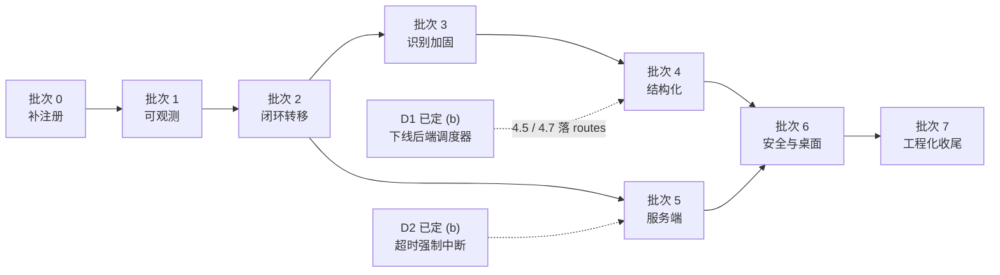

# AutoWSGR-GUI 问题汇总与修复排期

> **合并来源**（三份文档，2026-10-27 汇总）
>
> | 来源 | 篇幅 | 性质 | 在本文中的角色 |
> | --- | --- | --- | --- |
> | `AutoWSGR-GUI-架构与逻辑审查报告.md` | 46,029 字节 | 静态审查 + 架构结论 | 提供系统基线、契约规模、模块速查（§2、附录 D） |
> | `AutoWSGR-GUI-问题与风险清单.md` | 79,601 字节 | 49 条已定位问题 + 修复记录 | 提供问题主体、严重度、证据强度、状态（§4、§5） |
> | `AutoWSGR 状态机优化方案：把 UNKNOWN 变成一等状态.md` | 33,653 字节 | 分层改造方案 + 五批次排期 | 提供 L1–L5 设计、批次划分依据、真机验证（§6、§7） |
>
> **合并规则**：① 同一条问题只保留一个编号（沿用清单的 `R01–R49`，审查报告独有的两条吸收为 `R50/R51`，映射见 §3）；② 2026-10-25/26 之后的修复记录合并进「状态」与「遗留项」，不再按时间流水罗列；③ 两份文档曾给出两套互不兼容的批次（清单 §6 的四批 vs 状态机方案 §15 的五批），本文以 §15 为骨架重排为**统一批次 0–7**（§7）。
>
> **路径简写**：`py:` = `python/site-packages/autowsgr`；`asar:` = `resources/app.asar` 解包内容。
> **版本基线**：GUI `2.1.2-alpha.3` / 后端 `autowsgr 2.3.0` / Python `3.12.8`；后端来源 `ShiinaKuroko/AutoWSGR @ be09d354`（alpha），stable 基线 `OpenWSGR/AutoWSGR @ 49c28a28`。
> **截止时间**：本文状态截至 **2026-10-26 18:44**（最后一次前端改动实测）。

---

## 1. 一页纸结论

### 1.1 这是个什么系统

**Electron 壳 + 本地 FastAPI 后端 + 图像识别驱动手游**的三段式桌面自动化工具（战舰少女R）：

- **主进程**只做环境/进程/文件/窗口/更新的管家，不碰业务；
- **渲染层**是真正的**编排大脑**（任务队列、Cron、停止条件、日志统计），业务状态全在前端内存里；
- **Python 后端**是「一双眼睛 + 一只手」，只负责截图识别、决策、点击，外加一个**单槽任务执行器**；
- 三层用 **81 条 IPC**（配置/文件）+ **25 个 HTTP 路由 + 2 个 WebSocket**（运行时）连接，固定 `127.0.0.1:8438`。

架构评分 **B+**：分层干净、契约有意识（能力探针、路径沙箱、原子写、单一实例、双通道更新），关键路径（相对坐标、导航图、状态机、规则引擎）都是踩过坑之后的正确抽象。

### 1.2 问题总量与状态

**共 51 条**（清单 49 + 报告独有 2）：

| 级别 | 条数 | 已修复 | 已处置 | 部分缓解 | 不修 | 待修 |
| --- | --- | --- | --- | --- | --- | --- |
| **P0** | 6 | 4（R01/R02/R03/R46） | — | — | 2（R04/R05） | 0 |
| **P1** | 18 | 3（R19/R47/R48） | 1（R45） | — | — | 14 |
| **P2** | 23 | 0 | — | 3（R21/R22/R23） | — | 20 |
| **P3** | 4 | 0 | — | 1（R41） | — | 3 |
| **合计** | **51** | **7** | **1** | **4** | **2** | **37** |

> R45 的处置方式是「按用户要求整功能移除」，不是常规修复，故单列「已处置」而不再计入「已修复」。

**P0 已清空**：R01（设备泄漏）、R02（停止不下沉）、R03（识别无兜底）、R46（准备页未注册）已修复并真机验证；R04（建造配方）、R05（决战分支）经评估**明确不修**。目前没有任何「功能不可用 / 资源泄漏 / 任务停不下来」级别的已知问题。

### 1.3 三句最该记住的话

1. **「卡住」不是识别算法不准，是状态空间缺了一个格。** 现实世界有 15 个页面 + 弹窗 + 加载态 + 人工操作后的任意界面，而模型里原先只有 13 个已注册页面（批次 0 后 14 个），差额落到 `None`、被当成异常抛掉。**UNKNOWN 必须成为一等状态**，有自己的转移（恢复链），而不是异常。
2. **决策层抽象得不错，但「页面操作的同步语义」还停在「点一下等一会儿」。** 全仓 **212 处 `time.sleep`**（批次 2 审计口径；分项统计 ui/ 170、ops/ 44、combat/ 14）、**114 处裸 `click()` 对 23 处闭环等待**、**80 个含点击但函数体内无任何验证的方法**——这才是稳定性天花板的真正来源。
3. **最初定级的五个 P0 里有四个是「逻辑写了一半」或「清理少了一步」。** 断开设备、停止下沉、识别兜底、配方与分支选择，都属于「补完最后一公里」：改动面小、收益直接。真正需要设计决策的只有两件：**停止语义**与**双执行栈**。

### 1.4 剩余工作里性价比最高的四件（合计约 2.25 天）

| 顺序 | 条目 | 一句话 | 工时 |
| --- | --- | --- | --- |
| 1 | **R07** | 健康检查改用真实探活，消灭「模拟器已关、界面还是绿的」 | 0.5d |
| 2 | **R06 + R49** | 租约维度并入状态查询，消灭「status=idle 却 409」 | 0.75d |
| 3 | **R08** | 掉落停止条件改走事件/API，不再依赖日志文本 | 0.5d |
| 4 | **R09** | 停止超时升级为强制中断，消灭「UI 报失败、实际还在点屏幕」 | 0.5d |

这四条都属于「**看起来成功其实没做**」这一最伤信任的类别——功能没坏，但用户看到的结论是错的。

### 1.5 批次总览（详见 §7）

| 批次 | 主题 | 条目 | 工时 | 建议周次 | 状态 |
| --- | --- | --- | --- | --- | --- |
| 0 | 补注册与可识别（L1/L2a/L2b/L3a） | R46 | 0.5d | — | ✅ 已完成 |
| 1 | 止血与可观测 | R47 | 2d | — | ✅ 已完成 |
| 2 | 闭环转移 | R48 | 5d | — | ✅ 已完成 |
| — | 专项（不属批次） | R01 / R02 / R03 / R19 / R45 | 3d | — | ✅ 已完成 |
| **3** | **识别加固** | R21/R23/R24/R26/R39 + R46 遗留 | **7.75d** | 第 1–2 周 | 待开工 |
| **4** | **状态模型结构化** | R49/R22 + L4/L5（D1 已定，4.1/4.5/4.7 按 (b) 落点） | **13d** | 第 3–5 周 | 待开工 |
| **5** | **服务端状态与并发** | R06/R07/R08/R09/R10/R13–R16/R30/R31 + R50(d) 轮次原语 | **6.5d** | 第 6 周 | 待开工 |
| **6** | **安全与桌面体验** | R11/R12/R17/R18/R20/R27/R32–R34/R36–R38/R44 | **7.75d** | 第 7–8 周 | 待开工 |
| **7** | **工程化收尾** | R25/R28/R29/R35/R40–R43/R51 | **6.25d** | 第 9 周 | 待开工 |

**总剩余约 41 人日**：单人约 9–10 周；后端/桌面双人并行可压到 5–6 周（批次 5/6/7 与 4 无强依赖）。

---

## 2. 系统基线（速览）

### 2.1 代码规模

| 部分 | 文件数 | 行数 | 说明 |
| --- | --- | --- | --- |
| Electron 主进程（asar:dist/electron） | 69 | 14,126 | main / preload / 11 个 IPC 模块 / 30 个 service / 12 个 pythonEnv 模块 |
| 渲染层（asar:dist/renderer.bundle.js） | 1（128 模块） | 29,631 | esbuild 打包，未压缩，**无 sourcemap** |
| 页面与样式（asar:src/view） | 2 | 11,468 | index.html 2,456 + styles.css 9,012 |
| Python 后端（py:） | 186 | 43,460 | ui 74 / ops 22 / server 17 / vision 14 / combat 12 / emulator 10 |
| 随包资源（resources/resource） | 1,300+ | — | 模板块 101 张、地图 YAML 273 个、系统计划 40+ 份 |

### 2.2 全局架构

```
┌──────────────────────────────────────────────────────────────────────┐
│ 渲染进程 (Chromium)  index.html + renderer.bundle.js（原生 DOM，手写 MVC）│
│  ┌────────────┬─────────────┬──────────────┬────────────────────┐    │
│  │ View 层     │ Controller  │ Model 层      │ Adapter 层          │    │
│  │ 3 主页/12 弹层│ 20+ 控制器  │ Scheduler     │ IpcAdapter          │    │
│  │ 命令式渲染   │ 编排与校验   │ CronScheduler │ ApiClient(HTTP/WS)  │    │
│  │            │             │ TaskQueue     │ Storage/File/YAML   │    │
│  └────────────┴─────────────┴──────────────┴────────────────────┘    │
└───────────────┬──────────────────────────────────┬───────────────────┘
                │ window.electronBridge (81 通道)   │ HTTP :8438 / WS
┌───────────────▼──────────────────┐   ┌───────────▼───────────────────┐
│ 主进程 (Node)                     │   │ Python 后端 (uvicorn 单进程)   │
│  main.js 装配 + 生命周期           │   │  FastAPI + 单后台线程           │
│  ├ pythonEnv/  环境探测与安装      │   │  ├ /api/system  生命周期        │
│  ├ services/   30 个领域服务       │   │  ├ /api/task    任务单槽        │
│  ├ ipc/        11 组通道           │   │  ├ /api/game    只读状态        │
│  └ preload.js  API 白名单          │   │  ├ /api/ops     原子操作        │
└───────────────┬──────────────────┘   │  └ /ws/logs /ws/task           │
                │ spawn                └───────────┬───────────────────┘
      ┌─────────▼─────────┐            ┌───────────▼───────────────────┐
      │ python.exe 3.12.8 │            │ 自动化引擎                     │
      │ site-packages/    │            │  screenshot → recognize →      │
      │   autowsgr 2.3.0  │            │  decide → click → verify       │
      └───────────────────┘            └───────────┬───────────────────┘
                                         scrcpy H264 + 控制 socket
                                        ┌────────▼────────┐
                                        │ MuMu / 雷电 模拟器│
                                        └─────────────────┘
```

### 2.3 分层职责与越界点

| 层 | 位置 | 职责 | 现状 |
| --- | --- | --- | --- |
| 壳层 | asar:dist/electron | 窗口、单实例、环境安装、Python 进程、文件沙箱、更新 | ✅ 不碰游戏逻辑 |
| 编排层 | 渲染进程 | 任务队列、Cron 定时、停止条件、日志统计、UI 状态 | ⚠️ **承担了本该属于后端的调度职责**（见 R50） |
| 服务层 | py:server | HTTP 契约、设备租约、任务线程、状态上报 | ⚠️ 只做单槽，无队列；状态模型缺维度（R49） |
| 引擎层 | py:{scheduler,ops,combat} | 任务实现、战斗状态机、异常恢复 | ⚠️ `TaskScheduler` 完整实现但**未接线** |
| 感知层 | py:{ui,vision} | 页面识别、导航图、元素定位 | ⚠️ 13/15 页面注册（现 14），识别失败无降级 |
| 执行层 | py:emulator | scrcpy 视频流 + 触摸/按键注入 | ✅ 相对坐标、幂等回收（R01 后） |

### 2.4 进程与磁盘布局（要点）

| 进程 | 数量 | 生命周期 | 关键点 |
| --- | --- | --- | --- |
| AutoWSGR-GUI.exe | 1（单实例锁） | 用户启动 | 重复启动聚焦已有窗口 |
| 渲染进程 | 1 | 随窗口 | `contextIsolation=true`、`nodeIntegration=false`、CSP 注入 |
| python.exe | 1 | `startBackend()` 拉起 | `-X utf8 -c <bootstrap>`，uvicorn 绑 `127.0.0.1:8438` |
| adb.exe server | 0/1 | GUI 启停 | 退出时 `adb kill-server` |
| scrcpy-server（设备端） | 1 | 后端连接期间 | **R01 前退出不清理**，现已幂等回收 |

```
%APPDATA%/wsgrgui/            Electron userData（用户数据与安装目录彻底分离，升级不丢配置）
├─ gui_settings.json          GUI 自身设置（端口/Python/CUDA/自动化开关）
├─ usersettings.yaml          后端 UserConfig（模拟器/账号/OCR/日志/日常）
├─ task_groups.json            任务组定义 v4
├─ user_battle_plans/ · user_team_plans/ · ship-library/
└─ logs/                       GUI 侧 + 后端日志 + 失败截图
安装目录/logs/                 后端 loguru 日志 + logs/images/*.png
安装目录/.env_ready            环境就绪标记（版本 / commit / 绑定关系）
```

### 2.5 启动时序与三个陷阱

```
app.whenReady → 更新检查 → 迁移询问 → initPythonEnv → initBackend → 用户目录
→ 旧计划迁移 → 注册更新 IPC → 恢复热更新 → 创建窗口
渲染进程 init → getAppRoot/getPlansDir/getConfigDir(IPC) → Logger.init
→ 迁移冲突弹窗 → 读 usersettings.yaml → 探测模拟器 → [首次]SetupWizard
→ checkAndPrepareEnv → startBackend → 每秒 ping 最多 30 次
→ POST /api/system/start（超时 300s） → cronScheduler.start → 每 30s 心跳
```

| 陷阱 | 条目 | 后果 |
| --- | --- | --- |
| 启动链上 **8 条 `sendSync`** 同步 IPC 阻塞渲染主线程 | R36 | 冷启动白屏 200–800ms，用户重复双击 |
| `checkAndPrepareEnv` **无感知执行 `pip install`** | R20 | 离线/内网环境长时间卡在「正在检查环境」 |
| 启动即自动跑一次远征检查（占设备租约） | R49 | 「启动 → 立刻点开始」几乎必现 409，而 status 显示 idle |

### 2.6 三套「调度」，只有两套在跑

| # | 调度 | 位置 | 在跑？ | 说明 |
| --- | --- | --- | --- | --- |
| 1 | 前端 `CronScheduler`（每分钟 tick） | renderer.bundle.js:9279-9566 | ✅ | 演习 / 战役 / 常规 / 决战 / 战利品；「定时方案」分支**无生产调用方**（R28） |
| 2 | 前端 `Scheduler` + `TaskQueue`（事件驱动） | renderer.bundle.js:8480-8770 | ✅ | 优先级队列、插队、拖拽；**队列只在内存**（R37） |
| 3 | 后端 `TaskScheduler` | py:scheduler/scheduler.py | ❌ **GUI 下未启动** | 有优先级队列、`DOCK_FULL` 重试、远征插入、跨日重置；GUI 只调 `scheduler.launch()`，从未调 `TaskScheduler.run()` |

**后果**（R50）：三份轮次语义并存（`routes/task.py` 四处循环、`ops/normal_fight.py:175` `run_for_times`、`scheduler/scheduler.py:225` `_run_task`），新增任务类型要改两层。`ctx.active_fight_tasks` 与优先级饥饿保护**不再构成理由**——前者在 R45 后已无消费者，后者只存在于 GUI 不走的 `run_daily()` 路径（复核见 §6 主线 D）。

### 2.7 引擎五层链路与关键参数

| 层 | 入口 | 实现要点 |
| --- | --- | --- |
| 截图层 | py:emulator/controller/scrcpy.py:601 | scrcpy H264 + PyAV 解码线程维护「最新帧」，截图是**最近一帧**语义而非即时抓屏 |
| 识别层 | py:ui/page.py:121 `get_current_page()` | 三套原语并列：像素签名、模板匹配（`TM_CCOEFF_NORMED`）、OCR（EasyOCR / MaaFramework FastOCR） |
| 导航层 | py:ops/navigate.py:167 `goto_page()` | 14 页注册 + 23 条边 + BFS 最短路径 + **逐步重规划**（每步重新识别再走下一步） |
| 决策层 | py:combat/handlers.py:103 | 16 态战斗状态机、12 个阶段处理器，决策后由 `resolve_successors()` 校验转移合法性 |
| 执行层 | py:emulator/controller/scrcpy.py:633 | 全部坐标**相对值 0–1**，内部按分辨率换算；触摸用 scrcpy 二进制协议 |

| 场景 | 超时/重试 |
| --- | --- |
| 导航单步 | 识别 5 次 × 1 s，最多 20 步 |
| 出征准备页识别 | 5 s，间隔 0.5 s |
| 战斗夜战提示 | **150 s**（R26 的根源） |
| 战斗结算 | 90 s |
| 启动就绪 | 120 s |
| 章节切换 | 20 次尝试，需连续两帧一致 |

### 2.8 契约规模

| 契约 | 规模 | 备注 |
| --- | --- | --- |
| IPC | **81 条**（11 组），全部在 preload 白名单内 | 含 **13 条 `sendSync`**（启动路径至少触发 8 条）；10 个方法从未被调用；10 个「领域网关」返回同一对象 |
| HTTP | **25 路由 + 2 WS** | 原报告声明的总数；§8.2 契约表可点名的分组为：`/api/system` 4 · `/api/task` 3 · `/api/game` 2 · `/api/expedition` 3 · `/api/build` 3 · `/api/repair` 2（已随 R45 移除） · 其它 ops 4 · `/api/health` 1 = 22，差额为 `/api/intensify` 等未逐条列出的端点 |
| 任务判别式 | 5 类 | `normal_fight` / `event_fight` / `campaign` / `exercise` / `decisive`，由 `type` 字段路由（py:server/schemas.py:388-477） |
| 两个契约缺口 | — | `/ws/logs` 从未收到日志（R31）；全部端点**无鉴权** + `allow_origins=['*']` + 默认暴露 `/docs`（R17） |

---

## 3. 统一编号与来源映射

### 3.1 编号规则

- **R01–R49** 沿用《问题与风险清单》，是唯一权威编号；清单原有的分组（A–H + 附录 A–F）不再保留，改为按批次组织（§7）。
- **R50 / R51** 是审查报告独有的两条（报告编号 `R-17`、`R-24`），清单未收录，本文吸收。
- 审查报告的 `R-1`–`R-25` 是**另一套编号**，与清单编号**不对齐**（例如报告 `R-2` = 清单 `R04`）。本文一律使用清单编号，映射见 3.2。

### 3.2 审查报告 → 统一编号

| 报告 | 统一 | 说明 |
| --- | --- | --- |
| R-1 | **R01** | `system_stop` 不调 `ctrl.disconnect()` |
| R-2 | **R04** | 建造配方未实现 |
| R-3 | **R05** | `get_advance_choice()` 恒 `return 0` |
| R-4 | **R22** | 固定 sleep 主导同步（决战 32 处、全仓 212 处） |
| R-5 | **R03** | 识别全灭无兜底（清单 R03 有 5 次「无匹配」的日志实证） |
| R-6 | **R06** | 状态先置完成、租约后释放 |
| R-7 | **R02** | 停止只在战斗循环生效 |
| R-8 | **R12** | 设备不唯一时启动失败（报告原判「永久阻塞」，**已纠正**：实测不阻塞，直接抛错） |
| R-9 | **R13** | WS 广播持锁 `await send_text` |
| R-10 | **R14** | 两 WS 端点共用连接集合 |
| R-11 | **R18** | 4 处 `innerHTML` 拼接 |
| R-12 | **R19** | 退出不 `await` 异步落盘 |
| R-13 | **R33** | HTTP 超时 `setTimeout` 不清理 |
| R-14 | **R17** | CORS 全开 + 无鉴权 + 暴露 `/docs` |
| R-15 | **R11** | 配置路径不存在静默降级 |
| R-16 | **R10** | `lifecycle_lock` 覆盖启动/停止 |
| R-17 | **R50** | **双执行栈分叉**（清单未收录，本文新增） |
| R-18 | **R35** | 配置双真值源 |
| R-19 | **R41**（+R25、R28） | 死代码与桩（`IpcRegistrar.js` 空文件、`find_selected_chapter_y` 常量、`PAGE_SIGNATURE` 未用、`registerScheduledTask` 无调用方） |
| R-20 | **R39** | 模板/模型无版本与哈希清单 |
| R-21 | **R42** | 巨型单文件、无 sourcemap |
| R-22 | **R43** | 两套重复编队 UI |
| R-23 | **R34** | preload 只提供 `on*` 无退订 |
| R-24 | **R51** | **资源阈值缺失**（清单未收录，本文新增） |
| R-25 | **R40** | 硬编码绝对路径/像素坐标 |

### 3.3 严重度定义（沿用清单）

| 级别 | 判定标准 | 处理建议 |
| --- | --- | --- |
| **P0** | 功能实际不可用、数据/设备资源泄漏、任务无法停止、会导致「看起来成功其实没做」 | 下个版本必须修 |
| **P1** | 特定条件下稳定性崩坏、安全问题、可观测性缺失导致排障困难 | 优先排期 |
| **P2** | 一致性/可维护性缺陷、局部体验问题、潜在但有边界 | 随功能迭代修 |
| **P3** | 死代码、风格、优化项 | 有空再做 |

### 3.4 证据强度（保留，因为它是「能不能动手修」的判据）

| 标记 | 含义 | 用法 |
| --- | --- | --- |
| **[实证]** | 有运行日志/产物佐证，或本机复现路径明确 | 可直接开修，验收以复现路径为准 |
| **[直读]** | 逐行阅读源码确认，行号可复查 | 可直接开修，改前先确认行号未漂移 |
| **[推断]** | 由代码结构推导，未运行时验证 | **先写复现用例再修**，否则可能在修一个不存在的问题 |

---

## 4. 风险总览（51 条）

> 列说明：「批次」= §7 中的实施批次；`D1` = 架构决策项（§7.9）；`—` = 不进入实施队列。
> 状态标记：`已修复` / `已修复*`（有遗留）/ `已处置` / `部分缓解` / `不修` / `待修`。

| ID | 级别 | 标题 | 一句话后果 | 证据 | 状态 | 批次 |
| --- | --- | --- | --- | --- | --- | --- |
| R01 | P0 | 停止系统不断开设备 | scrcpy 连接与设备端进程永久泄漏 | 直读 | 已修复 | 专项 |
| R02 | P0 | 停止只对战斗循环生效 | 导航/准备阶段「停不下来」，最坏白开一场 | 直读 | 已修复* | 专项 |
| R03 | P0 | 页面识别失败无兜底 | 卡在未知页面直到手动干预 | 实证 | 已修复* | 专项 |
| R04 | P0 | 建造配方未实现 | 用户设的油弹钢铝被忽略 | 直读 | 不修 | — |
| R05 | P0 | 决战前进点恒选第一个 | 路线与配置不符，胜率下降 | 直读 | 不修 | — |
| R06 | P1 | 状态先完成、租约后释放 | 紧接新任务偶发 409「设备占用」 | 直读 | 待修 | 5 |
| R07 | P1 | 健康检查用 `_ctx is not None` | 模拟器掉线仍显示「已连接」 | 直读 | 待修 | 5 |
| R08 | P1 | 掉落停止条件依赖日志文本 | 改日志级别后停止条件静默失效 | 直读 | 待修 | 5 |
| R09 | P1 | 停止超时后上下文保留 | UI 报失败、实际仍在跑，状态撕裂 | 直读 | 待修 | 5 |
| R10 | P1 | `lifecycle_lock` 覆盖长任务 | 启动期间所有任务请求挂起 | 直读 | 待修 | 5 |
| R11 | P1 | 配置路径不存在静默降级 | 连错模拟器/错服而不报错 | 直读 | 待修 | 6 |
| R12 | P1 | 多设备时启动直接失败 | 多开用户首次配置必踩，且提示只进日志 | 直读 | 待修 | 6 |
| R13 | P1 | WS 广播持锁发送 | 一个死连接拖死所有推送 | 直读 | 待修 | 5 |
| R14 | P1 | 两个 WS 端点共用连接池 | 频道不隔离 + 残留死连接 | 直读 | 待修 | 5 |
| R15 | P1 | 跨线程状态无锁 | `result_summary` 偶发读到半截 | 推断 | 待修 | 5 |
| R16 | P1 | `run_coroutine_threadsafe` 无保护 | 退出瞬间把成功任务判失败 | 推断 | 待修 | 5 |
| R17 | P1 | 无鉴权 + CORS 全开 | 本机任意页面可驱动设备（解装/消耗资源） | 直读 | 待修 | 6 |
| R18 | P1 | 前端 4 处 innerHTML 拼接 | 恶意文件名可注入 DOM | 直读 | 待修 | 6 |
| R19 | P1 | 退出不等待异步落盘 | 最后一次任务组修改丢失 | 直读 | 已修复 | 专项 |
| R20 | P1 | 启动静默 pip install | 离线环境长时间卡住，无进度无取消 | 直读 | 待修 | 6 |
| R21 | P2 | 识别器异常被吞 | 某页识别器崩溃长期无人知 | 直读 | 部分缓解 | 3 |
| R22 | P2 | 固定 sleep 主导同步 | 设备卡顿即误判（决战 32 处最集中） | 直读 | 部分缓解 | 4 |
| R23 | P2 | 模板阈值双标准 | 同一次识别两套判定，0.84 不中 / 0.62 中 | 直读 | 部分缓解 | 3 |
| R24 | P2 | 分辨率获取失败回退 960×540 | 模板缩放基准错，整体低分不报错 | 直读 | 待修 | 3 |
| R25 | P2 | `find_selected_chapter_y()` 返回常量 | 方法名承诺了不存在的扫描逻辑 | 直读 | 待修 | 7 |
| R26 | P2 | 夜战超时 150s 连累同批候选 | 异常时白等两分半 | 直读 | 待修 | 3 |
| R27 | P2 | 截图开关未真正生效 | 关掉仍写盘 / 生成名为 None 的目录 | 实证 | 待修 | 6 |
| R28 | P2 | 定时任务注册无调用方 | 功能入口存在但永不触发 | 直读 | 待修 | 7 |
| R29 | P2 | 强化快照依赖未注入环境变量 | 该组 API 恒 503 | 直读 | 待修 | 7 |
| R30 | P2 | HTTP 错误语义混用 | 所有失败都是 200，监控失效 | 直读 | 待修 | 5 |
| R31 | P2 | `/ws/logs` 无生产者 | 通道存在但永远收不到日志 | 直读 | 待修 | 5 |
| R32 | P2 | 日志定时器无 dispose、缓冲无上限 | 长时间运行内存缓慢增长 | 直读 | 待修 | 6 |
| R33 | P2 | HTTP 超时定时器不清理 | 请求越多残留越多 | 直读 | 待修 | 6 |
| R34 | P2 | preload 事件无退订、暴露面过大 | 二次绑定叠加；最小权限缺失 | 直读 | 待修 | 6 |
| R35 | P2 | 配置双真值源 | 改 YAML 主题不生效 | 直读 | 待修 | 7 |
| R36 | P2 | 13 条同步 IPC | 首屏卡顿 | 直读 | 待修 | 6 |
| R37 | P2 | 队列只在内存 | 刷新/崩溃即丢队列 | 直读 | 待修 | 6 |
| R38 | P2 | 包名子串匹配 | `com.a` 命中 `com.ab` | 直读 | 待修 | 6 |
| R39 | P2 | 资源无版本/哈希清单 | 换模板后静默低分 | 直读 | 待修 | 3 |
| R40 | P2 | 硬编码绝对路径/像素坐标 | 换机器/换分辨率即失效 | 直读 | 待修 | 7 |
| R41 | P3 | 死代码与空实现 | 误导维护者 | 直读 | 部分缓解 | 7 |
| R42 | P3 | 巨文件无 sourcemap | 线上报错无法定位 | 直读 | 待修 | 7 |
| R43 | P3 | 两套重复编队 UI | 改一处要改两处 | 直读 | 待修 | 7 |
| R44 | P3 | CSP 缺加固指令 | 攻击面略大 | 直读 | 待修 | 6 |
| R45 | P1 | 维修方式=手动仍自动浴室修理 | 已按用户要求整功能移除 | 实证 | 已处置 | — |
| R46 | P0 | 准备页未注册，被误判为活动页并死循环 | 任务空转十几分钟，界面看是卡死 | 实证 | 已修复 | 0 |
| R47 | P1 | 状态机缺进度不变式，漂移无人消费 | 20 步预算被无效点击吃光 | 直读 | 已修复 | 1 |
| R48 | P1 | 闭环原语名不副实 | 关键选择点无验证 | 直读 | 已修复 | 2 |
| R49 | P2 | 状态查询缺租约维度 | 报空闲但设备被占（**必现**） | 实证 | 待修 | 4 |
| R50 | P2 | 双执行栈分叉（报告独有） | 三份轮次语义并存：新增任务类型改两层、船坞满轮计法不一（**D1 已定 (b)：7.2 下线 + 5.11 收敛**） | 直读 | 待修 | 7.2 / 5.11 |
| R51 | P2 | 资源阈值缺失（报告独有） | 资源耗尽只能靠游戏内弹窗被动发现 | 直读 | 待修 | 7 |

---

## 5. 已修复与已处置项的验收证据

> 这一节回答「凭什么说修好了」。没有真机证据的条目一律标 `已修复*`，不用 `已修复`。

### 5.1 已修复（7 条）

| ID | 修复时间 | 改动落点 | 验证证据 |
| --- | --- | --- | --- |
| **R01** | 2026-10-23 | `server/routes/system.py`、`server/main.py`、`emulator/controller/scrcpy.py`、`scheduler/launcher.py` | MuMu 实机连续 10 次 `/start` + `/stop`：连接期设备端稳定 3 个 scrcpy 进程、停止后 **0 个**；`adb forward --list` 全程无增长；人为造的 `tcp:27999` 规则自动移除 |
| **R02** | 2026-10-26 | `infra/exceptions.py`（`TaskStopRequested`）、`ops/navigate.py`、`ops/normal_fight.py`、`server/routes/task.py`、`ops/startup.py` | 离线 5 用例全过；真机两次——夜战等待中停止 0.7s 退出，**出征准备阶段停止**时日志里**没有再出现「开始出征」**，`details` 为空且不计失败 |
| **R03** | 2026-10-26 | `ops/navigate.py`（`_try_press_back` / `_try_dismiss_network_error`）、`ui/utils/navigation.py`（`PageNotRecognizedError`）、`server/routes/task.py`、`renderer.bundle.js`（`handleTaskFinished`） | 离线 7 用例全过；真机地图页→主页面退页成功；合成网络弹窗命中 0.999；`app.asar` 重打包后实测日志：`[Scheduler] 任务「自动演习」因页面无法识别而中止…现场截图：…png` |
| **R19** | 2026-10-23 | `asar:dist/electron/main.js`、`preload.js`、`renderer.bundle.js` | Windows 实机：关窗到 `task_groups.json` mtime 更新约 **380ms**，主进程输出「Renderer 已落盘，关闭窗口」；重复点关闭不重复触发 |
| **R46** | 2026-10-25 | `ui/__init__.py`、`ui/page.py`、`ui/stack.py`、`ui/navigation.py`、`ops/navigate.py` | 三张历史 NavError 截图：全量与候选集识别均返回「出征准备」（0.932 > 0.868）；`find_path(准备页, 主页面)` = [准备页 → 地图, 地图 → 主页面]；其余 9 张截图结果不变 |
| **R47** | 2026-10-25 | `ops/navigate.py`、`ui/stack.py`、`ui/utils/navigation.py`、`combat/engine.py`、`combat/recognizer.py` | 进度不变式 5 用例全过（原地踏步/振荡/正常推进/两次重复/A→A→B→B）；五种模式 `end_phase` 均可达，注入不可达值被拦截；真实截图 13 个阶段取证数值（`MAP_PAGE=0.728` 低于 0.80，正是「差一口气」样本） |
| **R48** | 2026-10-26 | `ui/utils/navigation.py`（`act_and_wait`）、`ui/battle/base.py`、`ops/campaign.py`、`ops/navigate.py` | 新增 14 用例全过；批次 1 的 15 用例无回归；**真机触发**：`已是目标舰队, 跳过点击` 出现 3 次（每轮一次），证明闭环验证在 GUI 通道同样生效 |

### 5.2 已处置（1 条）

| ID | 处置方式 | 影响 |
| --- | --- | --- |
| **R45** | 按用户要求**整功能移除**浴室修理（后端删除 `expedition_auto_check` 浴室阶段、`/api/repair/*`、`ops/repair.py`、`context/bathroom.py`、3 个配置字段；前端移除按钮/统计/设置项/`repair_method` 死字段） | 保留 `ui/bath_page/`、`PageName.BATH` 与识别模板仅供页面识别兜底；`repair_manually` 现在只控制战斗前快速修理 |

### 5.3 部分缓解（4 条）——说清边界，别当成已修

| ID | 已做 | 仍未做 |
| --- | --- | --- |
| **R21** | `dump_page_scores()` 把异常页记为 `score=-1.0`，使「识别器坏了」与「分数太低」在分数列表里可区分 | 异常**计数**与「连续 N 次升级为错误」未实现，前端仍无高亮 |
| **R22** | `act_and_wait` 闭环原语减少了「点完就睡」的盲点 | **212 处 `time.sleep` 未清理**；决战 `map_controller.py` 32 处一处未动 |
| **R23** | 准备页进候选后分数排序生效（0.932 胜 0.868） | **阈值来源仍未统一**；`PageMatch` 未记录所用阈值；margin 校验未做（批次 3.4） |
| **R41** | `handle_overlays` 空参数与 `NavConfig` 字段已删（6 处引用） | `IpcRegistrar.js`、`PAGE_SIGNATURE`、`py:scheduler/scheduler.py`、`registerScheduledTask` 未动 |

### 5.4 明确不修（2 条）与复启条件

| ID | 决定 | 理由 | **复启条件** |
| --- | --- | --- | --- |
| **R04** | 不修，接受现状 | 「功能未实现」而非「实现有缺陷」；补全配方滑块需重新标定三类控件坐标与拖拽行为，收益与成本不成比例 | 一旦启用建造任务队列 → **立即升为 P0**，配方滑块是第一个要补的 |
| **R05** | 不修，接受现状 | 用户当前不跑决战；分支决策需要额外地图拓扑数据支撑，不在现阶段范围 | 一旦启用决战跑图 → 升为 P1，至少把 `return 0` 改成「按 options 与配置优先列表匹配」 |

> 不修 ≠ 忘记。这两条已写进 §4 表格并标注 `不修`，不再出现在任何批次里；复启时从 §4 直接拉回。

### 5.5 累积的遗留项（本次合并新暴露）

原三份文档把遗留散落在各条修复记录末尾，容易漏。集中列出：

| 来源 | 遗留 | 归属批次 |
| --- | --- | --- |
| R02 | 残余延迟 ~3.5s：`change_fleet`、`_handle_spot_enemy` 等动作内部不查 stop；要做到 ≤1s 需把 stop 下沉到 `wait_for_page` | **4.7** |
| R02 | 服务器层「停止不计失败」只覆盖三个 executor，其他 ops 路由未统一 | 5.10 顺带 |
| R03 | 「重启游戏」兜底**刻意不在导航层做**，由 `startup._recover_to_main` 承担——批次 1 真机已验证：14 页全灭 → 恢复阶梯走到③仍失败 → Startup 强制重启 → 正常进主页面 | 已闭环，无需再做 |
| R46 | ① `fight_button_20260730` 文字条模板脆弱 ② 页面识别与浮层判定复用同一判据 ③ 缺分数 margin（0.932 vs 0.868 仅差 0.064） | **3.1 / 3.2 / 3.3 / 3.4** |
| R48 | 80 个未验证方法只改了 3 个（出征准备入口）；`start_battle` 刻意保留裸点击（点完可能弹「船坞已满」，重试会误触） | **4.1** |
| R48 | 恢复阶梯未含「逃生返回键」（已在 R03 专项补）与「重启游戏」（任务层职责） | 已闭环 |
| 批次 2 | 本批两项保障（重试、双重确认）在真机回归中**一次都没被用到**——它们是异常路径的保险，有效性目前只由 14 个用例覆盖 | 4.4 golden set 补 |

---

## 6. 六条主线：为什么这些问题会长成这样

> 这一节是三份文档「分析部分」的合并摘要。修的时候按批次走，但理解问题必须按主线看——同一个批次的十条修复，往往服务于同一条主线。

### 主线 A · 停止语义：从「一个检查点」到「可中断等待」

`ctx.stop_event` 全仓只有一个消费者（`combat/recognizer.py:323`）。所以停止只在「等战斗阶段出现」时生效——导航、换船、补给、点开始出征全都不响应。

最坏后果不是延迟，而是**点完停止之后又开了一场新仗**，然后在战斗第一帧放弃，白耗一次出征。

R02 已把检查点扩到：识别重试循环、导航每步、恢复每级、出征准备四节点、`run_for_times` 每轮、服务器层异常语义。**剩下的问题是粒度**：停止检查只能在动作之间生效，`click_and_wait_for_page` 最长 5 秒看不见 stop（批次 4.7）。

配套的两个坑：R09（超时后保留半死上下文，UI 说失败、设备还在动）、R10（`lifecycle_lock` 把启动的几分钟和任务请求串在一起，且没有「启动中」状态）。

### 主线 B · 页面识别：把 UNKNOWN 变成一等状态

**已确认的事实链**（不是推测）：
- `PageName` 定义 15 个值，注册 13 个（现 14）。缺 `BATTLE_PREP`（能识别、没接线）与 `CHOOSE_REPAIR`（被 `BathPage` 当 overlay 吸收，无问题）。
- 不注册的理由是「准备页有 5 个入口，图上建入边无法泛化」——**这是导航问题，被错误地当成了识别问题**。「无法确定怎么走到它」≠「无法知道自己在它上面」。
- 未注册的代价有三重：不在注册表（认不出）→ 不在候选集（`candidates()` 只含 当前+邻居+父+目标+目标邻居）→ 不在导航图（认出来也无路可走）。**三者缺一不可**，这是 R46 修复时最关键的发现。
- 误判放大效应：候选集不只是「缩小范围」，也会**放大误差**——候选内的高分误命中会抢先返回。实机案例：活动页「出击按钮」模板（173×31 **纯文字条**「出击准备」）在准备页标题栏命中 0.868，被判为活动页；而同一个 `_fight_button_detail()` 又充当「浮层是否打开」判据 → 恒为真 → 每 0.8 秒点一次红色 X → 无法自愈。

**目标模型**（状态机方案的 L1–L5，已有三分之二落地）：

| 层 | 内容 | 状态 |
| --- | --- | --- |
| L1 | 补注册 `BATTLE_PREP` | ✅ 批次 0 |
| L2 | 页面元数据 `overlay` / `always` / `escape`，候选集并入 always | ✅ 批次 0（escape 用图上出边替代） |
| L3 | 分级降级：候选 → 全量 → 清弹窗 → 逃生 → 退避 → 重启 | 🟡 前三级已有（批次 2.4 + R03 专项），退避/重启由 startup 承担 |
| L4 | 看门狗（同页同动作 3 次 / 12 步 1 页 / 连续失败 5 次） | ❌ 批次 4.6 |
| L5 | `goto_page` → `ensure_page`，UNKNOWN 成一等状态 | ❌ 批次 4.2 |

**一条重要的经验**：L4 看门狗不能只靠超时。本例里每一轮都有明确超时（5s/1s），单轮不卡，卡的是「轮与轮之间」——看门狗看的是**跨轮次的模式**，不是单次时长。

### 主线 C · 开环点击：114 : 23 的真相

| 指标 | 数值 | 含义 |
| --- | --- | --- |
| 裸 `click(` | **114 处** | 点完就走，不验证 |
| `click_and_wait_for_page(` | **23 处** | 有闭环等待 |
| `time.sleep()` | **212 处**（ui/ 170、ops/ 44、combat/ 14；决战 32） | 用固定睡眠充当同步 |
| 含点击但函数体内**无任何验证**的方法 | **80 个** | 静态扫描结果 |

结论：**约八成状态转移是开环的**。批次 2 已建好原语（`act_and_wait` + `stable_frames` + 重试前复查），但只迁移了 3 个入口。剩下的要靠批次 4.1 按页面重要性推进。

**两个刻意不做的选择**（避免过度工程）：
- **不在导航里重启游戏**——几十秒的重手段，塞进导航会导致「卡一次就重启」的风暴；由任务层按轮次决定。
- **不做无限重试**——最多 4 遍 `_goto_page`，之后照常抛错。失败要快，别把一次导航拖成几分钟。

### 主线 D · 双执行栈：前端编排 vs 后端调度器（R50）

**先给结论**：GUI 里**只有一个在跑的编排者（渲染层）**，后端只有**一个单槽执行器**，`TaskScheduler` 从来不在 GUI 的调用链上。R50 真正记录的不是「后端调度器没启用」，而是**三份轮次逻辑、三种船坞语义、一个没人消费的派生量**——每一条都能落到行号。

**事实链（2026-10-27 对照 `py:` 逐项复核）**

| # | 结论 | 证据 |
| --- | --- | --- |
| 1 | `TaskScheduler` 是完整实现，不是桩 | `py:scheduler/scheduler.py:127` 类定义；`:175` 顺序 `run()`；`:338` 触发器 `run_daily()`；`:405`/`:420` 优先级入队/出队；`:426` 跨日 reset；`:497` 轮间远征插队；`:282-320` 船坞满轮不计数 |
| 2 | 全仓**没有生产调用者** | 只出现在 `scheduler/__init__.py` 的用法示例、`daily_plan.py` 的文档串、`plan_runner.py:92`（CLI 辅助）；`server/` 下 **0 处**构造 |
| 3 | GUI 在跑的是**单槽执行器** | `py:server/task_manager.py:149-201`：一任务一线程；`:176` 取设备租约、`:235` 释放；无队列、无优先级 |
| 4 | 轮次循环在路由里**各写一遍** | `py:server/routes/task.py`：常规 `:127`、活动 `:184`、战役 `:231`、决战 `:313`，四处 `for i in range(times)`，各自做 stop 检查 + `update_progress` + 结果转换 |
| 5 | **渲染层才是编排者** | `renderer.bundle.js:8782` `consumeNext` 消费循环；`:8869` `scheduleRetry`（`maxRetries` + 5s）；`:8804` 停止条件预检；`:8892` `handleTaskFinished`（manual / unknown_page / terminal 三个出口）；`:8771-8780` 队列增删与拖拽 |

> 行号取自 2026-10-23 审查快照（本机 `python/site-packages/autowsgr` 当前不可读，故以同版本源码副本核对）。`routes/task.py` 与 `ops/normal_fight.py` 在 R02/R03 后有改动，**引用前按 §8.4 复核一次漂移**；`scheduler/scheduler.py` 未被已修复项触碰，行号可直接用。

**三条「可观察后果」重新打分**（原判断 → 复核）

| 原判断 | 复核结果 | 结论 |
| --- | --- | --- |
| `ctx.active_fight_tasks` 恒为 0 → 洗澡修理安全判断失效 | 该字段全仓只在 `scheduler.py:235`/`:322` 自增自减；R45 移除浴室修理后**没有任何消费者** | **已消解**，不再构成理由 |
| `build_daily_plan` 的优先级饥饿保护不生效 | 该保护（`daily_plan.py:193-199`）只存在于 `run_daily()` 路径，GUI 从不走；GUI 的等价语义是前端队列排序/拖拽，本来就没有自动优先级 | **不适用**，只能算「能力缺席」 |
| 新增任务类型要改两处 | 成立，但准确说法是**改两层**：后端 `routes/task.py` 新增一个 executor 循环 + 前端新增 task type 与 UI；新循环会照抄而不是继承 `:127-147` 的语义 | **成立**，是 R50 的残余价值 |

**真正的代价：三处语义只在「不跑的那份」里写对了**

| 语义 | `TaskScheduler`（不跑） | `routes/task.py`（在跑） | 可观察差异 |
| --- | --- | --- | --- |
| 船坞满轮是否计入次数 | 解装成功（`dock_full_destroyed`）的轮**不占次数**、立即重试（`:282-287`） | 每轮无条件 `current_round = i+1` 并计入结果，**不区分**解装轮 | 同一份「打 10 次」计划，船坞满时 GUI 实际少打 |
| 船坞满且解装失败 | 停止本任务并告警（`:312-320`） | 不 break，把剩余轮次继续跑完 | 反复撞同一堵墙，白耗租约与时间 |
| 轮与轮之间的远征/日常插队 | `_maybe_collect_expedition()`（`:497`） | 无；远征是前端另起的独立任务 | 长任务期间远征只能等任务结束 |

> `py:ops/normal_fight.py:175` 的 `run_for_times()` 还有**第三份**轮次循环（遇 `DOCK_FULL` 直接 `break`，`:203-205`），语义又与上面两份不同。三份循环、三种船坞处理，是 R50 最容易踩的坑——比「调度器没启用」严重得多。

**为什么会分叉成这样**（不是谁写错了）

- 后端是 **CLI 优先**的库：`launch()` → `build_daily_plan()` → `run_daily()` 面向「一条命令挂一天」，天然带触发器、优先级、跨日。
- GUI 要的是**可干预**：插队、拖拽、单条重试、按掉落停止、停止后继续队列。这些能力先在渲染层长出来（`Scheduler` + `TaskQueue`），后端只保留「给我一个任务，我跑完报结果」的单槽契约。
- 于是 `TaskScheduler` 成了**第三份**实现：GUI 不走，CLI 走的是同类的 `run_daily()` 路径——它服务的是「库用户 / 脚本」，不是这个 GUI。

**D1 要回答的三个问题**（不是「启用还是删除」）

1. **队列归谁**：现在在前端（含重试、停止条件、逻辑任务），要不要搬到后端？
2. **轮次语义归谁**：三份循环要不要收敛成一份共用原语（船坞满轮、stop 检查、进度上报）？
3. **长驻调度要不要在 GUI 里存在**：跨日 reset、轮间远征插队、优先级饥饿保护——GUI 现在是「没有」，不是「坏了」。

> 三个问题**不必同一个答案**：问题 2 可以先做（与 D1 无关，见 §7.9 选项 (d)），问题 1 留到出现「无头运行 / 跨日无人值守」硬需求时再定。

### 主线 E · 设备生命周期：四个状态源互不可见

| 状态源 | 位置 | 谁在维护 |
| --- | --- | --- |
| `_ctx`（上下文是否建立） | `server/main.py` | 启动/停止路由 |
| 设备租约（谁在用设备） | `server/task_manager.py` | 任务、ops 路由 |
| 任务状态（`idle` / `running`） | `task_manager` | worker |
| 真实设备连通性 | 设备控制器 | **没人主动探活** |

四个源互不可见，于是产生了 R01（断开不回收）、R06（顺序竞态）、R07（`_ctx` 冒充连通性）、R49（status 报 idle 但租约被占）。**这四个应该一起修**，修单个只是把矛盾换个地方出现。

R49 的实证（2026-10-26 17:16）最刺眼：两个请求间隔不到 1 秒，返回互相矛盾——

```
POST /api/task/start   → 409  device in use by api:expedition-check
GET  /api/system/status → idle, emulator_connected=true, current_task=null
```

因为 GUI 每次启动都会自动跑一次远征检查，所以「启动 → 立刻点开始」这条路径**几乎必现**。

### 主线 F · 服务端契约与安全：三条「说了不算」

| 契约 | 承诺 | 实际 |
| --- | --- | --- |
| 健康检查 | 「设备已连接」 | 只看 `_ctx is not None`，模拟器关掉仍报绿（R07） |
| HTTP 状态码 | 失败应 4xx/5xx | `except Exception: return ApiResponse(success=False)`，**全是 200**（R30） |
| `/ws/logs` | 「日志流」 | `send_log()` 全仓无调用者，通道是死码（R31） |
| 鉴权 | 无 | CORS `*` + 无 token + `/docs` 暴露 → 本机任意页面可 `POST /api/destroy` 解装（R17） |

这四条的共同点：**调用方无法通过返回值判断真实情况**。它们不制造崩溃，但让所有上层自动化（golden set、前端自省、调度器）建在不可信的基础上——这也是为什么 R49 虽定 P2 却建议提前做。

---

## 7. 修复排期批次

### 7.1 排期五原则

1. **先可观测，再修。** 批次 1 不新增任何能力，但后面每一批的修复都要靠它验证「是否真的修好」。没有取证能力，修完只能靠「感觉好了」。
2. **先闭环，再加固识别。** 开环转移会让「识别对了」也变成「没用」，所以批次 2（闭环）必须排在批次 3（识别加固）之前——这条已经在历史排期中被遵守。
3. **止损优先于优雅。** 同一批次内，「看起来成功其实没做」类问题（R07/R06/R49/R08/R09）排在最前，哪怕它们级别只是 P1/P2。
4. **依赖优先于级别。** D2 与 D1 均已定（2026-10-27，§7.9）：D2 取 (b)，5.3 按「协作式 + 超时强制中断」实现；D1 取 (b)，4.5/4.7 的落点固定在 `routes/task.py`，4.1 不受约束。
5. **每批必可独立回滚。** 改动前留快照到 `.workbuddy/backup/<日期>_<条目>/`，改动后跑固定回归基线（§8），不通过不入下一批。

### 7.2 依赖关系



**说明**：批次 5 与批次 3/4 无代码依赖，只有人员排期冲突——后端与桌面可拆两条线并行；批次 6 同时依赖 4.0（状态可信）与 5（服务端契约），但只有 6.9/6.11 这类小项可以提前。D1 **已定 (b)**：不阻塞 4.1（4.1 改的是 `ui/` 内部的识别—动作—验证，不碰轮次循环），4.5（进度上报）与 4.7（停止落点）随之固定在 `routes/task.py`；D2 **已定 (b)**：5.3 按强制中断实现。

### 7.3 已完成批次（0–2 + 专项）

| 批次 | 主题 | 条目 | 交付 |
| --- | --- | --- | --- |
| **0**（2026-10-25） | 补注册与可识别 | R46 | ① `register_page(BATTLE_PREP, ..., always=True)`；② `UIStack.candidates()` 并入 always 页；③ 补出边「出征准备 → 地图」；④ `dump_page_scores()` Top6 取证 |
| **1**（2026-10-25） | 止血与可观测 | R47 | ① `_reconcile_drift` 消费漂移信号；② `_detect_stall` 进度不变式（原地打转 / A↔B 振荡）；③ `_probe_phase_score` 超时取证；④ 删 `handle_overlays` 空参数；⑤ `_validate_plan` 校验 `end_phase` 可达 |
| **2**（2026-10-26） | 闭环转移 | R48 | ① `act_and_wait` 原语；② 重试前复查（超时后不重复点）；③ `stable_frames=2` 双重确认；④ `select_fleet`/`select_panel`/`ensure_battle_support` 闭环；⑤ `goto_page` 三级恢复阶梯 |
| **专项**（10-23/10-26） | 不属任何批次 | R01 / R02 / R03 / R19 / R45 | 见 §5.1 / §5.2 |

> 批次 0–2 的共同价值：把「卡死 + 日志刷屏」变成「一条明确错误 + 现场截图」。批次 1 真机已被真实触发一次——会话一启动时游戏停在标题页，14 个识别器全灭，取证与恢复阶梯按设计走到第三级，最后交给 Startup 层强制重启，重启后正常开打。

### 7.4 批次 3 · 识别加固（7.75 天，第 1–2 周）

**目标**：让「看错了」不再发生。批次 2 解决「点了没用」，这一批解决误判——2026-10-24 的活动页误判是典型样本：活动页本有 3 个锚点，但按「哪个方便」排序而非「哪个特异」，最弱的文字条模板（0.868）排了第一。

| # | 条目 | 动作 | 落点 | 工时 | 验收标准 |
| --- | --- | --- | --- | --- | --- |
| 3.1 | R46 遗留① | 锚点从「单模板」改为「多锚点 + 特异性排序」，活动页把标题图提到第一位 | `ui/event/event_page.py` | 1d | 三张历史截图上活动页得分低于准备页；标题图独占命中 |
| 3.2 | R46 遗留① | 替换 `fight_button_20260730_540p.png`（173×31 纯文字条）：换完整按钮图，或对文字条加颜色 mask | `data/images/event/` | 0.5d | 准备页标题栏不再命中（0.868 → < 0.80）；活动页真按钮仍命中 |
| 3.3 | R46 遗留② | 拆分判据：页面识别用 `event_title_*`，浮层判定才用出击按钮，不再复用 `_fight_button_detail` | `ui/event/event_page.py` | 1d | `go_back` 不再对准备页点红 X；浮层判定在真浮层上仍生效 |
| 3.4 | **R23** + R46 遗留③ | ① 阈值来源统一（按识别器类型配置）；② `PageMatch` 记录所用阈值；③ **margin 校验**：最高分 − 次高分 < 0.05 判 UNKNOWN 走恢复链 | `ui/page.py` | 1.5d | 0.932 vs 0.868 场景被 margin 拦下并进恢复链；日志每条 `PageMatch` 带阈值 |
| 3.5 | 文档 | 每页「锚点清单」：哪些锚点必须存在、各自阈值、特异性排序、是否 always | 文档 + 评审 | 1.5d | 14 页逐页过审；标注 `CHOOSE_REPAIR` 这类「有意不注册」的页面及理由 |
| 3.6 | **R26** | `wait_for_phase` 总超时改「首个候选命中即返回 + 分阶段预算」，不再取 `max(sig.default_timeout)` | `combat/recognizer.py` | 0.5d | 夜战场景异常 ≤30s 判失败（原 150s）；正常夜战不受影响 |
| 3.7 | **R21** | 识别器异常计数；连续 N 次升级为 error 并在前端日志面板高亮；`dump_page_scores` 区分「坏了」（−1.0）与「分低」 | `ui/page.py` + 前端 | 0.5d | 人为损坏一个模板 → 面板红色条目 + 计数递增 |
| 3.8 | **R24** | 分辨率回退 `(960,540)` 时打 WARNING + 状态栏提示「分辨率未识别，使用默认 960×540」 | `emulator/controller/scrcpy.py` | 0.25d | 强制 `wm size` 返回空 → UI 明示 |
| 3.9 | **R39** | `image_resources/manifest.json`（路径 + 尺寸 + sha256 + 基准分辨率 + 适用游戏版本），启动校验并上报 | `py:image_resources/` | 1d | 删一张/换一张模板 → 启动报清单不一致并指出文件 |

**批次出口标准**：连续挂机 8 小时无「无匹配（评估 13 个候选）」型卡死；任何一次误判都能从日志里直接读出「是哪个锚点、差多少分」。

### 7.5 批次 4 · 状态模型结构化（13 天，第 3–5 周，分 4a/4b）

**目标**：让 UNKNOWN 成为一等状态，让状态可信，让改动可回归。这是收益最大、风险也最大的一批。

> **D1 已定 (b)（2026-10-27，§7.9）**：后端只做单槽执行器 → 4.5 的进度源留在 `routes/task.py:update_progress`，4.7 的每轮 stop 检查留原处，4.1 的范围与 4d 工时不变。

**4a（第 3–4 周，7.5 天）：先把地基铺平**

| # | 条目 | 动作 | 落点 | 工时 | 验收标准 |
| --- | --- | --- | --- | --- | --- |
| 4.0 | **R49** | `/api/system/status` 增 `device_lease{holder, since}`；前端状态栏显示「设备忙：<holder>」而非空闲；可选 `retry_after` | `server/routes/system.py`、`task_manager.py`、前端 | 0.5d | 启动 GUI 后 1 秒内点开始 → UI 显示租约持有者，不再显示空闲 |
| 4.1 | **R22** + R48 遗留 | 子状态纳入：状态改 `(page, substate)`，或至少让 `ensure_panel`/`switch_tab`/`apply_supply`/`change_fleet` 走统一「识别 → 动作 → 验证」；顺带清理决战 10 处高频 sleep。**D1 已定 (b)：范围只到 `ui/`，进度与轮次不在本条** | `ui/page.py`、`ui/map/*`、`ui/build_page.py`、`ui/battle/*` | 4d | 30 个高频子状态入口有 checker；决战高频 sleep 改轮询；`start_battle` 保持裸点击（有意的）；**不触碰轮次计数与进度上报**（留给 (d)/4.5） |
| 4.2 | L5 | `goto_page` 升级为 `ensure_page`：UNKNOWN 成一等状态；图上不可达时先 `escape` 再重规划 | `ops/navigate.py` | 2d | 构造「孤岛页面」→ 自动出逃而非直接抛错；恢复预算有上界 |
| 4.3 | 错误分级 | `PageDriftError`（可恢复）/ `UIVersionError`（需人工）/ `DeviceError` 三类 | `infra/exceptions.py` | 1d | 三类错误在前端的提示文案与重试策略不同 |

**4.1 的依赖边界（与 D1 的关系）**

原排期把 4.1 写成「D1 不定就不能开工」，复核后要改成分层判断——4.1 的主体（子状态建模 + 入口闭环）与 D1 无关，只有两个接入点相关：

| 4.1 的组成 | 依赖 D1？ | 说明 |
| --- | --- | --- |
| 子状态建模 `(page, substate)`；`ensure_panel`/`switch_tab`/`apply_supply`/`change_fleet` 走「识别 → 动作 → 验证」 | **否** | 全在 `ui/` 层（`py:ui/map/base.py:210`、`py:ui/build_page.py:197`、`py:ui/battle/supply.py:77`、`py:ui/battle/fleet_change/_change.py:312`），由 ops 调用，与轮次循环在哪无关；`switch_tab` 已经在用 `click_and_wait_for_page`，证明原语可复用 |
| 30 个高频入口清单与 checker 模板 | **否** | 纯 `ui/` 清点与迁移，产出是可复用的 checker |
| 决战 10 处高频 sleep 改轮询 | **否** | `py:ui/decisive/*` 内部 |
| 进度上报带 substate（4.5） | **是** | 「一轮」由谁定义决定 `substate` 由谁产出：维持现状改 `routes/task.py` 的 `update_progress`；选 (a) 则落在 `_run_task`。**D1 已定 (b) → 改 routes** |
| 停止检查点位置（4.7） | **弱** | stop 下沉到 `wait_for_page` 与循环无关；但「每轮一次 stop 检查」这份代码在 (a) 下要从 routes 搬到 scheduler（删一处、不改逻辑）。**D1 已定 (b) → 留 routes** |
| 船坞满轮的计数语义 | **是** | 见 §6 主线 D 的语义表；走 (d) 抽共用原语即与 D1 解耦 |

结论：**4.1 可以在 D1 之前开工**，前提是把边界限制在 `ui/` 层——不顺手改轮次计数与进度上报。这样即使最终选 (a)，4.1 的 checker 与子状态模型原样复用，返工面只有「进度/停止」两个接入点（≤1 天）。反过来，若先定 D1 再开 4.1，等于让 4 天的重构等一个 1 小时的会议决定。

> **2026-10-27 决策已落（D1 取 (b)）**：上表里两个「是」随之定死——**4.5 改 `routes/task.py:update_progress`**、**4.7 的每轮 stop 检查留原处**；「船坞满轮」由 5.11 的共用原语一并解决，不再依赖调度器归属。4.1 的范围与 4d 工时不变。

**4b（第 5 周，5.5 天）：让问题可见、可回归**

| # | 条目 | 动作 | 落点 | 工时 | 验收标准 |
| --- | --- | --- | --- | --- | --- |
| 4.4 | golden set | `tests/golden/`：每页标准截图 + 期望识别结果，改模板后一键跑 | 新增 `tests/golden/` | 2d | 一次跑完 14 页 + 12 张历史截图；任何模板改动前必跑，杜绝「改了 A 坏了 B」 |
| 4.5 | 前端自省 | WS 推送 `(current_page, ui_stack.pages(), combat_phase)`。**D1 已定 (b)：进度源留在 `routes/task.py` 的 `update_progress`，不迁后端调度器** | `server/routes/task.py`、`ws_manager.py` | 1.5d | 界面实时可看当前页面与战斗阶段；卡住肉眼可见 |
| 4.6 | L4 | 看门狗与 4.2 合并实现（避免两套恢复逻辑打架）：同页同动作 3 次 / 12 步 1 页 / 连续失败 5 次 → `StuckError` | `ops/navigate.py` | 1.5d | 构造空转 → 30 秒内报 `StuckError` 并带页面轨迹 |
| 4.7 | **R02 残留** | stop 下沉到 `wait_for_page`：给它传 ctx，轮询内查 stop。**D1 已定 (b)：每轮 stop 检查留在 `routes/task.py` 循环内，不搬 scheduler** | `ui/utils/navigation.py` | 0.5d | 导航中点停止 ≤1s 中断（原 3.5s） |

**批次出口标准**：golden set 成为发布前置；卡住事件在 UI 上可见；UNKNOWN 有明确出口且预算可控；状态查询与设备租约一致。

**风险**：4.1 是全项目最大的一次重构（触及 `ui/map/*` 与 `ui/battle/*`）。若排期紧张，**先做 4.0 + 4.2 + 4.4**——这三项投入 4.5 天、风险低、收益高，4.1 可以推到批次 5 之后单独做；推到那时反而更省事：4.3 的错误分级与 4.5 的进度上报已经定了接口，4.1 的 checker 直接按接口实现。

### 7.6 批次 5 · 服务端状态与并发（6.5 天，第 6 周）

**目标**：让状态不再撒谎。这一批全是「后端说了不算」的问题，单条都不大，但合起来决定上层能不能自动化。

> **D2 已定 (b)（2026-10-27，§7.9）**：5.3 按「协作式 + 超时强制中断」实现。**D1 已定 (b)**：单槽契约不变，5.11 的 `run_rounds()` 是轮次语义的唯一收敛点，也是将来 (a) 立项的迁移基座。

| # | 条目 | 动作 | 工时 | 验收标准 |
| --- | --- | --- | --- | --- |
| 5.1 | **R07** | 健康检查改真实探活：`ctrl.is_alive()` / 最近一帧时间戳 < 3s；`emulator_connected` 与 `_ctx` 解耦 | 0.5d | 手动关模拟器 → 30 秒内心跳显示「未连接」并停止派任务 |
| 5.2 | **R06** | `finally` 里先释放租约、再写状态（或状态写入进同一把锁） | 0.25d | 战役→演习连发 100 次无 409 |
| 5.3 | **R09** | 停止超时后升级为「强制中断」（断开设备 + 标记 ctx 失效），不再保留半死上下文（**D2 已定 (b)：协作式为主 + 超时强制中断**） | 0.5d | 停止卡死场景：30s 后设备真的断开，退出耗时 < 35s |
| 5.4 | **R10** | 引入显式状态机 `starting / ready / stopping`；`task_start` 在非 ready 时立即回 409/503 + 明确文案 | 1d | 启动中点击任务 → 立刻得到「系统正在启动，请稍候」，不再挂 300s |
| 5.5 | **R13** | 锁内只做快照，锁外 `asyncio.gather(..., return_exceptions=True)`，每个 send 加 `wait_for(1s)` | 0.5d | 人为制造半死连接 → 其他广播不阻塞；新连接可正常建立 |
| 5.6 | **R14 + R31** | 按 path 分两个 manager；所有路径加 `finally: await disconnect()`；`/ws/logs` 二选一（删掉通道，或给 loguru 加 WS sink） | 0.5d | 刷新界面 10 次后连接集合为空；`/ws/logs` 不再是无生产者的死码 |
| 5.7 | **R15** | `TaskInfo` 加锁，或改为不可变快照（每次更新生成新对象） | 0.5d | 1 秒级轮询 10 分钟，`current_round` 与 `success_runs` 始终自洽 |
| 5.8 | **R16** | `try/except RuntimeError` + `future.add_done_callback` 吞异常；`update_progress` 同理 | 0.25d | 任务结束瞬间关窗 20 次，不会再出现「上次任务失败」 |
| 5.9 | **R08** | 掉落停止条件改结构化：后端每次掉落经 WS 发 `loot_update`，前端只在无事件时回退到日志解析 | 0.5d | 日志等级设为 WARNING 时「刷胖次 50 个停」仍生效 |
| 5.10 | **R30** | 业务失败统一 4xx/5xx + 结构化 `error_code`；前端强制走统一封装 | 1d | 远征/建造/强化/解装失败时前端自动识别为失败，不依赖逐端点判 `success` |
| 5.11 | **R50(d)** | 抽出 `run_rounds()`：四处路由循环收敛为一处（stop 检查 / `update_progress` / 船坞满轮 / 结果转换），补「解装轮不计数」「解装失败即停」；`ops/normal_fight.py:175` 的第三份循环改为复用同一原语。**D1 已定 (b)：单槽契约不变，本条是轮次语义的唯一收敛点，也是将来 (a) 立项的迁移基座** | 1d | 「打 10 次」遇船坞满时实际开打 10 场；四处路由的轮次行为逐项一致 |

**批次出口标准**：`status` / `health` / 租约三者一致；任何失败都能从状态码判断；WS 单连接异常不影响其他客户端；**轮次语义只剩一份实现**（5.11 后 `routes/task.py` 四处循环调用同一原语）。

### 7.7 批次 6 · 安全与桌面体验（7.75 天，第 7–8 周，分 6a/6b）

**6a · 安全与正确性（3 天）**

| # | 条目 | 动作 | 工时 | 验收标准 |
| --- | --- | --- | --- | --- |
| 6.1 | **R17** | 启动生成随机 token 写入 `.env_ready`，preload 读取后随请求头带上；CORS 收紧到 `file://` / `app://`；生产模式关闭 `/docs` | 1.5d | 从浏览器直接 `fetch` 本地端口被拒；GUI 自身正常 |
| 6.2 | **R18** | 4 处 `innerHTML` 拼接改 `escapeHtml()` 或 `createElement + textContent` | 0.5d | 文件名含 `"` 与 `` 不再破坏 DOM |
| 6.3 | **R44** | CSP 补 `object-src 'none'`、`base-uri 'none'`、`frame-ancestors 'none'` | 0.25d | 注入 `<base>` 不再改变相对路径解析 |
| 6.4 | **R34** | `on*` 返回退订函数；按领域暴露 `bridge.settings.*` / `bridge.plans.*`；删除 10 个死接口 | 0.75d | 界面二次初始化后日志不再重复两遍 |

**6b · 启动/退出/持久化（4.75 天）**

| # | 条目 | 动作 | 工时 | 验收标准 |
| --- | --- | --- | --- | --- |
| 6.5 | **R11** | GUI 显式传路径时 **fail fast**（HTTP 400 + 明确文案），只有未指定路径才允许默认 | 0.5d | 拼错配置路径 → 启动即报错并指出路径，不再静默用雷电+官服 |
| 6.6 | **R12** | 启动失败把后端 `error` 原文透传 UI；设置页提供「检测到的设备列表 + 一键选择」 | 0.5d | 双开 MuMu 时界面直接给设备列表，不用去翻日志 |
| 6.7 | **R20** | 安装前弹确认（含体积/耗时预估）、提供「取消/离线导入」、安装给进度条、失败保留完整日志 | 1d | 离线环境下能取消；pip 输出不再截断到 `slice(-200)` |
| 6.8 | **R27** | `save_images=False` 时显式 `_image_dir = None`，`save_screenshot` 直接 return | 0.25d | 关掉截图开关后 `logs/images/` 不再增长 |
| 6.9 | **R32** | `dispose()` 清定时器；`buffer` 上限 5000 条丢最旧；失败加指数退避 | 0.5d | 磁盘满场景挂机 8 小时内存不涨 |
| 6.10 | **R33** | `const t = setTimeout(...); try { await fetch } finally { clearTimeout(t) }` | 0.25d | 挂机 8 小时无残留定时器增长 |
| 6.11 | **R36** | `sendSync` 改 `invoke` + 并行 `Promise.all`，首屏先渲染骨架 | 0.5d | 冷启动白屏从 200–800ms 降到 < 150ms |
| 6.12 | **R37** | 队列快照节流落盘，启动恢复「未开始」任务，运行中标记为中断 | 1d | 挂机中强杀渲染进程 → 重开队列还在 |
| 6.13 | **R38** | 解析 `ps -A` 最后一列精确匹配，或 `pidof <package>` | 0.25d | 同时装官服与渠道服时不再误判「已运行」 |

**批次出口标准**：无鉴权/注入/数据丢失类问题清零；冷启动体感正常；离线可安装可取消。

### 7.8 批次 7 · 工程化收尾（6.25 天，第 9 周）

| # | 条目 | 动作 | 工时 | 验收标准 |
| --- | --- | --- | --- | --- |
| 7.1 | **R40** | 全部改相对坐标 + 分辨率换算；路径改从 `AppPaths` / 环境变量注入 | 1.5d | 1280×720 与 1920×1080 下强化滑动、浴室布局均正确 |
| 7.2 | **R41 + D1(b)** | 删除 `IpcRegistrar.js` 空文件、`PAGE_SIGNATURE` 未用定义；按 **D1(b)** 下线 `py:scheduler/` 的触发器调度链路（`scheduler.py`、`daily_plan.py`、`plan_runner.py`、`triggers.py`），`__init__.py` 只导出 `launcher` | 0.5d | 新维护者不会误以为「IPC 注册走 IpcRegistrar」；`import autowsgr.server` 通过且 `from autowsgr.scheduler import launch` 仍可用；四个文件 `Test-Path` 均为 False |
| 7.3 | **R25** | `find_selected_chapter_y()` 要么真实现扫描，要么改名 `DEFAULT_CHAPTER_Y` 并注明常量语义 | 0.25d | 方法名与实际行为一致 |
| 7.4 | **R28** | 定时方案：接线（接进 `CronScheduler`）或从 UI 移除入口 | 0.5d | 不再出现「配了但永不触发」 |
| 7.5 | **R29** | Electron 启动时注入 `AUTOWSGR_STRENGTHEN_DATA` / `AUTOWSGR_SHIP_LIBRARY`，或后端从 `GameContext` 推导 | 0.5d | `/api/intensify/*` 返回 200 而非恒 503 |
| 7.6 | **R35** | 单一真值源：YAML 为准，localStorage 只存纯 UI 偏好，启动时以文件为准 | 1d | 手改 YAML 的 `log.level` 重启后界面同步生效 |
| 7.7 | **R42** | 构建时生成外链 sourcemap，或至少保留 `//# sourceURL` | 0.5d | 线上报错可映射回 `src/view/...` |
| 7.8 | **R43** | 抽共享组件/模板片段（fleet 与 decisive 两套编队 UI） | 1d | 改「候选舰船优先级」只需改一处 |
| 7.9 | **R51** | 调度层增加油/弹/钢/铝阈值判断（复用 `/api/game/context` 的资源字段） | 0.5d | 资源低于阈值时任务暂停并提示，而非等游戏弹窗 |

> 7.8（R43）可标为**可选**：它只影响维护成本，不影响运行。排期紧张时先做 7.1–7.7、7.9，把 7.8 放到下一轮。

### 7.9 架构决策项（D1 / D2 已定，D3 维持）

| 决策 | 内容 | 结论 | 落地与影响 |
| --- | --- | --- | --- |
| **D1** | **R50 双执行栈**：三份轮次逻辑 + 前端队列 + 未启用的 `TaskScheduler` | **✅ 已定（2026-10-27）：短期 (b)——下线触发器调度子系统、文档化「后端只做单槽执行器」；长期 (a)——单独立项重写编排层** | 删除动作落在 7.2（可提前到批次 4 开工前）；4.5/4.7 的落点随之固定在 `routes/task.py`；4.1 本就不受约束 |
| **D2** | **停止语义**：协作式 vs 强制中断 | **✅ 已定（2026-10-27）：(b) 协作式为主 + 超时后强制中断**（断开设备 + 标记 ctx 失效；不做 signal / 线程强杀） | 5.3 按此实现；4.7 的「导航中 ≤1s 中断」仍是动作边界的协作式检查，两者不冲突 |
| **D3** | **R04 / R05 不修** | 维持；复启条件见 §5.4 | — |

**D1 选项表**（2026-10-27 决策：**(b) 短期 + (a) 长期立项**）

| 选项 | 决策 | 做什么 | 工时 | 风险 | 何时做 |
| --- | --- | --- | --- | --- | --- |
| **(b) 下线** | ✅ **短期选定** | 下线整条触发器调度链路：删 `scheduler/scheduler.py`、`daily_plan.py`、`plan_runner.py`、`triggers.py`，`scheduler/__init__.py` 只保留 `from .launcher import Launcher, launch`；「GUI = 前端编排 + 后端单槽」写进后端说明 | **0.5d** | 中：`server/routes/system.py:43` 用的是 `from autowsgr.scheduler import launch`，漏改 `__init__` 即启动失败；属对上游分叉，升级后需重放 | 7.2，可提前到批次 4 开工前（纯删除，不改运行时行为） |
| **(a) 接线** | ⏳ **长期立项** | 队列、重试、停止条件、逻辑任务、队列持久化全部下沉 Python，前端退化为视图 + 手动排序/停止 | **8–12d**（`TaskScheduler` 缺 per-task 重试、停止条件求值、逻辑任务去重，需**重写**而非恢复；前置 5.9 / 5.10） | 高：动所有任务路径，`/api/task/*` 契约重写，前端并行开发停摆 | 出现硬需求（无头运行 / CLI 与 GUI 同源 / 跨日无人值守）时立项 |
| (b′) 标注 | ✖ 未采纳 | 保留文件 + docstring 标注「GUI 不使用」 | 0.25d | 低 | 被 (b) 取代：既然只留一套编排，死码加注释只是把误导换个形式 |
| (c) 现状 | ✖ 未采纳 | 不动作 | 0 | 低 | — |
| (d) 收敛轮次原语 | ✅ **保留（与 (b) 不冲突）** | `routes/task.py` 四处循环抽成 `run_rounds()`（stop / 进度 / 船坞满轮 / 结果转换）；`ops/normal_fight.py:175` 的第三份循环改为复用 | 1d | 低：纯后端，可逐路由灰度 | 5.11；在 (b) 下它是单槽执行器的唯一循环实现，也是将来 (a) 的迁移基座 |

> **决策记录（2026-10-27）**：D1 分两步——先用 0.5 天下线（7.2），把「GUI 只有一个编排者（渲染层）+ 一个单槽执行器」变成显式契约，顺带关掉「三份轮次语义」里最误导的那一份；(a) 另立项，立项时**重写编排层**，不要恢复被删的 `TaskScheduler`——它缺重试、停止条件求值、逻辑任务去重，恢复等于把 8–12 天的活做两遍。
>
> **运维提醒**：删除是对 `autowsgr 2.3.0` 的分叉，后端升级会把这些文件带回来；`backend-distribution.json` 的 `forceUpdateOnInstall=false` 只挡「安装即覆盖」，不挡手动更新。每次更新后端后跑 §8.4 第 2 步（`import autowsgr.server`），并用 `Test-Path` 确认 `scheduler/scheduler.py` 是否被还原。
>
> **原判断的修正**：原文写「D1 必须在批次 4 开工前给出结论，否则 4.1 会在两套循环上各改一遍」。复核后不成立——4.1 改的是 `ui/` 内部的识别与验证，不碰轮次循环；两套循环里只有一套在跑。D1 的实际约束是 **4.5（进度上报）与 4.7（停止落点）**，两者随 (b) 固定为 `routes/task.py`，见 §7.5。

> **D2 落地**：5.3 按 (b) 实现——协作式为唯一主路径，超时后断开设备并标记 ctx 失效；不做 signal / 线程强杀（Python 线程无法安全打断，且会破坏设备状态）。

### 7.10 时间线与里程碑

| 周 | 批次 | 里程碑（可验收） |
| --- | --- | --- |
| 第 1–2 周 | 3 | **M1**：连续 8 小时挂机无 UNKNOWN 卡死；误判可从日志定位到锚点与分数差 |
| 第 3–4 周 | 4a | **M2a**：状态查询与租约一致；UNKNOWN 有出口；三类错误可区分 |
| 第 5 周 | 4b | **M2b**：golden set 成为发布前置；看门狗可捕获空转；停止响应 ≤1s |
| 第 6 周 | 5 | **M3**：`status`/`health`/租约三者一致；失败有状态码；WS 单连接异常不扩散 |
| 第 7–8 周 | 6 | **M4**：无鉴权/注入/丢数据类问题清零；冷启动 < 150ms；离线可取消安装 |
| 第 9 周 | 7 | **M5**：换分辨率/换机器可用；死码清零；资源阈值生效 |

**单人约 9–10 周；后端 + 桌面双线并行约 5–6 周**（批次 3/4 走后端线，批次 5/6/7 中服务端与桌面部分可拆给两人；4.1 与 3.x 有文件重叠，不能并行）。

### 7.11 排期风险与对策

| 风险 | 触发信号 | 对策 |
| --- | --- | --- |
| **4.1 膨胀**（子状态纳入是最大重构） | 第 4 周末仍无 checker 落地 | 只做 4.0 + 4.2 + 4.4（4.5 天），把 4.1 单独排到批次 5 之后 |
| **D1/D2 拖延** | —（2026-10-27 已定，风险关闭） | 决策记录见 §7.9；若 (a) 立项再次推迟，按「前端编排 + 后端单槽」继续，不阻塞任何批次 |
| **前端改动返工**（改 bundle 要重打包 `app.asar`） | 打包后体积异常缩小/膨胀 | 每次打包后校验体积（正常 ~4.76MB）与 CRLF 行尾；改前备份到 `.workbuddy/backup/` |
| **修复引入新误判** | 12 张历史截图回归出现差异 | 任何识别相关改动必须先跑 golden set；差异必须逐张解释 |
| **真机验证排队** | 改动完成但无设备/无人跑 | 每批至少留 1 天真机窗口；无设备时以离线用例 + golden set 为最低门槛，标注「真机未验」 |
| **`forceUpdateOnInstall` 覆盖本地修复** | 启动后修复消失 | 确认 `resources/backend-distribution.json` 该字段为 `false`（当前已是） |

---

## 8. 验收与回归基线

### 8.1 离线用例现状（41 条，全部通过）

| 来源 | 条数 | 覆盖 |
| --- | --- | --- |
| 批次 1（R47） | 15 | 进度不变式 5（原地踏步/振荡/正常推进/两次重复/A→A→B→B）、`end_phase` 可达性、取证数值、截图不变性 |
| 批次 2（R48） | 14 | `act_and_wait` 重试次数、超时复查不重点、`stable_frames=2` 拒抖动、`select_fleet` 四场景、面板切换、恢复阶梯两路径 |
| R02 专项 | 5 | 导航阶段立即抛出、停止后 0 次出征、未停止跑满、中途停止只跑 1 轮、准备阶段中止 |
| R03 专项 | 7 | 返回箭头命中、网络弹窗只点「重新连接」、异地登录不代点、`PageNotRecognizedError` 携带截图、剩余轮次中止 |

### 8.2 真机回归基线（每次发版必跑）

| 项 | 内容 | 期望 |
| --- | --- | --- |
| 预设 | 用户计划 `bettle-10-1`（10-1，节点 0/A/C，舰队 1，C 终点），`times=3` | — |
| 通道 | `POST /api/task/start`（与界面点「开始」同一路径） | 3/3 成功 |
| 观察点 | `已是目标舰队, 跳过点击`、`切换舰队失败`、`探针不可用`、`未到达, 重试`、`超时复查已到达` | 第一项应出现（每轮 1 次）；后四项应为 0 |
| 已知 WARN | `[NodeTracker] 节点 'C' 缺少路由信息`（终点无路由，正常）；`RESULT / GET_SHIP 页面未关闭, 延迟重试`（结算动画未播完，正常） | 不视为失败 |
| 历史截图 | 12 张历史截图 + 3 张 NavError 截图 | 识别结果逐张不变 |
| 启停 | 连续 10 次 `/start` + `/stop` | 连接期 3 个 scrcpy 进程、停止后 0 个；`adb forward --list` 无增长 |

### 8.3 指标看板（现状 → 目标）

| 指标 | 现状 | 目标 | 批次 |
| --- | --- | --- | --- |
| 已注册页面 / `PageName` | 14 / 15（1 个有意不注册） | 15/15 或有据可查 | 3.5 |
| 裸 `click` : 闭环等待 | **114 : 23** | 高频路径 ≤ 1 : 1 | 4.1 |
| `time.sleep` 处数 | **212**（批次 2 审计口径）；分项 ui/ 170、ops/ 44、combat/ 14（决战 32） | 高频路径 < 50 | 4.1 |
| 含点击但无验证的方法 | **80** | 出征必经路径 0 | 4.1 |
| 识别失败自愈级数 | 2 级（返回箭头 / 网络弹窗）+ startup 重启 | 4 级阶梯 + UNKNOWN 上报 | 3 / 4 |
| 停止响应延迟 | 3.5s（动作边界） | < 1s | 4.7 |
| `status` 与租约一致性 | **不一致**（idle 但持有租约） | 一致 | 4.0 |
| 轮次循环实现处数 | **3 套**（`routes/task.py` 四处 / `ops.run_for_times` / `scheduler._run_task`） | 2 套（GUI 共用原语 + CLI 调度器） | 5.11 |
| 离线用例 | 41 | + golden set（26+ 张图） | 4.4 |
| 冷启动白屏 | 200–800ms | < 150ms | 6.11 |

### 8.4 每批次固定流程

1. **改前**：确认行号未漂移；快照到 `.workbuddy/backup/<日期>_<条目>/`（Python 文件直接复制，前端复制 `renderer.bundle.js`）。
2. **改后**：`python -m py_compile` 全部改动文件；`import autowsgr.server` 通过。
3. **回归**：离线用例全过 → 12 张历史截图结果不变 → 真机跑一轮 10-1。
4. **打包**（涉及前端时）：`python .workbuddy/repack_asar.py`，校验体积与 CRLF；重启 GUI 生效。
5. **记录**：更新本文 §4 状态 + `.workbuddy/memory/` 当日记录；把「没修到的边界」写进 §5.5。

---

## 9. 误报纠正与取证纪律

### 9.1 四条已纠正的误判（防止修错地方）

| 原判断 | 实际情况 | 证据 |
| --- | --- | --- |
| 「设备不唯一时 `input()` 会让后端永久阻塞，只能等 300s 超时」 | **不会阻塞**。`prompt_user_select` 先判 `sys.stdin.isatty()`；Electron 以 `stdio:'pipe'` 启动，非 TTY，直接抛 `EmulatorConnectionError`，启动快速失败。风险性质是「启动失败且提示只写进日志」（R12），不是挂起 | `py:emulator/detector.py:328-334` |
| 「手动停止会与 WS 完成事件竞态，导致任务既完成又回队列」 | **已处理**。`handleTaskFinished` 先读 `stopRequest.reason`，`manual` 走 `finishManualStop`，不会重复入队 | `renderer.bundle.js:8906-8915` |
| 「物理返回键连点（模板 `BackButton.back_1..8`）」 | **术语混用**。物理键（KEYCODE_BACK）在游戏里只弹「是否退出游戏」，且全仓从未发送过；`common/back_*.png` 是 UI 上真实渲染的「◁」箭头，点击后正常退页、无弹窗。阈值 0.85 由 14 张截图标定（有箭头 0.887–0.975，无箭头 0.710–0.739） | 实机验证 + 14 张截图 |
| 「任务失败会无限重试」 | **有上限**。`maxRetries` 默认 2（部分任务 1），超限走 `onLogicalTaskCompleted(failed)` | `renderer.bundle.js:8326`、`:8879-8883` |

### 9.2 关于「暂停队列」的决策（不实现）

R03 原方案包含「上报 UNKNOWN_PAGE 让前端**暂停队列**等待人工确认」。实施时改为「**明确上报 + 不重试**」，原因：

- 代码里**根本没有 paused 概念**，也没有恢复入口——一个停住却无法解除的队列比失败更糟；
- 改为「结束逻辑任务、跳过重试、继续后续任务」：后端恢复阶梯已试过四级，前端再按普通失败重试只会在同一堵墙上重复撞；而队列继续用后续任务，每个任务的 `goto_page` 都会重新走一遍恢复，反而更有机会自愈。

### 9.3 取证纪律（写进代码的三条）

1. **失败现场必须能回答「差多少」**。`dump_page_scores()` 打 Top6、`_probe_phase_score` 打「实测/阈值」——只报「无匹配」等于没有信息。
2. **异常要能与低分区分**。识别器异常记 `score=-1.0`，不是「分数低」。
3. **一次误判要能追到锚点**。批次 3.4 的 `PageMatch` 记录所用阈值 + margin 校验，是这条纪律的落地。

---

## 10. 附录

### 附录 A · 路径与落点速查

| 简写 | 实际路径 | 备注 |
| --- | --- | --- |
| `py:x/y.py` | `python/site-packages/autowsgr/x/y.py` | 直接改这里即生效（运行时 `python/python.exe`，3.12） |
| `asar:dist/...` | `resources/app.asar` 解包内容 | 改前端需重打包；工作副本在 `.workbuddy/asar_work/`，全量解包在 `.workbuddy/asar_all/` |
| `py:data/images/...` | 模板块目录 | 101 张 PNG |
| `py:data/map/**/*.yaml` | 地图数据 | 273 个 |
| `%APPDATA%/wsgrgui/` | 运行数据 | `task_groups.json`、`usersettings.yaml`、`gui_settings.json`、`logs/` |

**设备端验证**：`adb -s <serial> shell "ps -A -o PID,ARGS"`（`ps -A` 的 NAME 列只显示 `app_process`，**不能**用来匹配包名——这正是 R38 的坑）。

### 附录 B · 按使用场景反查（用户视角）

| 用户场景 | 会踩到的问题 | 典型表现 | 归属批次 |
| --- | --- | --- | --- |
| 首次安装/换机 | R20、R12、R11 | 启动长时间无响应；多开选不中设备；连错服 | 6 |
| 每天挂机过夜 | R02✅、R03✅、R07、R10、R32、R37 | 任务卡住停不下来；早上看到一串失败；模拟器关了还显示已连接；队列清空 | 5/6 |
| 手动打图/刷胖次 | R08、R01✅、R05❌、R22 | 掉落达标不停；反复启停设备变卡；决战走错路；偶发走错节点 | 4/5 |
| 改计划/编队 | R18、R19✅、R43 | 方案列表显示错乱；关窗后改动丢失 | 6/7 |
| 打完点停止 | R02✅、R09 | 等 30 秒报「停止失败」，实际还在点屏幕 | 5 |
| 更新 GUI / 后端 | R16、R39、R03✅ | 更新后识别率下降；退出瞬间任务判失败 | 3/5 |
| 关掉日志/调日志级别 | R08、R27 | 停止条件失效；截图仍占磁盘 | 5/6 |
| 多开模拟器 | R12、R38 | 启动失败；游戏运行检测误判 | 6 |
| 低配/一边看视频 | R22、R26、R03✅ | 决战走错、等待 150 秒、识别失败 | 3/4 |
| 公司内网/离线 | R20、R11 | pip 卡住；配置降级到默认 | 6 |

（✅ = 已修复；❌ = 明确不修）

### 附录 C · 「不建议做」清单（避免过度工程）

| 不做 | 理由 |
| --- | --- |
| 改写成 ALAS 那种反应式架构 | 它的容错是用「50 多页全表扫描 + 30 个弹窗处理器 + 点击计数器」换来的，代价是效率低、行为由优先级顺序决定、极难调试。本项目显式状态 + 转移校验的骨架更适合长期维护，缺的是约束和可观测性，不是另一个范式 |
| 在导航层里重启游戏 | 几十秒的重手段，塞进导航会导致「卡一次就重启」的风暴；由任务层按轮次决定 |
| 无限重试 | 修复必须有上界，否则从「卡住」变成「更久地卡住」。最多 4 遍 `_goto_page` |
| 实现「暂停队列」 | 无 paused 概念、无恢复入口；「不重试 + 继续后续任务」等价且更安全 |
| 补建造配方 / 决战分支 | 见 §5.4，复启条件已写明 |
| 给 `start_battle` 加闭环重试 | 点完可能弹「船坞已满」，重试会误触弹窗；该状态由战斗状态机的 `DOCK_FULL` 阶段接管 |

### 附录 D · 模块速查（改动前先定位到模块）

**Electron 主进程（asar:dist/electron，69 文件 / 14,126 行）**

| 模块 | 职责 |
| --- | --- |
| `main.js` | 装配全部服务、注册 IPC、生命周期、退出清理、更新安装前置 |
| `preload.js` | 81 条通道白名单（含 13 条 `sendSync`） |
| `ipc/*`（11） | Backend / CombatPlan / Configuration / DailyPlan / Device / Environment / File / MigrationConflict / ShipLibrary / TeamPlan / Updater |
| `services/BackendService` | spawn/停止 Python，日志清洗与转发，ADB 预连接，CUDA/OCR 环境注入 |
| `services/BackendShutdownService` | 先 `POST /api/system/stop`，超时后 `taskkill /T /F` 进程树 |
| `services/PythonEnvironmentService` | 环境检查、装 Python、装依赖（R20 的落点） |
| `services/GuiSettingsCommitService` | 前端表单 → `usersettings.yaml` 的单次原子提交 |
| `services/PlanManagementService` | 三类计划 CRUD、来源（system/user）、关联状态 |
| `services/UserDataMigrationService` + `LegacyPlanMigration` | 旧版数据迁移与冲突处理 |
| `services/ShipLibraryService` + Updater + ShipNameSynchronizer | 舰娘图鉴、立绘、与后端 `shipnames.yaml` 同步 |
| `services/WindowService` | 窗口创建、CSP（R44 落点）、尺寸记忆、主题背景色 |
| `services/GuiUpdate*`（5） | GUI 更新状态机、策略、安装器、日志 |
| `pythonEnv/*`（12） | finder / envCheck / installer / updater / cuda / backendContractProbe |

> 统计口径为 2026-10-23 审查时。`ipc/IpcRegistrar.js` 是空文件（R41）。

**Python 后端（py:，186 文件 / 43,460 行）**

| 包 | 文件 | 职责 |
| --- | --- | --- |
| `server/` | 17 | FastAPI 应用、5 组路由、任务管理器、设备租约、WS 管理（批次 5 的主战场） |
| `scheduler/` | 6 | 启动编排（在用）+ 触发器调度（**未接线**，见 R50） |
| `ops/` | 22 | 远征/战役/演习/常规战/决战/建造/强化/解装/烹饪/领奖；`navigate.py` 是主战场 |
| `combat/` | 12 | 战斗状态机、决策、识别（R26 落点）、动作、规则引擎、节点追踪 |
| `ui/` | 74 | 页面识别（`page.py`）、导航图、各功能页操作（批次 3/4 主战场） |
| `vision/` | 14 | 像素签名、模板匹配（R23 落点）、OCR、舰名模糊匹配 |
| `emulator/` | 10 | scrcpy 控制器（R01/R24 落点）、设备探测（R12 落点）、进程管理 |
| `context/` | 9 | 运行时状态聚合（资源/舰队/远征/建造） |
| `infra/` | 6 | Pydantic 配置（R11 落点）、loguru（R27 落点）、异常、YAML 工具 |
| `image_resources/` | 10 | 模板声明与惰性加载（R39 落点） |
| `contracts/` `constants/` | 4 | 舰种契约、舰名分组 |

> 统计口径为 2026-10-23 审查时；R45 后 `ops/repair.py`、`context/bathroom.py` 已删除，`ui/bath_page/` 保留（仅供识别兜底）。

### 附录 E · 修订记录

| 日期 | 事件 |
| --- | --- |
| 2026-10-23 | 架构与逻辑审查报告（v1）、问题与风险清单（v1）成稿；R01、R19、R45 修复 |
| 2026-10-25 | 批次 0（R46）、批次 1（R47）实施并验证；三份文档开始交叉补注 |
| 2026-10-26 | 批次 2（R48）、R02 专项、R03 专项（后端 + 前端）实施并验证；R49 上报并定级；真机 GUI 通道 3/3 |
| **2026-10-27** | **本文成稿**：三份文档合并，编号统一为 R01–R51，两套冲突批次重排为批次 0–7，补充累积遗留项（§5.5）、依赖图（§7.2）、决策项（§7.9）、指标看板（§8.3） |
| **2026-10-27（晚）** | **R50 / D1 / 4.1 依赖复核**：对照 `py:` 源码核对 `TaskScheduler` 调用链（`server/` 0 处构造）、三份轮次循环（`routes/task.py` 四处 + `ops/normal_fight.py:175` + `scheduler.py:225`）与前端编排入口（`renderer.bundle.js:8782`/`:8869`）；D1 选项表重估工时（(a) 5–8 → 8–12 天）并新增 (b′)/(d)，(d) 排进 5.11（批次 5 由 5.5 调至 6.5 天，总量约 41 人日）；把「4.1 依赖 D1」修正为「4.5/4.7 落点依赖 D1」；R50 一句话后果、§2.6 后果段、§8.3 看板同步更新 |
| **2026-10-27（决策）** | **D1 / D2 定案**：D1 取 **(b) 短期 + (a) 长期立项**——(b) 落 7.2（下线 `scheduler.py`/`daily_plan.py`/`plan_runner.py`/`triggers.py`，`scheduler/__init__.py` 只留 `launcher`），(a) 单独立项、立项时重写编排层；(d) 保留于 5.11。D2 取 **(b)**（协作式 + 超时强制中断），落 5.3。§7.5 的 4.1/4.5/4.7 与 §7.6 的 5.3/5.11 已标注「D1/D2 已定」；R50 批次改为 7.2 / 5.11，§7.11 的「D1/D2 拖延」风险关闭 |

---

**一句话收尾**：

> P0 已经清空，剩下的问题没有一条是「架构错了」——它们是「状态缺一维、契约缺一句、动作缺一次验证」。
> 批次 3 让误判不再发生，批次 4 让卡住不再无解，批次 5 让状态不再撒谎，批次 6 让界面不再骗人，批次 7 让改动不再倒退。
